# Lemur Home Dashboard

Türkçe · **[English](README.en.md)**

Home Assistant için hazır, tam ekran ev panosu. Entegrasyonu ekle; odaların, ışıkların, senaryoların, iklim, perde, medya ve kamera kontrollerinin, enerji takibinin olduğu pano evindeki cihazlardan kendiliğinden kurulsun. Duvar tabletleri ve kiosk ekranları için tasarlandı, telefonda da çalışır.

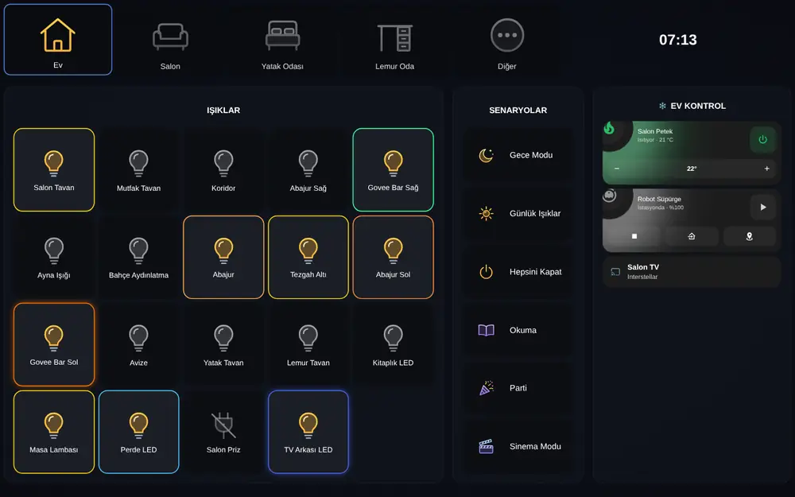

**Hızlı kurulum:** [Marketplace'te aç](https://my.home-assistant.io/redirect/hacs_repository/?owner=mendebur-lemur&repository=lemur-home-dashboard&category=integration) (Home Assistant 2026.11 öncesinde HACS'ta açılır) → İndir → Home Assistant'ı yeniden başlat → [entegrasyonu ekle](https://my.home-assistant.io/redirect/config_flow_start/?domain=lemur_home_dashboard) → sayfayı yenile; pano kenar çubuğunda hazır. Adım adım anlatım [aşağıda](#kurulum).

- **Kendiliğinden kurulan pano.** Entegrasyonu eklerken pano da oluşturulur; hiçbir yapılandırma yazmazsın. Odalar Home Assistant alanlarından, ışıklar, senaryolar, klimalar, petekler, süpürge ve medya cihazları o alanlardan bulunur.
- **Başka eklenti gerekmez.** Marketplace'ten (ya da HACS'tan) tek seferde kurulur; mushroom, card-mod, bubble-card ya da başka bir kart veya tema istemez. Lemur Halo kartları (iklim, süpürge, sensör, hava, enerji, güvenlik, oda, ışık) pakete gömülü gelir.
- **Her şey yönetim panelinden.** Sol menüdeki **Lemur Home Dashboard** sayfasında sekmeleri, bölümleri, kolon genişliklerini ve hangi cihazın nerede duracağını düzenlersin; canlı önizleme gösterir, değişiklik evdeki bütün tabletlere aynı anda gelir. Her adım geri alınabilir. **Basit** modda yalnız temel ayarlar görünür, **Gelişmiş** modda boyutlar, renkler, koşullar ve kartlar açılır; karmaşık ayarların yanında **?** yardımı var.
- **Simge seçici.** Sekme, ışık ve düğme simgelerini listeden seçersin: önce o şeye uygun öneriler, aramada Home Assistant'ın bütün simgeleri. Türkçe de arayabilirsin (lamba, kanepe, tavan...).
- **Kendi simge seti.** Panodaki bütün simgeler pakete gömülü 1751 renkli simgeden çizilir; sette olmayan bir `mdi:` adı yazarsan Home Assistant'ın düz simgesi çizilir. Varsayılan **Otomatik** stilde kapalı cihazlar gri, açıklar renkli görünür; istersen hepsi renkli ya da hepsi gri olabilir.
- **Kaydırmalı ışık çubukları.** İstersen ışık bölümü kare karolar yerine yatay çubuklarla görünür: dokununca ışık açılır/kapanır, sağa-sola kaydırınca parlaklık değişir, çubuk parlaklık kadar ışığın renginde dolar. Sadece telefonda çubuk, tablette karo da seçilebilir.
- **Işık penceresi.** Işık karosuna basılı tutunca büyük parlaklık çubuğu, beyaz tonlar, renk çemberi, hazır renkler, efektler ve (varsa) segmentlerle ışık penceresi açılır. İstersen ayarlardan Home Assistant'ın kendi penceresine geçersin.
- **Anında tepki.** Işığa, prize ya da fana dokununca karo cihazın cevabını beklemeden değişir; açarken ışığın son renginde yanar. Cihaz başka bir şey bildirirse gerçek durum gösterilir.
- **Besleme kartı.** Kedi, köpek, balık... için besleme hatırlatıcısı: zamanında yeşil, gecikince kırmızı; dokun "Besledim", gecikince telefona bildirim, istersen otomatik yemlik.
- **Perde penceresi.** Perde karosuna basılı tutunca perdenin gerçek konumunu gösteren pencere çizimi, altında Aç, Durdur, Kapat. Altı tasarım (ortadan açılan, tek taraflı, panjur, stor, jaluzi, dikey stor); çizimi sürükleyerek konum ince ayarlanır, jaluzide kanat açısı da.
- **Enerji takibi, başka eklentisiz.** Hazır Enerji sekmesi: evin anlık gücü, kategoriler, şu an en çok çekenler, günlük tüketim, son 24 saat; güneşli evde enerji akışı ve batarya. Güç ölçen cihazlar tek dokunuşla eklenir, ölçmeyenler için sanal ölçüm kurulur (ışık parlaklıkla, TV duruma göre, buzdolabı etiketteki yıllık kWh ile). Kademeli tarife, yıllık sınır ve faturalarla gerçek birim fiyat. Bildirim yok: "Klima 3 saattir açık" gibi ipuçları Halo'nun altında sessizce döner. Başka bir eklentideki tanımlar tek seferde aktarılır; ölçmeyen akıllı cihazlar bir kez prize takılarak öğretilir, ışık ölçümleri ortak havuzda paylaşılır.
- **Kameralar.** Kameralar anlık görüntü karosu olarak görünür ve birkaç saniyede bir yenilenir; dokununca canlı görüntü açılır. Kamera kapalıysa ya da görüntü vermiyorsa karoda yazar.
- **Kart seçici.** Halo kartları, Home Assistant kartları ve kurulu özel kartlar listeden seçilir; kartın kendi görsel düzenleyicisi ve canlı önizlemeyle eklenir.
- **Yedek kontrol ve duvar anahtarları (Gelişmiş).** İki entegrasyonda görünen lambaya (ör. Govee LAN ve Matter) yedek seçilir: komut hızlı yoldan gider, lamba cevap vermezse yedekten tekrar gönderilir. Yalnız sinyal veren duvar rölesi bir lambaya bağlanır; internet ya da Wi-Fi gidip gelse de anahtar çalışır.
- **İkinci satır ve şablon.** Karonun altına durum, son değişim ya da öznitelik; ad ve ikinci satırda Home Assistant şablonu. İstersen düğme çalışmadan önce onay sorar.
- **Her ekrana uyar.** Pano ekranın boyutuna göre ölçeklenir; 16:10, 4:3 ve geniş ekranlarda aynı oranla görünür, eski tabletlerde (iOS 12) de akıcı çalışır. Telefonda, yatay tutulan telefonda ve dikey tutulan tablette kendi düzenine geçer.
- **Otomatik kur.** Yönetim panelindeki … menüsünden açılır. Solda dolu bir hayali evin canlı önizlemesi var: evinde henüz birkaç cihaz olsa da panonun nereye varabileceğini görürsün. Sağda büyük seçenekler: hangi odalar sekme olsun, hangi cihazlar dahil olsun, tablet ve telefon için ayrı ayrı görünüm, arka plan ve ışık efektleri. Önizleme her seçimde değişir; Uygula panoyu kendi evinden kurar, beğenmezsen geri alırsın.
- **Stil seç.** Üst çubukta, Ayarlar'ın yanında (Ayarlar'daki kart da buraya götürür). Görünüm ayarlarının hepsi burada: arka plan (Koyu, Siyah, Renk, Resim, efekt renkleri), ışık ve iklim görünümü, telefon düzeni, Efektler düğmesi. Otomatik kurla aynı pencere, sekmelerine dokunmaz. Önizlemede ışık penceresini de açıp görebilirsin. Önizlemede kendi panonu ya da örnek evi görürsün; beğenirsen Uygula.
- **Telefonda kendi düzeni.** Oda düğmeleri yana kayar, bölümler alt alta dizilir, düğmeler başparmak boyunda olur. İstersen odalar ya da kategoriler (Işıklar, İklim, Senaryolar) ekranın altına iner, ışıklar tek sıra olur, ışık penceresi alttan açılır.
- **Mevsime göre iklim.** Yazın klimalar, kışın petekler gösterilir; otomatik ya da elle.
- **Işık efektleri (isteğe bağlı).** [Lemur Light Effect Card](https://github.com/mendebur-lemur/lemur-light-effect-card) kuruluysa üst şeride Efektler düğmesi gelir, oynayan efekt karolarda görünür.
- Türkçe ve İngilizce arayüz.


**Görselli rehber:** panonun yapabildiği her şey adım adım [docs/REHBER.md](docs/REHBER.md)'de. Aynı rehber yönetim panelinde **⋯ → Rehber**'de de var.

## İçindekiler

- [Kurulum](#kurulum)
  - [1. Panoyu indir](#1-panoyu-indir)
  - [2. Entegrasyonu ekle](#2-entegrasyonu-ekle)
  - [3. Panoyu oluştur](#3-panoyu-oluştur)
  - [4. Yönetim panelinde düzenle](#4-yönetim-panelinde-düzenle)
- [Pano](#pano)
- [Yönetim paneli](#yönetim-paneli)
  - [Ayarlar](#ayarlar)
- [Işık penceresi](#işık-penceresi)
- [Perde penceresi](#perde-penceresi)
- [Enerji](#enerji)
- [Telefon](#telefon)
- [Işık efektleri (isteğe bağlı)](#işık-efektleri-isteğe-bağlı)
- [Güncelleme](#güncelleme)
- [Sorun giderme](#sorun-giderme)
- [Ekran görüntüleri](#ekran-görüntüleri)
- [Lemur ailesi](#lemur-ailesi)
- [Geliştirme](#geliştirme)

## Kurulum

Gerekenler: Home Assistant 2024.8 ya da daha yeni bir sürüm. Home Assistant 2026.11 ve sonrasında topluluk eklentileri **Ayarlar → Marketplace**'ten kurulur, ayrıca bir şey kurman gerekmez; daha eski sürümlerde [HACS](https://hacs.xyz/docs/use/) gerekir. Başka kart, tema ya da eklenti gerekmez.

### 1. Panoyu indir

Lemur Home Dashboard topluluk kataloğunda; özel depo eklemeye gerek yok. En kolay yol bu düğme. Home Assistant adresini bir kez sorar, sonra panoyu doğrudan açar (2026.11 ve sonrasında Marketplace'te, daha eski sürümlerde HACS'ta):

[](https://my.home-assistant.io/redirect/hacs_repository/?owner=mendebur-lemur&repository=lemur-home-dashboard&category=integration)

1. **İndir**'e bas, sürümü seçme penceresinde tekrar **İndir**.
2. **Ayarlar → Sistem → sağ üstteki ⏻ → Home Assistant'ı yeniden başlat**. Ayarlar sayfasında "Yeniden başlatma gerekli" uyarısı da çıkar, oradan da yapabilirsin.

<details>
<summary>Düğme çalışmazsa: elle ara</summary>

1. **Home Assistant 2026.11 ve sonrası:** **Ayarlar → Marketplace**. Daha eski sürümlerde sol menüden **HACS**.
2. Arama kutusuna **Lemur Home Dashboard** yaz, sonuca tıkla.
3. **İndir** → **İndir**, ardından Home Assistant'ı yeniden başlat.

Daha önce HACS'a özel depo olarak eklediysen bir şey yapman gerekmez; kurulumun ve güncellemelerin aynen sürer (2026.11'e geçerken Marketplace'e kendiliğinden taşınır).

</details>

### 2. Entegrasyonu ekle

[](https://my.home-assistant.io/redirect/config_flow_start/?domain=lemur_home_dashboard)

Düğmeyi kullanmıyorsan: **Ayarlar → Cihazlar ve hizmetler → Entegrasyon ekle** → "Lemur" yaz → **Lemur Home Dashboard** → **Gönder**. **Panoyu oluştur** açık gelir; istersen panonun adını değiştir. Sol menüye **Lemur Home Dashboard** yönetim sayfası eklenir (yalnızca yöneticiler görür).

Sayfayı bir kez yenile: pano kendiliğinden oluşturulur ve sol menüde görünür. Bu durumda 3. adımı atla.

### 3. Panoyu oluştur

2. adımda **Panoyu oluştur**'u kapattıysan ya da ikinci bir pano istiyorsan elle de oluşturabilirsin:

1. **Ayarlar → Panolar → Pano ekle → Sıfırdan yeni pano oluştur**, bir ad ver (örneğin "Tablet") ve **Oluştur**.
2. Yeni panoyu aç, sağ üstteki **✏️ (Düzenle)** düğmesine bas.
3. Sağ üstteki **⋮** menüsü → **Ham yapılandırma düzenleyicisi**. İçindekileri sil, yerine şunu yapıştır ve **Kaydet**:

```yaml
strategy:
  type: custom:lemur-home-dashboard
```

4. Düzenleyiciyi kapat. Pano evindeki alanlardan kendiliğinden kurulur: bir **Ev** sekmesi (bütün evin ışıkları, senaryolar ve kontroller) ve her oda için bir sekme.

Bu panoda Home Assistant'ın kendi düzenleyicisinde **"Kontrolü al"** dersen pano sabit hâle gelir ve Lemur Home Dashboard'dan kopar. Düzenlemeyi her zaman sol menüdeki Lemur Home Dashboard'dan yap.

Tabletinde kiosk gibi kullanacaksan [Ayarlar](#ayarlar)'daki **Üst barı gizle** ve **Yan menüyü gizle** ile Home Assistant'ın başlık çubuğunu ve sol menüsünü sadece bu panoda kapatabilirsin.

### 4. Yönetim panelinde düzenle

Hiçbir şeye dokunmadan da kullanabilirsin. Değiştirmek istersen sol menüden **Lemur Home Dashboard**'u aç. İlk değişiklikte otomatik düzen kaydedilir, sonra her şey buradan düzenlenir:

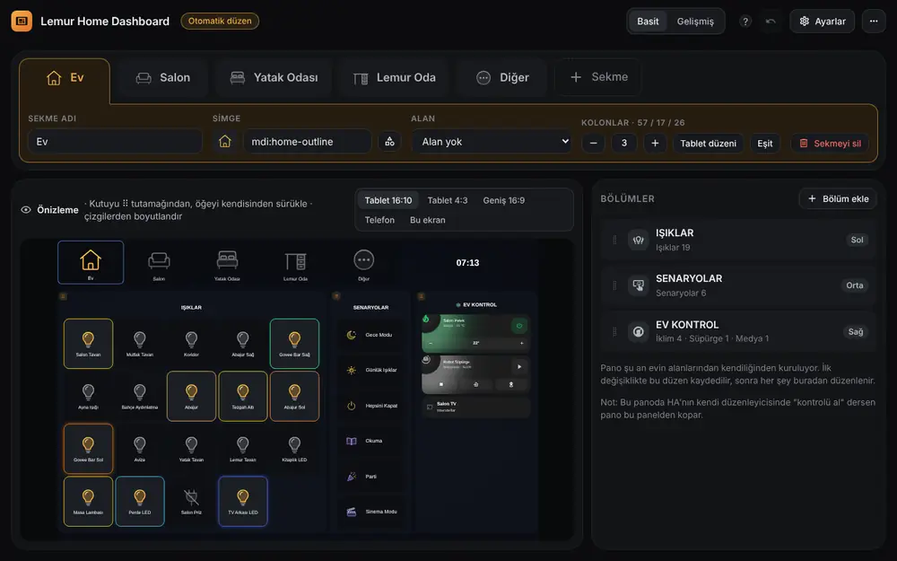

## Pano

Üstte oda düğmeleri ve saat, altında kolonlar. Her kolon bir ya da birkaç bölümden oluşur:

| Bölüm | Ne gösterir | Dokununca |
|---|---|---|
| **Işıklar** | Işık, priz, perde ve fan karoları ya da kaydırmalı çubuklar | Aç/kapat (anında); çubukta sağa-sola kaydır: parlaklık (perdede konum, fanda hız); basılı tut: [ışık penceresi](#işık-penceresi) |
| **Senaryolar** | Script, sahne ve otomasyon düğmeleri, her birinin kendi rengi ve simgesi | Çalıştırır |
| **İklim** | Klima ve petek kartları; yazın klimalar, kışın petekler | Aç/kapat, sıcaklık |
| **Süpürge** | Robot süpürge kartı | Başlat, durdur, istasyona gönder |
| **Medya** | TV ve hoparlörler | Cihaz penceresi |
| **Kameralar** | Kameraların anlık görüntüsü; birkaç saniyede bir yenilenir (öğe ayarından 5 sn - 1 dk). Kamera kapalıysa "Kamera çevrimdışı", açık ama görüntü vermiyorsa "Görüntü alınamıyor" | Canlı görüntü penceresi |
| **Değerler** | Sensör, ikili sensör, zamanlayıcı, sayaç, seçim: simge, değer + birim ve ad; çalışan zamanlayıcı geri sayar | Cihaz penceresi (değiştirilebilir) |
| **Kartlar** | Kart seçiciden ya da YAML ile eklenen herhangi bir kart: Halo kartları, Home Assistant kartları, kurulu özel kartlar | Kartın kendisi |
| **Evcil hayvan** | Besleme kartı: son besleme, sıradaki besleme ve renkle durum | "Besledim"; basılı tut: son beslemeler |

Açık ışıklar kendi renginde çerçeveyle görünür, ulaşılamayan cihazlar soluk durur. Dokununca karo cihazın cevabını beklemez; ışığın son rengi bu tarayıcıda hatırlanır, cevap 5 saniyede gelmezse karo eski haline döner. Otomatik düzen ışık gruplarının üyelerini, segmentleri, gizli ve ayar varlıklarını, parametre isteyen scriptleri atlar.

## Yönetim paneli

**Basit / Gelişmiş:** Üst çubuktaki anahtar. Basit modda (varsayılan) yalnız temel ayarlar görünür: sekme, bölüm, cihaz ekleme, ad, simge, görünüm ve dokununca ne olacağı. Gelişmiş modda boyutlar, renkler, koşullu görünürlük, özel eylemler, kartlar ve bölüm yerleşimi de açılır. Mod değişince ayar silinmez; basit modda gizlenen ayarlar çalışmaya devam eder. Karmaşık ayarların yanındaki **?** ne işe yaradığını ve nasıl ayarlandığını örnekle anlatır.

Sol menüdeki **Lemur Home Dashboard** (yalnızca yöneticiler görür). Üstte sekmeler, solda canlı önizleme, sağda seçili sekmenin bölümleri.

- **Sekmeler:** Ad, simge ve alan (oda) seçilir. Bir alan seçilen sekmeye **Alandan yeniden doldur** o odanın cihazlarını yeniden yerleştirir. **+ Sekme** boş sekme ya da odası seçilmiş, dolu gelen bir sekme açar.
- **Kolonlar:** 1 ile 6 arası kolon. Genişlikler önizlemedeki çizgilerden sürüklenerek ayarlanır; **Tablet düzeni** ve **Eşit** hazır oranlardır. Her kolon kendi içinde 1-3 sütuna bölünebilir.
- **Enerji değerleri her bölümde:** Cihaz ekle → Enerji süzgeci evin şu anki gücünü, bugünkü tüketimi, bugünün ve bu ayın tutarını, bu ayın kWh'ını, dönem sonu tahminini, yılın toplamını ve ölçülmeyen payı listeler. Işık karosu, senaryo düğmesi, satır ya da Halo olarak eklenir; ayrı enerji sekmesi gerekmez.
- **Serbest ızgara:** sekmenin ayarında Düzen → Serbest ızgara. Kutu ⠿ ile taşınır, sağ alt köşesinden büyütülür; ötekiler yer açar. Ekrana sığdır (boşluk kalmaz, kaydırma yok) ya da Kaydırılabilir. Büyük dikey ekranda 6 sütun, telefonda alt alta.
- **Bölümler serbest:** Her bölüm bir kutu ve içine her şey eklenebilir: ışık, priz, perde, senaryo düğmesi, iklim ve süpürge kartı, medya cihazı, kamera aynı kutuda olabilir; her öğe kendi türüne göre görünür. **Bölüm ekle**'deki türler (Boş bölüm, Işıklar, Senaryolar, İklim, Süpürge, Medya, Kameralar) sadece başlangıç başlığıdır. Bölümler önizlemede tutamaklarından sürüklenerek kolonlar arasında taşınır; öğeler kendileri sürüklenerek sıralanır ya da başka bir bölüme taşınır.
- **Işık bölümünün görünümü:** **Karo** (kare karolar), **Kaydırmalı** (yatay çubuklar: dokun aç/kapat, sağa-sola kaydır parlaklık) ya da **Telefonda otomatik** (tablette karo, telefonda çubuk). Satırdaki karo ve çubuk sayısı ayrıca seçilir.
- **Ekle:** Seçicide her tür cihaz listelenir; üstteki süzgeçle (Tümü, Işık ve anahtar, Senaryolar, Değerler, İklim, Süpürge, Medya, Kameralar) daraltılır, birden fazla cihaz tek seferde eklenir. Betik, sahne ve otomasyonlar renkli düğme olur. Işık karosunun adı ve simgesi değiştirilebilir; senaryo düğmesine renk ve simge verilir. İklim kartında sıcaklık ve nem sensörü, dış sıcaklık sensörü, birlikte kontrol edilen ikinci cihaz ve tür (klima/petek) seçilir.
- **Simge seçici:** Simge alanlarının yanındaki düğme. **Simgeler** sekmesinde panonun 1751 simgesi var; önce o şeye uygun olanlar önerilir (oda, ışık ya da senaryo için), arama kutusu Türkçe kelimeleri de tanır. ★ işaretliler panoya özel çizimler. Light Effect Card kuruluysa **Light Effect Card** sekmesinde onun 356 renkli efekt simgesi de seçilebilir. İstersen `mdi:...` adını doğrudan yazarsın; sette yoksa Home Assistant'ın düz simgesi çizilir.
- **Öğe ayarları (⚙):** Her öğenin yanındaki çark. Ad, simge, açıkken ve kapalıyken simge (ör. bağlantı sensörü), **Dokununca** ve **Basılı tutunca** ne olacağı (cihaz penceresi, aç/kapat, servis çalıştır, pencerede kart aç, hiçbir şey ya da YAML), senaryo düğmesinin ne yaptığı ve **Sadece şu durumda göster**: öğe, seçilen varlık belirli bir durumdayken görünür; koşul sağlanmazsa panoda hiç çizilmez, yerinde boşluk kalmaz (önizlemede soluk görünür).
- **Boyut ve yerleşim:** Öğe ⚙'de karonun boyutu (1×1, 2×1, 1×2, 2×2, satır boyu), simge ve yazı boyutu (küçük / orta / büyük). Bölüm düzenleyicide **Doldurma** (içeriğe göre ya da kutuyu doldur: düğmeler ve karolar kutunun yüksekliğine eşit dağılır) ve **Hizalama** (üst, orta, eşit dağıt). İçerik kutuya sığmazsa kutu uzar; sütun ekrandan uzunsa kendi içinde kayar, hiçbir öğe kesilmez.
- **Görünüm ve renk:** Öğe ⚙ → **Görünüm**: senaryo/eylem düğmesi Düğme, Karo (ışıklarla aynı ızgarada) ya da Satır; değer öğesi Karo, Düğme, Satır ya da Halo (sayısal değerler Halo sensör kartı olarak); ışık ve anahtar Karo, Düğme ya da Satır. **Renkler**: simge rengi, açıkken renk, arka plan tonu; sayısal değerde **Değere göre renk** (4 sınır, 5 renk). Kart öğesine ve Halo görünümüne de dokununca / basılı tutunca eylemi verilebilir; o zaman kartın kendi tıklaması yerine o çalışır.
- **Kamera:** Cihaz ekle'den bir kamera seçilir; öğe ⚙'de görüntünün ne sıklıkla yenileneceği seçilir (5 sn, 10 sn, 30 sn, 1 dk). Sekme ekranda değilken görüntü yenilenmez. Karoya dokununca canlı görüntü panonun kendi penceresinde açılır. Kamera bölümünün ayarında bölümdeki bütün kameraların **Görüntü yenileme** süresi ve **Satırda kaç kamera** seçilir (Oto: kutuya sığdığı kadar; 1, 2, 3, 4; telefonda en fazla 2).
- **Kameralar sekmesi:** **+ Sekme** menüsündeki **Kameralar sekmesi** evdeki bütün kameraları tek sekmede, tek sütunluk bir bölümde toplar. Otomatik kur'da **Kameralar** işaretlenirse kameralar en sonda ayrı bir sekmede olur (işaretlenmezse kameralar otomatik düzene girmez).
- **Besleme kartı:** Bölüme **Evcil hayvan** eklenir: ad, tür (kedi, köpek, balık, kuş, tavşan, kaplumbağa, diğer), her N saatte bir ya da günün belli saatlerinde, yaklaşıyor uyarısı ve gecikme payı, gecikince bildirim, isteğe bağlı otomatik yemlik. Kart zamanında yeşil, yaklaşınca sarı, zamanı gelince turuncu, gecikince kırmızı ve yanıp söner; dokununca "Besledim" kaydedilir (10 sn içinde yeniden dokununca geri alınır), basılı tutunca son beslemeler açılır. Home Assistant'ta her hayvan için `sensor.<ad>_besleme` (ok, soon, due, late, never) ve `button.<ad>_besledim` oluşur; `lemur_home_dashboard.feed` servisi de var.
- **Aralık, yükseklik, renk:** Bölüm düzenleyicide **Aralık** (öğeler arası 0-24 px; kutuyu doldururken varsayılan 12). Halo görünümünde ve kart öğelerinde **Yükseklik** (1, 1,5, 2 satır), Halo'da simge ve yazı boyutu da. Renklerde Halo renkleri tek dokunuşla; **Duruma göre renk** bir varlığın durumunu renge eşler (metin değerlerde de çalışır). **Alt başlık** öğesi bölümün içine küçük bir ara başlık koyar.
- **İkinci satır, şablon, onay:** Öğe ⚙ → **İkinci satır** (durum, son değişim, öznitelik, yazı ya da şablon); ad ve ikinci satırda Home Assistant şablonu ({{ }} / ) yazılabilir. **Dokununca onay iste** düğmeye basınca önce sorar.
- **Kart seçici:** **Kart** düğmesi Halo kartlarını, Home Assistant kartlarını ve kurulu özel kartları listeler; seçilen kart görsel düzenleyicisi ve canlı önizlemesiyle açılır, istenirse YAML ile düzenlenir.
- **Kart (YAML):** Bölüme Home Assistant kartı ekler; yüklenemezse yerinde kısa bir uyarı çıkar. Düğmeye **Pencerede kart aç** verilirse kart, ışık penceresi gibi panonun kendi penceresinde açılır (dışarı dokun, X ya da geri tuşu kapatır).
- **Yedek kontrol (Gelişmiş):** Öğe ⚙ → **Yedek kontrol**: lamba Home Assistant'ta iki kez görünüyorsa (ör. govee2mqtt ve Matter) ikinci kopyası seçilir; aday otomatik bulunur (aynı ad, aynı alan). Dokununca komut önce öğenin kendisinden gider. Lambanın açık mı kapalı mı olduğu iki kopyadan hangisi en son değiştiyse ondan okunur. Lamba birkaç saniye içinde cevap vermezse (lambanın kendisi ya da yedeği istenen durumu bildirmezse) aynı komut yedekten gönderilir ve karonun köşesinde turuncu nokta 30 dakika kalır. Aynı mantık `lemur_home_dashboard.control` servisiyle otomasyonlarda da kullanılabilir.
- **Duvar anahtarları (Ayarlar → Gelişmiş):** Lambanın elektriğini kesmeyen, yalnız sinyal veren röle (Sonoff, ESPHome...) bir lambaya bağlanır. Elle basınca lamba açılır ya da kapanır (yedek kontrol varsa o da kullanılır); açarken parlaklık ve kelvin verilebilir. Home Assistant'tan ya da bir otomasyondan rölenin değişmesi yok sayılır. Aynı anahtarı kullanan açık bir otomasyon varsa uyarı çıkar; onu kapat, yoksa her basış iki kez çalışır.
- **Önizleme ekranları:** Tablet 16:10, Tablet 4:3, Geniş 16:9, Telefon ve Bu ekran. Bölüm sığmazsa önizlemede uyarı çıkar.
- **Geri al:** Her değişiklik geri alınabilir (düğme ya da Ctrl+Z). **⋯** menüsündeki **Otomatik düzene dön** her şeyi sıfırlar.

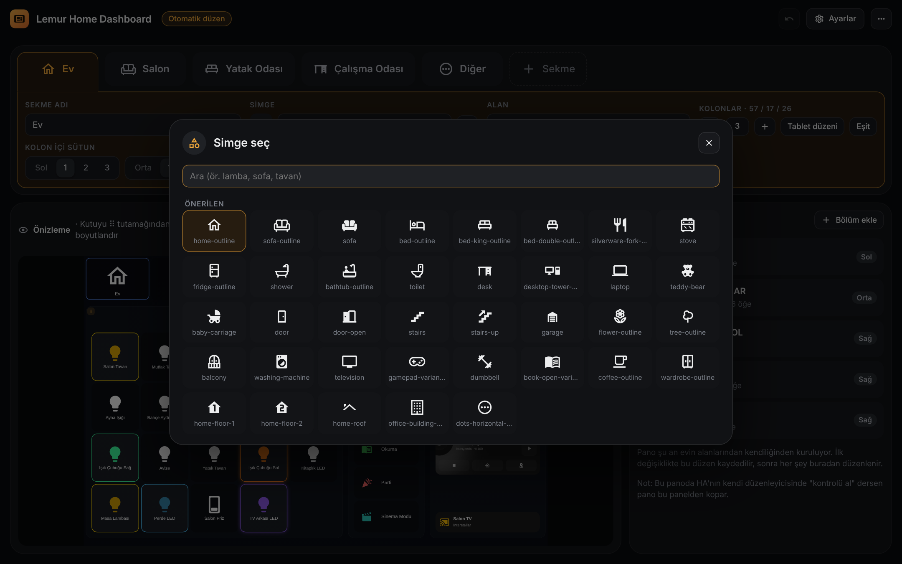

### Ayarlar

Sağ üstteki **Ayarlar** evdeki bütün tabletlere uygulanır. Görünümle ilgili olanlar (arka plan, ışık ve iklim görünümü, telefon düzeni, Efektler düğmesi) **Stil seç**'tedir; Ayarlar'daki kart oraya götürür.

- *Sürüm ve güncelleme:* en üstte; yüklü sürüm, yenilikler ve **Güncellemeleri denetle**. Yeni sürüm varsa HACS ya da Marketplace ile buradan kurulur, ardından Home Assistant yeniden başlatılır.
- *Dil:* otomatik (Home Assistant'ın dili), Türkçe ya da İngilizce.
- *Mevsim:* iklim bölümünde yazın klimalar, kışın petekler. Otomatik: Mayıs-Eylül yaz.
- *Simge stili:* Otomatik (varsayılan; kapalı cihazlar ve seçili olmayan odalar gri, açıklar renkli), Renkli (hepsi renkli), Düz (hepsi gri) ya da Tek renk (çizimler tek tona çevrilir: kapalılar gri, açıklar seçtiğin renkte; istersen açık ışık lambanın kendi renginde, senaryo düğmesi kendi renginde). Simge seti ayrı bir dosyadır; bir kez indirilir, tarayıcı saklar.
- *Üst şerit:* Oda düğmelerinin boyutu (varsayılan 235 × 155) ve **Kolona hizala**: düğmeler seçilen kolonun sağ kenarında biter, aradaki alanı eşit paylaşır; her ekran boyutunda aynı hizada kalır. Light Effect Card kuruluysa Efektler düğmesi hizalı alana alınabilir ya da saatin yanında kalır.
- *Saatte parlaklık (isteğe bağlı, varsayılan kapalı):* üst şeritte saatin olduğu alanı sağa sola kaydırınca o sekmenin odasında açık olan bütün ışıkların parlaklığı birlikte değişir (odası olmayan sekmede sekmedeki ışıklar). En sola çekince kapanırlar; hepsi kapalıyken kaydırınca buradan en son kapatılanlar yeniden açılır. Görünüm: *Gizli* (yalnız saat görünür, kaydırınca belirir) ya da *Kutu* (oda düğmeleri gibi); istenirse solda ampul simgesi; parlaklık göstergesi yalnız kaydırırken ya da hep. Telefonda yok.
- *HA teması:* açılır pencerelerin kullanacağı Home Assistant teması (boş bırakılabilir).
- *Üst barı gizle / Yan menüyü gizle:* yalnızca bu panoda Home Assistant'ın başlık çubuğu ve sol menüsü görünmez.
- *Kanvas (Gelişmiş):* tasarım genişliği ve referans yüksekliği; pano ekrana bu oranla ölçeklenir.
- *Işığa basılı tutunca:* Işık penceresi (varsayılan), HA penceresi ya da (Light Effect Card kuruluysa) efekt ekranı.
- *Lemur Light Effect Card:* kurulu olup olmadığı (Efektler düğmesi Stil seç'te).
- *Sorun bildir:* sürüm ve cihaz bilgisiyle GitHub'da kayıt açar (oda, cihaz ya da kişi adı eklenmez).
- *Yedek:* sekmeler, bölümler, ayarlar ve hayvanlar tek dosyada indirilir; geri yüklemeden önce onay sorulur.

### Stil seç

Üst çubukta, Ayarlar'ın yanında. Solda önizleme (kendi panon ya da örnek ev, tablet ya da telefon), sağda büyük seçenekler; her seçim önizlemede anında görünür, **Uygula** hepsini birden kaydeder. Sekmelere dokunmaz, beğenmezsen geri al.

- *Tablet:* ışıklar **Karo** ya da **Kaydırmalı çubuk**; iklim ve süpürge kartları **Halo** (büyük, halkalı kartlar) ya da **Sade** (her cihaz tek satır; karta dokununca genişler: hedef − +, aç/kapat, mod, fan, salınım ya da durdur, bul, emiş gücü).
- *Telefon:* gezinme (altta kategoriler, altta odalar, üstte odalar), ışıklar (tabletteki gibi, karo, tek sıra) ve ışık penceresinin alttan mı ortada mı açılacağı.
- *Arka plan:* Efekt renkleri (varsayılan Meditasyon; Kutup ışığı, Ateş, Gün batımı, Okyanus ve 25 tane daha), Koyu, Siyah, istediğin bir renk ya da kendi resmin (`/local/zemin.jpg` gibi bir adres).
- *Işık efektleri:* Light Effect Card kuruluysa Efektler düğmesi açılıp kapanır; kurulu değilse ne işe yaradığı ve nasıl kurulduğu anlatılır.
- **Işık penceresi** düğmesi önizlemede bir ışığın penceresini açar.

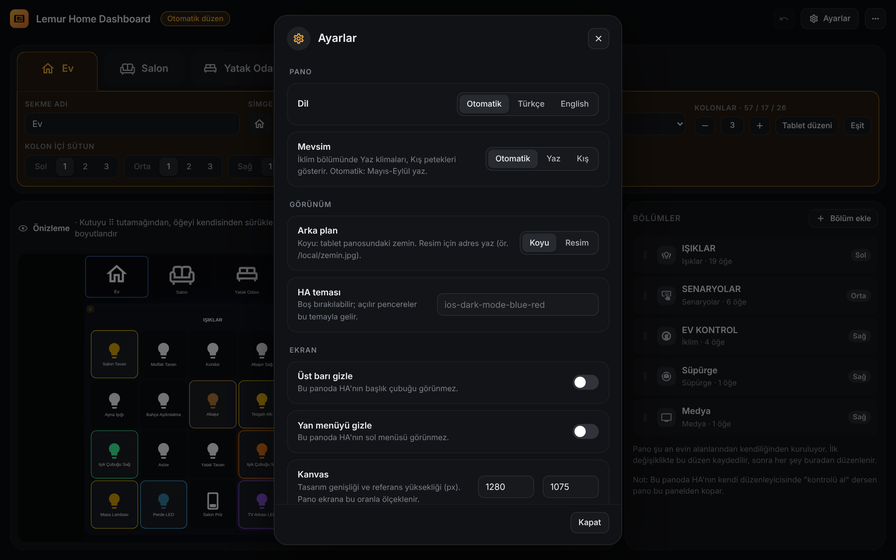

## Işık penceresi

Işık karosuna basılı tut. Üstte büyük parlaklık çubuğu (sürükle) ve güç düğmesi, altında sekmeler:

- **Renk:** 2200 K ile 6500 K arası beyaz ton düğmeleri, renk çemberi ve hazır renkler. Işık yalnızca beyaz destekliyorsa sadece beyaz tonlar görünür.
- **Efekt:** Işığın kendi efektleri. Light Effect Card kuruluysa efekt ekranı lambanın odasıyla açılır.
- **Segment:** Segmentleri olan şerit ve lambalarda tek tek segment seçip renk verirsin.

Pencere geri tuşu, Esc ya da ✕ ile kapanır. Ayarlardan Home Assistant'ın kendi cihaz penceresine geçebilirsin.

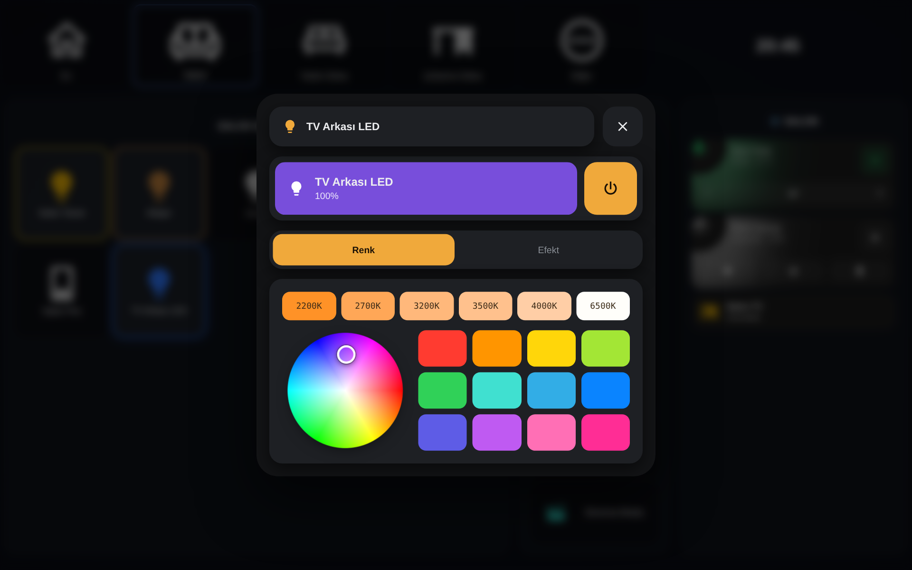

## Perde penceresi

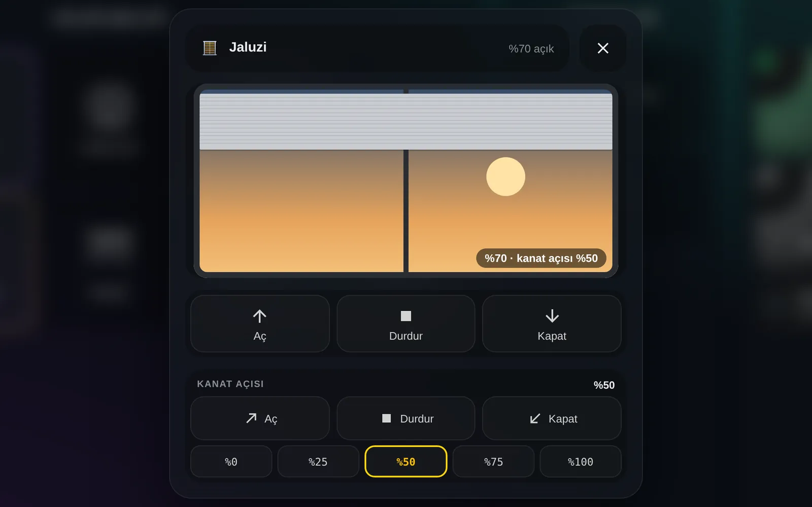

Perde karosuna basılı tut. Üstte ad ve durum (açılıyor, kapanıyor, yüzde kaç açık), ortada perdenin gerçek konumunu gösteren bir pencere çizimi, altında **Aç**, **Durdur**, **Kapat**. Perde hareket ederken aynı düğmeye yeniden basınca durur. Cihaz konum destekliyorsa çizimi parmağınla sürükleyerek konumu ince ayarlarsın.

Altı tasarım var: ortadan açılan perde, tek yönden açılan perde, panjur, stor, jaluzi ve dikey stor. Perdenin ⚙ ayarında **Perde penceresi** satırından seçilir; Oto bırakılırsa cihazın türünden seçilir. Tek yönden açılan perde ve dikey storda toplanma yönü (sola, sağa, dikey storda iki yana) de seçilir. Tasarımlar ayarda küçük pencere çizimleriyle gösterilir. Jaluzi ve dikey storda, cihaz destekliyorsa, kanat açısı için ikinci bir Aç, Durdur, Kapat sırası çıkar. Kanatları ayrı bir motor döndürüyorsa (Home Assistant'ta ikinci bir perde varlığı) ⚙ ayarında **Kanat açısı motoru** olarak seçilir; kanat sırası o motoru sürer, motor konum bildiriyorsa %0-100 hazır açılar da çıkar.

Otomatik düzende perdeler odasının sekmesinde ışıkların arkasında görünür.

## Enerji

Evin anlık gücü, kategoriler, şu an en çok çeken cihazlar, günlük tüketim, son 24 saat ve bekleme tüketimi; güneş enerjisi olan evde enerji akışı ve batarya. **+ Sekme → Enerji sekmesi** hepsini hazır bir sekmede kurar; tek tek kartlar bir bölüme **Enerji kartı** olarak da eklenir. Otomatik kur'da **Enerji** seçilirse sonda bir Enerji sekmesi açılır. Başka bir eklenti gerekmez.

Cihazlar ve kategoriler yönetim panelindeki **Enerji** sayfasından gelir. Orada hiç cihaz yoksa kartlar Home Assistant'ın **Enerji** ayarlarındaki **Cihaz tüketimi** listesini kullanır (başka bir girişin içinde olmayanlar kategori, içindekiler cihaz). Grafikler Home Assistant'ın kendi kayıtlarından okunur; pano ayrıca kayıt tutmaz.

- **Evin anlık gücü:** Halo halkası tüketime göre yeşilden kırmızıya döner. Altında ipucu satırı, bugünkü kWh, para karşılığı ve bu hızla aylık tüketim.
- **Kategori karoları:** her kategorinin anlık gücü, toplamdaki payı ve küçük grafiği (24 saat ya da 7 gün). Dokununca o kategorinin cihazları açılır. Kategorisi olmayan cihazlar **Kategorisiz** karosunda.
- **Şu an en çok çekenler:** cihazlar anlık güce göre sıralanır (3-10 cihaz, kategoriyle süzülebilir, beklemedekiler gizlenebilir). Uzun süredir açık kalan cihazın satırı turuncu kenarlı.
- **Günlük tüketim** (7 ya da 30 gün, kWh ya da para), **Son 24 saat** (kategori çizgileri ya da toplam) ve **Bekleme tüketimi**.
- **Enerji akışı:** güneş, şebeke, ev ve batarya arasında o an akan güç; altında bugünkü üretim, kendi kullanımı ve şebekeye verilen. **Batarya:** doluluk, kWh, şarj ya da boşalma ve kalan süre.

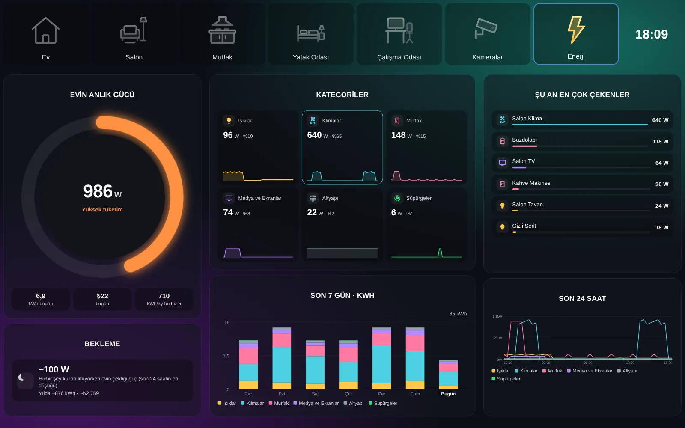

**Enerji sayfası** (yönetim panelinin üst çubuğunda **Enerji**):

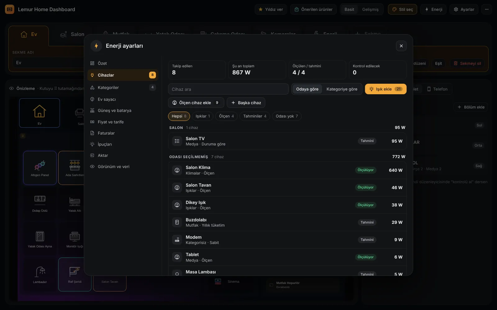

- **Cihazlar:** Home Assistant'ta güç ölçen ama panelde olmayan cihazlar listelenir, **Ekle** ile gelir (kWh sensörü varsa o da bulunur, yoksa panel güçten hesaplar). Ölçmeyen bir cihazı eklerken **Panelden seç** listesinden seçmen yeter: ad paneldekinden gelir, tür ve kategori kendiliğinden seçilir; ışık kütüphanede ölçülmüşse değerleri ölçüm tablosuyla dolar. Sanal ölçüm türleri: ışık (bekleme, en düşük ve en çok W, parlaklıkla; ör. 2-60 W ışık %30'da 19,4 W), **duruma göre** (her durum için ayrı W: TV oynatırken 95, duraklatınca 70, beklemede 28 W; klimada soğutma, ısıtma, fan), aç/kapa, sabit, yıllık tüketim (etiketteki kWh/yıl; 250 kWh/yıl ≈ 28,5 W) ya da çevrim (kWh/100 çevrim, haftada kaç kez). Entegrasyon her biri için `sensor.lhd_<ad>_power` ve `sensor.lhd_<ad>_energy` kurar. Kartlarda "~" ile görünür.
- **Kategoriler:** ad, renk ve içindeki cihazlar. Her kategori için `sensor.lhd_kat_<ad>_power` ve `_energy` (cihazlarının toplamı).
- **Kart görünümleri:** her enerji kartının ayarında Görünüm, beşer seçenek (halka, gösterge, ağaç haritası, saat kadranı, dalga, fiş gibi). Kutu küçülünce kart sadeleşir. Ayrıca Bu ay ve tarife, Ev sayacı ve İpuçları kartları. Kategorilerin sırası Kategoriler listesinde oklarla; Kategorisiz karosu gizlenebilir.
- **Ev sayacı:** evin tamamını ölçen bir cihaz (Shelly Pro EM gibi) kendiliğinden bulunur; **Evin sayacı yap** ile güç, alınan ve verilen kWh ve gerilim aynı cihazdan dolar. Ev ölçülen değerle gösterilir, ölçülmeyen pay faturasız bulunur (sayaç − paneldeki cihazlar), yılın toplamı sayaçtan gelir. Panel sayacı Home Assistant'ın Enerji ayarlarına şebeke kaynağı olarak kendisi ekler; kaldırınca geri alır.
- **Güneş ve batarya:** iki anahtar, **Güneş enerjisi var** ve **Batarya var**; yalnızca açtığının ayarları görünür. Güneş: üretim gücü (ve varsa kWh sensörü). Batarya: gücü, doluluk ve kapasite; dönemin şarj, deşarj ve kaybı, üç zamanlı tarifede bataryanın kazandırdığı. Şebeke ev sayacından gelir, sayaç yoksa burada seçilir. Güneşsiz bataryalı evde akış kartı güneşsiz çizilir; şebeke kesilip ev bataryadan beslenince **Şebeke yok** yazar. Akış kartı tek dokunuşla Enerji sekmesine eklenir.
- **Öğren:** güç ölçmeyen akıllı bir cihazın gerçek değerini bir kez güç ölçen prizle öğretirsin; priz sonra başka cihaza taşınır. Işıkta önce ortak havuza bakılır; yoksa panel bekleme gücünü, kısa bir renk yoklamasını ve ardından bütün beyaz tonları (5 × 8 parlaklık) ve renkleri (12 ton × 2 doygunluk × 8 parlaklık) sırayla ölçer. Her adımda prizin değeri oturana kadar bekler; prizin hızına göre 20 dakika ile 1,5 saat sürer. Ölçüm arka planda sürer: duraklatılır, ışık başka yerden değiştirilirse durur, sonunda ışık eski durumuna döner. Hesapta ışığın o anki moduna (beyaz ton, renk, parlaklık) göre tablodan ara değer bulunur. Işığın kendi efektleri de tek tek ölçülür, birkaçında parlaklık eğrisi çıkarılır (istersen efektler atlanır). Aynı modeldeki diğer ışıklara tek dokunuşla uygulanır. Bir priz aynı anda tek ölçüm yapar; aynı köprüdeki iki ışık birlikte ölçülmez, farklı prizlerle birkaç ölçüm aynı anda sürebilir. Buzdolabı gibi akıllı olmayan, sürekli açık cihazlarda panel prizin uzun süreli ortalamasını tutar (bir gün, bir hafta; oturunca söyler) ve cihazı o watt ile kaydeder; yeni cihazı eklerken "Kaydet ve öğren" ile hemen başlar. TV, konsol, klima gibi durumu olan cihazlarda panel prizi ve cihazın durumunu birlikte dinler, her durumun ortalamasını kendisi doldurur.
- **Ortak havuz:** başka evlerde ölçülmüş bir ışık modeli ölçmeden kullanılabilir. Ölçümünü isteğe bağlı olarak havuza gönderirsin: GitHub'da hazır doldurulmuş bir sayfa açılır; yalnız marka, model, ışığın özellikleri, ölçüm tablosu, ölçen prizin modeli, şebeke gerilimi (şeritte uzunluk ve adaptör gücü) gider, ev ve cihaz adları gitmez. Biçim hemen kontrol edilir, havuza haftalık incelemeden sonra eklenir; bir modelin değeri birden fazla evin ölçümünün orta değeridir. Şerit LED'ler metre başına tutulur, kendi uzunluğuna ve adaptörün gücüne göre uyarlanır. Havuzda olmayan ışıklar için açık bir ölçüm kütüphanesine de bakılır.
- **Fiyat ve tarife:** fiyat son faturadan (tutar ÷ kWh, vergiler dahil), tek fiyat, kademeli (düşük ve yüksek fiyat, günlük sınır; dönemin sınırı günlük sınır × gün sayısı) ya da üç zamanlı (gündüz 06-17, puant 17-22, gece 22-06; tüketimin saatlere dağılımı Home Assistant'ın kayıtlarından). Üç adımda: tarife, 1 kWh'in fiyatı, yılın gidişi; fatura girmeden de çalışır (yılın toplamı Home Assistant'ın kayıtlarından, şebeke sayacı varsa ondan). Resmi kademe ve üç zamanlı fiyatlar tek dokunuşla yazılır. **Yıllık sınır** sade dille anlatılır: bu yılın (1 Ocak'tan bu yana) toplamı, şimdiki hızla yıl sonu ve sınır aşılacaksa son kaynak fiyatının hangi tarihte başlayacağı (aşılan ayı izleyen 3. ayın 1'i). Sınır 3.000 kWh; 2026 tüketimi de bununla sayılır (EPDK 30 Ekim 2026). Son kaynak tarifesindeysen hesaplar o fiyatla yapılır.
- **Faturalar:** dönem, kWh ve tutar. Panel o dönemde ölçtüğünü kendisi toplar; aradaki fark kategori karolarında gri **Ölçülmeyen** karosu olur. Bu yılın faturaları (ya da 1 Ocak'tan son faturaya kadarki toplam) yıllık sınır takibini başlatır.
- **İpuçları:** bildirim yok. Uzun süre açık kalan cihaz (varsayılan 300 W üstü, 3 saat), gece bekleme tüketimi, günlük hedef (isteğe bağlı), yıllık sınıra yaklaşma ve güneş fazlası Halo'nun altında tek satırda sırayla döner. Dokununca cihaz açılır, basılı tutunca o ipucu o ekranda gizlenir. Enerji sekmesinin düğmesinde küçük nokta isteğe bağlı (varsayılan kapalı).
- **Aktar:** başka bir eklentiyle kurulmuş sanal güç cihazları ve grupları taranır; ne olacağı (kategoriler, cihazlar, türleri, eski ve yeni toplam) önce gösterilir, onaylanınca panele gelir ve Enerji ayarlarındaki eski girişlerin yerine panelin sensörleri geçer. O eklentide hiçbir şey değişmez; değerler uyuşunca kaldırılabilir.
- **Veri kaynağı ve Görünüm:** Enerji ayarlarıyla eşleme (panel kendi cihaz, kategori ve güneş girişlerini yönetir, diğerlerine dokunmaz), evin toplam güç ve bekleme sensörü, Halo renk sınırları, ışık/priz karolarında anlık watt, tahmini değerleri ayırma ve ölçülmeyen karo.

## Telefon

Ekran 700 pikselden darsa, telefon yatay tutulmuşsa (yükseklik 500 pikselden az) ya da tablet dikey tutulmuşsa pano telefon düzenine geçer: oda düğmeleri yana kayan bir şerit olur, bölümler alt alta dizilir, senaryolar iki sütunda durur, sayfa aşağı kayar. Karo sayısı ekranın genişliğine göre artar (telefonda 3, dikey tablette 6). Işık bölümünü **Telefonda otomatik** yaparsan telefonda ışıklar iki sütun kaydırmalı çubuk olur. Ayrı bir pano gerekmez; aynı pano tablette tablet, telefonda telefon düzeniyle açılır.

**Stil seç → Telefon** seçenekleri birbirinden bağımsızdır, istediğin birleşimi seçebilirsin. Tablet hiçbirinden etkilenmez:

- *Gezinme:* **Altta kategoriler** (varsayılan), **Altta odalar** (oda düğmeleri ekranın altında, uygulama gibi; üstte sekmenin adı ve saat) ya da **Üstte odalar** (yukarıdaki eski düzen). **Altta kategoriler** (altta Işıklar, İklim, Senaryolar, kamera varsa Kameralar ve Light Effect Card kuruluysa Efektler). Kategori sayfası bütün sekmelerin o türdeki bölümlerini sekme adlarıyla tek sayfada gösterir. Işıklarda üstte oda şeridi vardır; odalar arasında sağa sola kaydırarak geçilir, **Tümü** bütün evin ışıklarıdır (aynı lamba iki sekmede varsa bir kez).
- *Işıklar:* **Bölümdeki gibi**, hep **Karo** ya da **Tek sıra** (her ışık bir satır: dokun aç/kapat, sağa sola kaydır parlaklık).
- *Işık penceresi alttan* (varsayılan açık): Basılı tutunca açılan pencere ekranın altından gelir, aşağı çekince kapanır.
- *Telefona özel düzen:* Yönetim panelinde **Düzenlenen: Telefon**'a geçince (önizleme telefona döner) yapılan değişiklikler yalnız telefona yazılır, tablet aynı kalır. Telefonda oda düğmelerinin sırası, adı, simgesi ve görünürlüğü; bölümlerin sırası, görünürlüğü, görünümü (karo ya da tek sıra) ve satırdaki karo sayısı; ışıkların ve öteki öğelerin sırası ve görünürlüğü ayrı ayarlanır. **Telefonu tabletle aynı yap** (önce "Emin misin?" diye sorar) telefona özel her şeyi siler. **Telefon görünümü** kartında gezinme, ışık görünümü, ışık penceresi, simge stili, iklim kartları ve zemin telefona ayrı seçilir. Değişen her yerde "telefona özel" yazar, **Tablettekine dön** ile geri alınır. Sekmelerin kendisi, cihazlar, adları ve simgeleri tabletle ortaktır.

Bu seçenekler yönetim panelindeki **Telefon** önizlemesinde de görünür.

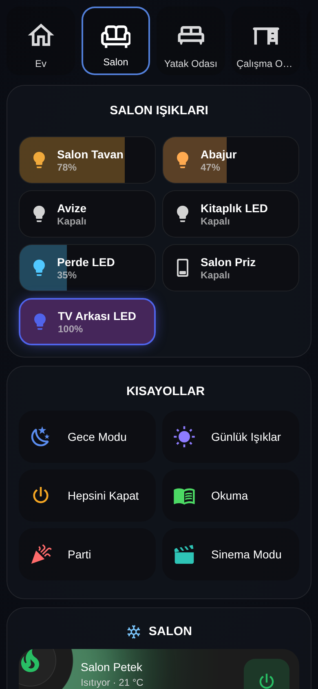

## Işık efektleri (isteğe bağlı)

[Lemur Light Effect Card](https://github.com/mendebur-lemur/lemur-light-effect-card) ayrıca kuruluysa pano onu kendiliğinden tanır, yönetim paneli de ilk açılışta haber verir:

- **Üst şeritte Efektler:** Oda düğmelerinin yanına kendiliğinden gelir; dokununca efekt ekranı o sekmenin odasıyla tam ekran açılır. Stil seç'ten kapatılabilir.
- **Efekt ekranı düğmesi:** İstersen senaryo bölümüne de eklenir.
- **Efekt düğmeleri:** Senaryoya düğme eklerken seçicide **Işık efektleri** grubunda odanın efektleri listelenir; seçilen efekt tek dokunuşla başlar. **Efekti durdur** düğmesi de eklenebilir.
- **Oynayan efekt görünür:** Odada efekt oynarken o odanın ışık karoları efektin renkleriyle parlar, efektin düğmesi yanar.
- **Işık penceresinden efekt ekranına:** Işık penceresindeki Efekt sekmesi efekt ekranını lambanın odasıyla açar. İstersen ayarlardan ışığa basılı tutmak doğrudan efekt ekranını açar.

Kurulu değilse bu düğmeler panoda görünmez, başka hiçbir şey değişmez.

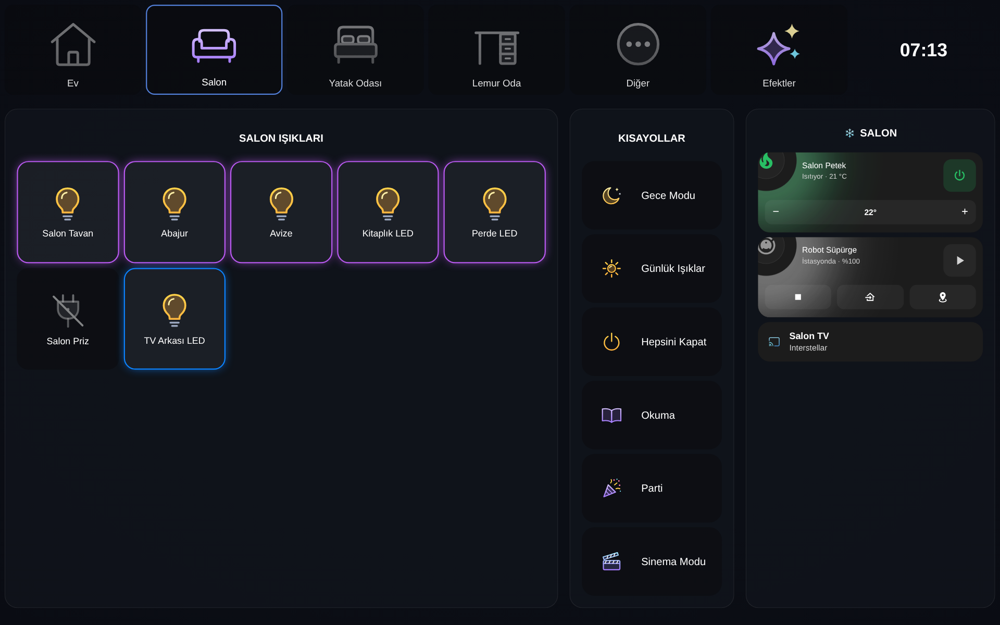

## Güncelleme

En kolayı yönetim panelinden: **Ayarlar → Sürüm ve güncelleme → Güncellemeleri denetle**. Yeni sürüm varsa **Güncelle** indirir, **Yeniden başlat** Home Assistant'ı yeniden başlatır.

Ya da Home Assistant'tan:

1. **Ayarlar**'daki güncelleme bildiriminden **Güncelle**. Ya da Marketplace'te (eski sürümlerde HACS'ta) **Lemur Home Dashboard → ⋮ → Bilgileri güncelle**, sonra **İndir**.
2. Home Assistant'ı yeniden başlat.

Güncellemeden sonra pano ya da yönetim paneli açıksa üstte "Yeni sürüm yüklendi, görmek için sayfayı yenile" uyarısı çıkar; **Yenile**'ye basınca yeni sürüm açılır. Sayfa kendiliğinden yenilenmez. Sekmelerin, bölümlerin ve ayarların güncellemede silinmez.

## Sorun giderme

- **"Timeout waiting for strategy element" ya da pano boş.** Entegrasyonun eklendiğinden ([adım 2](#2-entegrasyonu-ekle)) ve Home Assistant'ın yeniden başlatıldığından emin ol, sonra sayfayı Ctrl+F5 ile yenile. Telefon uygulamasında **Ayarlar → Companion app → Reset frontend cache**.
- **Pano kendiliğinden oluşmadı.** Entegrasyonu eklerken **Panoyu oluştur** açık olmalı; pano, kurulumdan sonra bir yönetici hesabıyla açılan ilk sayfada oluşur. Sayfayı yenile. Yine yoksa [3. adımla](#3-panoyu-oluştur) elle oluştur.
- **Kamera karosunda "Görüntü alınamıyor".** Kamera Home Assistant'ta açık görünüyor ama görüntü vermiyor: kameranın kendisini ya da entegrasyonunun ayarlarını kontrol et (ör. yazıcı kameralarında yerel ağdan canlı izleme açık olmalı). Görüntü gelince karo kendiliğinden düzelir.
- **Sol menüde Lemur Home Dashboard yok.** Sayfa yalnızca yönetici kullanıcılara görünür. Pano herkes için çalışır.
- **Bir cihaz panoda yok.** Otomatik düzen cihazları Home Assistant alanlarından bulur; alanı olmayan cihazlar **Diğer** sekmesinde toplanır. Yönetim panelinde istediğin bölüme **Ekle** ile ekleyebilirsin.
- **Pano HA düzenleyicisinde açılıyor ve değişiklikler panele yansımıyor.** Panoda "Kontrolü al" denmiş olabilir. Ham yapılandırma düzenleyicisinde içeriği yine [iki satırlık koda](#3-panoyu-oluştur) çevir.
- **Bölüm sığmıyor.** Yönetim panelindeki önizleme sığmayan bölümü işaretler; öğe sayısını azalt, bölümü başka kolona taşı ya da kolonu genişlet.
- **Hâlâ çözülmedi mi?** [Sorun bildir](https://github.com/mendebur-lemur/lemur-home-dashboard/issues); Home Assistant sürümünü, tarayıcıyı ve cihazı yazarsan hızlı bakarız.

## Ekran görüntüleri

| Ev sekmesi | Oda sekmesi |
|---|---|
| 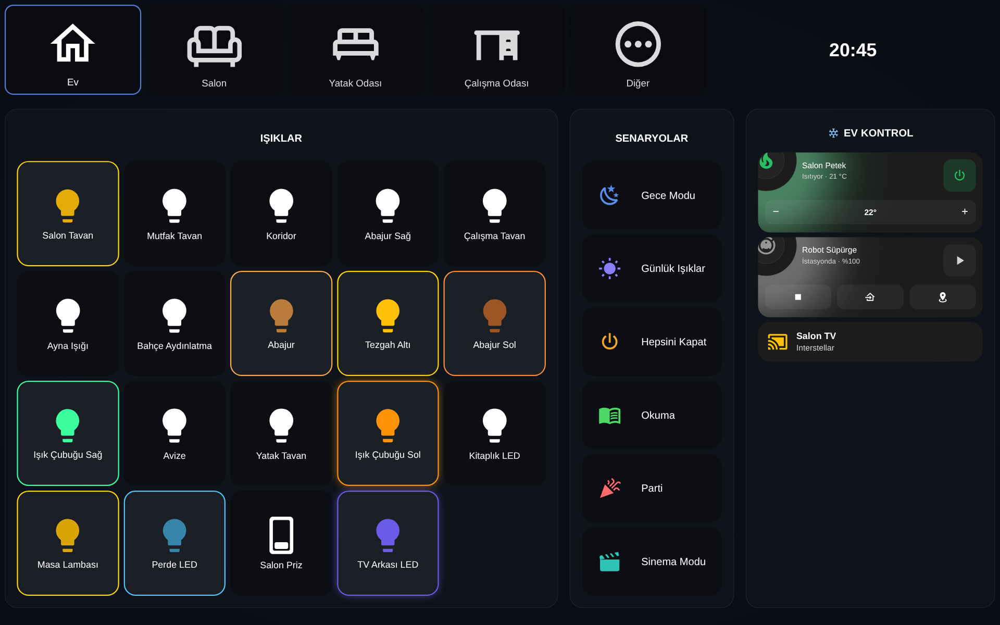 | 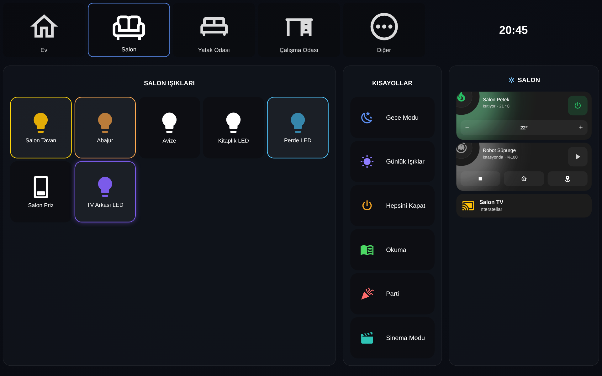 |
| **Enerji** | **Telefon** |
|  | 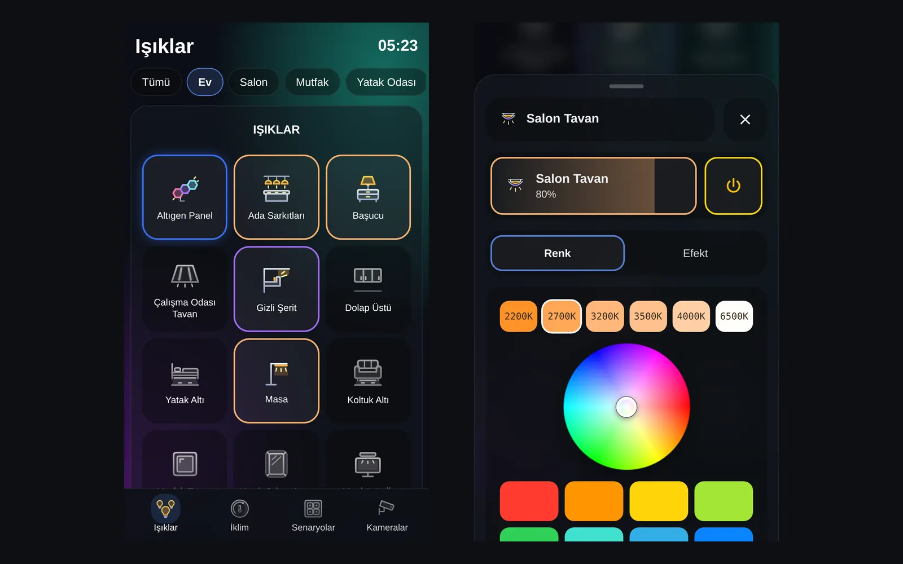 |
| **Yönetim paneli** | **Otomatik kur** |
| 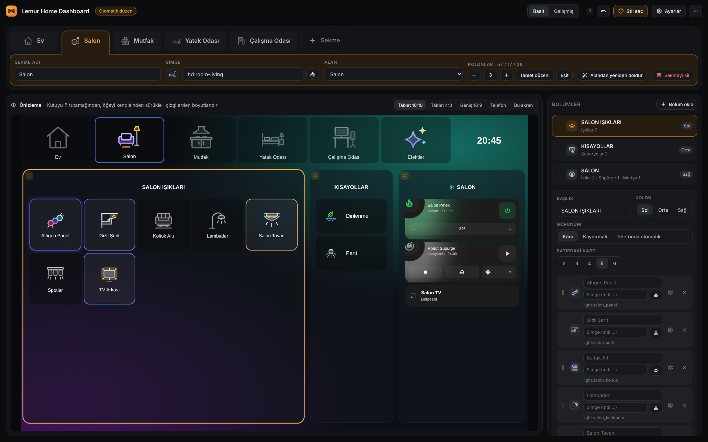 | 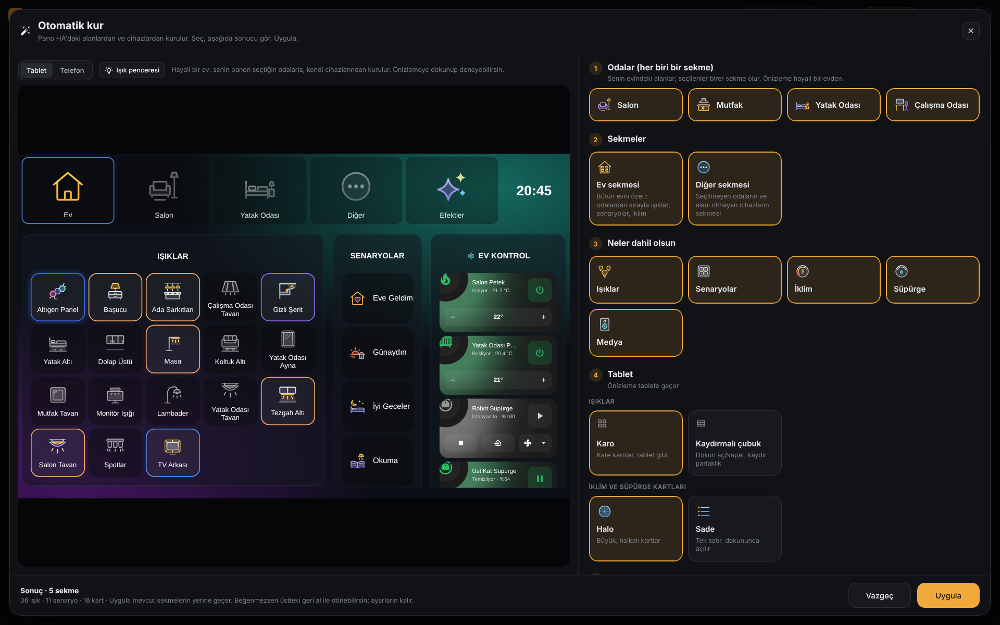 |

## Lemur ailesi

Üçü de birbirinden bağımsız kurulur; birlikte kurulunca birbirini tanır.

| | Ne yapar | Kurulum |
|---|---|---|
| **Lemur Home Dashboard** (bu depo) | Tek satırla kurulan, kendi yönetim paneli olan hazır tablet panosu | [](https://my.home-assistant.io/redirect/hacs_repository/?owner=mendebur-lemur&repository=lemur-home-dashboard&category=integration) |
| **[Lemur Light Effect Card](https://github.com/mendebur-lemur/lemur-light-effect-card)** | Efekt destekleyen bütün ışıkları oda oda yöneten efekt ekranı. Kuruluysa panoda Efektler düğmesi ve efekt düğmeleri açılır. | [](https://my.home-assistant.io/redirect/hacs_repository/?owner=mendebur-lemur&repository=lemur-light-effect-card&category=integration) |
| **[Lemur Halo Cards](https://github.com/mendebur-lemur/lemur-halo-cards)** | Durumu renkli haleyle anlatan sekiz kart: iklim, sensör, hava, süpürge, enerji, güvenlik... Sekizi de panoya gömülü gelir, kart seçiciden eklenir; başka panolarda kullanmak için ayrıca kurabilirsin. | [](https://my.home-assistant.io/redirect/hacs_repository/?owner=mendebur-lemur&repository=lemur-halo-cards&category=plugin) |

## Geliştirme

```bash
python3 build.py          # src/ klasörünü custom_components/.../frontend/ içine tek dosya olarak paketler
pip install -r tests/requirements.txt && pytest   # entegrasyon testleri
node --test tests/*.test.js                       # tarayıcı tarafı güvenlik denetimleri (src/safe.js)
```

**Güvenlik:** Hayvanların yemlik servisi yalnız izinli alanlardan olabilir (switch, button, input_button, timer, script, fan, number, select, esphome, notify, input_boolean, light), bildirim hedefi `notify.*` olmalı. "Besledim" bir dakika içinde ikinci kez sayılmaz. Yönetici olmayan kullanıcılar yemlik servisini ve bildirim hedefini görmez. Yedekten geri yüklemede sekmeler ve hayvanlar denetlenir, çalışacak servisler onay penceresinde gösterilir.

Ayarlar `.storage/lemur_home_dashboard` içinde tutulur. Pano `custom:lemur-home-dashboard` stratejisiyle üretilir; her sekme tek bir `custom:lemur-home-dashboard-card` kartı içeren bir görünümdür.

## Lisans

Kod **[GPL-3.0](LICENSE)** lisansıyla ve [NOTICE.md](NOTICE.md) dosyasındaki ek atıf koşuluyla yayınlanır:

- Herkes kullanabilir, değiştirebilir ve paylaşabilir.
- Bu kodu kullanan ya da üzerine geliştiren her proje **kendi kaynak kodunu da aynı lisansla açmak** zorundadır; kapalı kaynak bir ürüne dönüştürülemez.
- Kopyalar ve geliştirilmiş sürümler şu atıf satırını korumak zorundadır: *Based on Lemur Home Dashboard by mendeburlemur — https://github.com/mendebur-lemur/lemur-home-dashboard*

Görseller, videolar ve dokümanlar **[CC BY-NC-SA 4.0](docs/LICENSE.md)** lisansıyla yayınlanır: kaynak göstererek, ticari olmayan amaçla ve aynı lisansla paylaşılabilir.

v0.1.0 ve önceki sürümler MIT lisansıyla yayınlanmıştı; o sürümler için MIT geçerli kalır.
