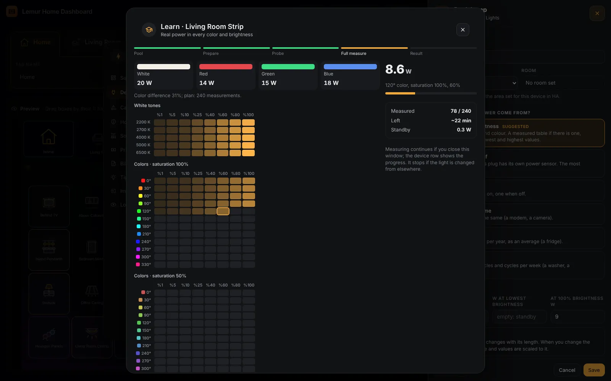
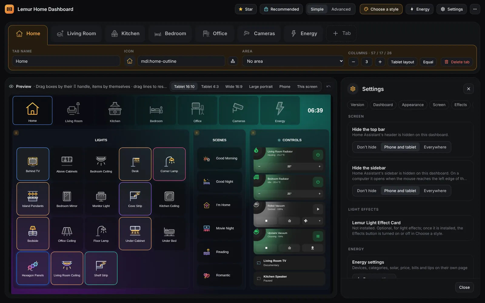
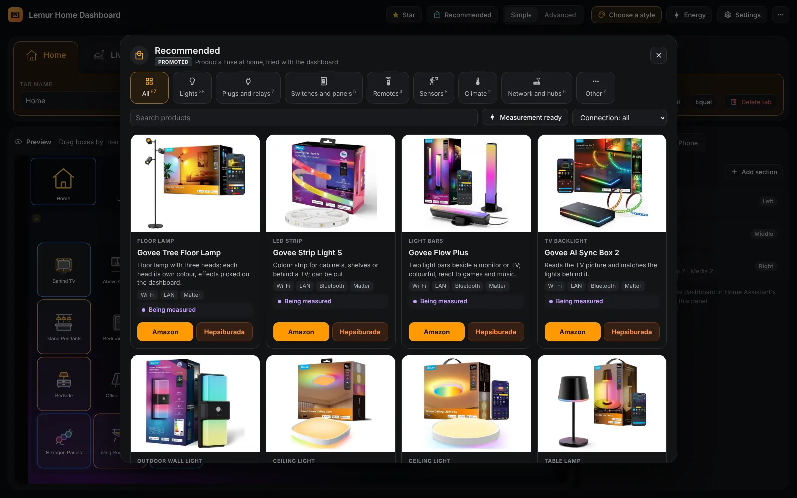

# Lemur Home Dashboard guide

Everything the dashboard can do, in order. The same guide is in the admin panel under **⋯ → Guide**. [Türkçe](REHBER.md)

## Using

### 1. The dashboard at a glance

Room buttons and the clock at the top, columns below. Each column holds one or more sections: lights, scenes, climate, vacuum, media, cameras, values and cards.

The dashboard builds itself from the areas in your home: a **Home** tab (lights, scenes and controls of the whole home) and one tab per room. You can use it without touching anything.

Tap a room button to open that room's tab, with its lights, covers, climate devices and room scenes.

### 2. Lights

Tap a tile: the light turns on or off at once. A light that is on gets a frame in its own colour; an unavailable device is dimmed.

In the **Sliders** look every light is a horizontal bar: tap to toggle, slide left or right for brightness. Plugs, covers and fans can sit in the same section; sliding a cover sets its position, a fan its speed.

Choose tiles or sliders in Choose a style or in the section's settings.

**Options**

- **Tiles**: Square tiles; tap to toggle, long press for the window.
- **Sliders**: Horizontal bars; slide for brightness (position for covers, speed for fans).
- **Auto on phone**: Tiles on the tablet, sliders on phones.
- **Tiles per row** (2 · 3 · 4 · 5 · 6): How many tiles fit in a row in the tile look.
- **Sliders per row** (1 · 2 · 3): How many sliders sit side by side.

### 3. Light window

Long press a light tile. A big brightness bar and a power button at the top, tabs below:

**Colour:** white tones from 2200 K to 6500 K, a colour wheel and ready colours. **Effect:** the light's own effects. **Segment:** colour single segments of strips and lamps that have them.

Close it by tapping outside, with the back button, Esc or ✕. On phones it slides up from the bottom and closes when pulled down.

**Options**

- **Holding a light** (Light window · HA dialog · Effect screen): What opens on a long press of a light tile (Choose a style → Tablet).
- **Light window from the bottom**: On phones the window slides up from the bottom and closes when pulled down (Choose a style → Phone).

### 4. Cover window

Long press a cover tile. The drawing shows the cover at its real position, with **Open**, **Stop**, **Close** below. While it moves, pressing the same button again stops it; drag the drawing to fine-tune the position.

There are six designs: center opening curtain, one-side curtain, shutter, roller shade, venetian blind and vertical blind. Pick one from the drawings in the cover's ⚙ settings.

Venetian and vertical blinds get a second row for the slat angle. If a separate motor turns the slats, pick it as the **Slat angle motor** in ⚙.

**Options**

- **Cover window** (Auto · Center opening · One side · Shutter · Roller shade · Venetian blind · Vertical blind): The drawing and buttons of the window. Auto picks from the device type.
- **Gathers to** (Left · Right · Both sides): For one-side curtains and vertical blinds, the side the cover gathers to.
- **Slat angle motor (optional)**: For venetian and vertical blinds, the cover entity of a separate slat motor. If it reports a position, 0-100% presets appear.

### 5. Scenes, climate, vacuum and media

Scene buttons run a script, scene or automation with one tap; each has its own colour and icon.

Climate cards hold air conditioners and radiators: on/off, target temperature, mode and fan. Depending on the **Season** setting, air conditioners show in summer and radiators in winter.

The media section holds TVs and speakers; a tap opens the device window.

The vacuum card starts, pauses and sends it to the dock. In Choose a style pick **Halo** (big ring cards) or **Simple** (one row per device that expands when tapped). An open Simple row has big buttons: for a vacuum Start/Pause and Back to dock, with Stop, Locate and Suction below; for climate Power, Mode, Fan and Swing.

**Options**

- **Season** (Automatic · Summer · Winter): Air conditioners in summer, radiators in winter. Automatic: May to September is summer (Settings).
- **Climate and vacuum cards** (Halo · Simple): Halo shows big ring cards; Simple shows one row per device that expands when tapped (Choose a style).
- **Type** (Automatic · Air conditioner · Radiator): Whether a climate item is an air conditioner or a radiator (item ⚙).
- **Temperature sensor**: The room temperature shown on the card; empty uses the device's own value.
- **Humidity sensor**: The humidity shown on the card.
- **Outdoor temperature sensor**: The radiator card shows the heating need when it is cold outside.
- **Device controlled together**: A second device that gets the same commands (e.g. a second radiator in the room).

### 6. Cameras

A camera tile shows a snapshot and refreshes it every few seconds (5 s to 1 min in the item settings). It does not refresh while the tab is not on screen.

Tap the tile and the live view opens in the largest window that fits the screen.

**+ Tab → Cameras tab** gathers every camera in one tab; choose how many cameras sit in a row.

**Options**

- **Picture refresh** (5 s · 10 s · 30 s · 1 min): How often one camera refreshes (item ⚙).
- **Picture refresh**: The same setting for every camera in the section (section settings).
- **Cameras per row** (Auto · 1 · 2 · 3 · 4): Cameras per row; Auto fits as many as the box allows (at most 2 on phones).
- **Cameras tab**: In the + Tab menu: every camera in one tab.

### 7. Feeding card

Feeding tracking for your pets: every N hours or at set times of day.

The card is green on time, yellow when it is close, orange when it is due and red when late. Tap to log "Fed" (tap again within 10 s to undo), long press for the last feedings.

It can send a notification when late and run an automatic feeder. Add it to a section as a **Pet**.

For every pet Home Assistant gets a "<name> feeding" state and a "<name> fed" button to use in automations.

**Options**

- **Kind** (Cat · Dog · Fish · Bird · Rabbit · Turtle · Other): Sets the card's icon.
- **When to feed** (Every N hours · At set times of day): The feeding schedule.
- **Every how many hours**: The interval for Every N hours.
- **Times (comma separated)**: The times for At set times of day (e.g. 08:00, 20:00).
- **Soon warning (min before)**: How many minutes before the card turns yellow.
- **Grace time (min)**: How long after the time before it turns red.
- **Notify when late**: Sends a Home Assistant notification when late.
- **Automatic feeder (optional)**: (Advanced) Runs a service when you log a feeding (e.g. a feeder button).

### 8. Energy

Home power now, categories, the devices drawing the most right now, daily usage and the last 24 hours in one tab; with solar or a battery, the energy flow and the battery. Devices and categories come from the dashboard's Energy page (or, without them, from "Individual devices" in Home Assistant's Energy settings); the charts from Home Assistant's own history.

The Halo ring turns from green to red with usage. Tap a category tile for that category's devices, tap a device row for its more-info window. The standby card shows what the home draws when nothing is in use, and what that adds up to in a year.

**+ Tab → Energy tab** sets up a ready tab. Cards can also be added one by one to a section with **Energy card**. Every card has five looks; while choosing, each is drawn as a small preview with your data. When the box gets small the card shows less.

Energy values can go into any section: home power now, today's usage, today's and this month's cost, the period-end estimate, the year's total, the share not measured, and each room's power and usage today. Find them at the top of the Energy card menu or in Add device → Energy. They come in the look that fits the section: a tile next to lights, a button next to scenes, a Halo next to climate cards.

The home and room totals are real sensors in Home Assistant (sensor.lhd_ev_power, sensor.lhd_oda_<room>_power and _energy) that automations can use. Light and plug tiles can also show live watts in their corner (Energy → Look and data → Watts on light tiles); for a light group it is the sum of its lights.

**Tips** send no notifications: they rotate in one line under the Halo (e.g. "AC on for 3 hours") and the related device's row gets an orange edge. Tap to open the device; hold and that tip won't show again on that screen.

**Options**

- **Card** (Home power now · Category tiles · Top consumers now · Daily usage · Last 24 hours · Standby usage · Solar and grid flow · Battery · This month and tariff · Home meter · Tips): Added to a section as an Energy card; change its kind with the item ⚙. The flow and battery cards fill once solar or a battery is turned on on the Energy page.
- **Look**: Five looks per card (e.g. Home power now: ring, gauge, breakdown ring, number and curve, level bar). The first is the card's default.
- **Details below**: Under the Halo: today's kWh, cost and this month's cost (without a price, monthly usage at this rate).
- **Tier and yearly limit bars**: Under the Halo: this month's tier bar and this year against the yearly limit.
- **Columns** (Auto · 2 · 3 · 4): Category tiles per row. Auto follows the number of categories (2 side by side, 4 two by two, 6 three by two).
- **Order** (Order in Categories · Highest first): The order of category tiles: as in Energy → Categories, or highest first.
- **Uncategorized tile**: The total of devices without a category; always last, can be turned off.
- **Small chart** (24 hours · 7 days · None): The small chart on a category tile; all categories share one scale.
- **How many devices** (3 · 5 · 6 · 8 · 10): How many devices the top consumers list shows.
- **Category**: Limits the list to one category.
- **Hide idle devices**: Devices under 2 W are not listed.
- **Days** (7 · 30): How many days the daily usage chart shows.
- **Unit** (kWh · Money): Daily usage in kWh or money.
- **Lines** (Categories · Total): Last 24 hours as category lines or one total.
- **Values that fit this section**: At the top of the Energy card menu: the chosen value is added in the look that fits the section, the same size as the other items.
- **Energy tab**: In the + Tab menu: a ready Energy tab.

### 9. Light effects (optional)

If Lemur Light Effect Card is installed too, the dashboard finds it by itself: an **Effects** button appears in the top bar and opens the effect screen for that tab's room.

Effect buttons can be added to scenes; while an effect plays, the room's light tiles glow in its colours.

If it is not installed these buttons do not show and nothing else changes.

**Options**

- **Effects in the top bar**: The button in the top bar that opens the effect screen (Choose a style → Light effects).
- **Effects inside the aligned area**: (Advanced) Keep Effects inside the aligned area when room buttons are aligned to a column (Settings).
- **Effect screen**: A scene button that opens the effect screen.
- **Stop effect**: A button that stops the room's effect.
- **Effect screen**: A long press on a light opens the effect screen directly (Choose a style → Tablet → Holding a light).

### 10. On phones

The same dashboard switches to a phone layout by itself; no second dashboard needed. Upright tablets use the same layout.

Navigation can be categories at the bottom (Lights, Climate, Scenes, Cameras, Energy), rooms at the bottom or rooms at the top. Lights as tiles or one per row; section by section also two per row. The light window slides up from the bottom.

On phones the section boxes have thin frames, which leaves more room for lights and buttons. Sections can also be frameless: no boxes are drawn and titles become small labels.

In the Lights category swipe the room strip on top to move between rooms; **All** shows every light in the home. With brightness on the clock on, swipe the row with the page name and the clock; swiping there does not change the room.

Navigation, lights and the light window are in **Choose a style → Phone**; frameless sections are in the admin panel under **Editing: Phone → Phone look**. The tablet is not affected.

**Options**

- **Navigation** (Categories at the bottom · Rooms at the bottom · Rooms on top): Navigation on phones.
- **Lights** (As in the section · Tiles · One per row): Lights on phones.
- **Light window from the bottom**: The light and cover windows slide up from the bottom and close when pulled down.
- **Sections** (Framed · Frameless): Frameless: on phones section boxes are not drawn and titles become small labels; more room for lights (Phone look).
- **On phones and upright tablets too**: Brightness on the clock works on phones and upright tablets too (Settings).

## Editing

### 11. Admin panel

**Lemur Home Dashboard** in the sidebar (admins only). Tabs at the top, a live preview on the left, the selected tab's sections on the right.

The top bar has Star, Recommended, Simple/Advanced, Choose a style, Energy, Settings and ⋯ (Guide, Auto setup, Choose a style, Back to automatic layout). **Undo** is in the preview's header next to the screen choice; Ctrl+Z works too.

Your first change saves the automatic layout; from then on everything is edited here.

**Simple** mode shows what everyday layout needs; **Advanced** also opens the fine tuning. An advanced setting that is in use still shows in simple mode; nothing is lost or changed by being hidden. The **?** next to harder settings explains them with an example.

**Options**

- **Simple**: Tab name, icon, area, number of columns (removing an empty column too); sections, devices, name, icon, look, on tap; on phones navigation, lights, framed/frameless, light window, hiding sections and items, a section's phone look (two per row too), collapsible groups, hiding a room button; Choose a style, icon style, turning on brightness on the clock and using it on phones, theme, top bar and sidebar.
- **Advanced**: Also: free grid, columns inside a column, room background, item size, colour, condition, custom action and card settings, empty tiles and subtitles; phone-only room name and icon, tiles per row on phones, phone-only icon style, climate card and background; aligning room buttons to a column and their size; the box, icon and always-show options of brightness on the clock; canvas width; wall switches; the custom preview screen. Nothing is deleted.
- **Preview** (Tablet 16:10 · Tablet 4:3 · Wide 16:9 · Large portrait · Phone · Custom · This screen): The preview screen. Large portrait is drawn in the phone layout, like a real upright tablet. **Custom** (advanced): type your device resolution and the preview uses that ratio; on tablets the resolution as is (e.g. 2560 × 1600), on phones the width the browser sees (e.g. 412 × 915). This browser remembers it.
- **Editing** (Tablet · Phone): Whether changes go to the tablet or only to phones.
- **Undo**: Every change can be undone: the button in the preview's header, the notice after a change, or Ctrl+Z.
- **Star**: If you like the dashboard, opens the project's GitHub page; no reminders or counting.
- **Recommended**: Opens the recommended products window (More → Recommended products).

### 12. Tabs

Tabs on top, the selected tab's settings below. Every tab is a room button in the dashboard's top bar.

Drag tabs to reorder them. A tab tied to an area uses that room for the effect screen and brightness on the clock.

**Options**

- **Tab name**: The name on the room button.
- **Icon**: The room button's icon.
- **Area**: The tab's room: the effect screen and brightness on the clock use it.
- **Room background** (General): (Advanced) A background for this tab only: a colour or an effect. **General** uses the background from Choose a style. A phone-only background wins on phones.
- **Refill from area**: Rebuilds the tab from the devices of the chosen area.
- **Layout** (Columns · Free grid): (Advanced) In the free grid a box moves by its ⠿ handle and resizes from its lower right corner; the others make room. Back in Columns the old layout is still there. The section list shows the box size instead of the column.
- **Fit the screen** (Fit the screen · Scrollable): (Free grid) Fit the screen: the layout fills the screen, no scrolling; pick 8 to 20 rows. Scrollable: fixed row height, the page grows downwards.
- **Fill gaps**: (Free grid) Boxes grow right and down to close empty cells.
- **Reset portrait layout**: (Free grid) On a large portrait screen the layout drops to 6 columns by itself; change it there and that screen gets its own layout. This button removes it and derives it from the wide layout again.
- **Columns**: 1 to 6 columns; − and + remove or add the last column, drag the lines in the preview for widths. An empty column is not drawn on the dashboard; while editing, **Remove this column** inside it removes it, even in the middle, and the other columns stay.
- **Tablet layout** (Tablet layout · Equal): Ready column ratios; Tablet layout only with 3 columns.
- **Columns inside**: Splits a column into 2-3 columns of its own (advanced).
- **Tab** (Empty tab · Tab from area · Cameras tab · Energy tab): A new tab.
- **Delete tab**: Deletes the tab (asks first, can be undone).

### 13. Auto setup

**⋯ → Auto setup** builds the dashboard from the areas and devices in your home. You see the result in the preview while choosing.

The preview uses an imaginary home; applying builds the dashboard with your own rooms and devices.

**Options**

- **Rooms (one tab each)**: Every selected room becomes a tab.
- **Home tab**: A summary of the whole home: lights, scenes and climate from each room.
- **Other tab**: A tab for unselected rooms and devices without an area.
- **What to include** (Lights · Scenes · Climate · Vacuum · Media · Cameras · Energy): Which sections go into the tabs; with Energy an Energy tab is added at the end.
- **Look** (Tiles · Slider bars · Bars on phones): How lights look.
- **Climate and vacuum cards** (Halo · Simple): Climate and vacuum cards.
- **Holding a light** (Light window · HA dialog · Effect screen): The window a long press on a light tile opens.
- **Phone** (Categories at the bottom · Rooms at the bottom · Rooms on top): Navigation on phones (shown when the preview is switched to Phone).
- **Light window** (From the bottom · In the middle): The light window on phones.
- **Background**: Background; if you pick none the current one stays.
- **Light effects** (Effects on · Effects hidden): The Effects button (when Light Effect Card is installed).
- **Apply**: Replaces the current tabs; settings stay and undo brings them back.

### 14. Adding devices

Press **Add** in a section. The picker lists every device in the home; the filter on top (Lights and switches, Scenes, Values, Energy, Climate, Vacuum, Media, Cameras) narrows it.

Add several at once. Scripts, scenes and automations become coloured buttons; sensors become value tiles.

The **Card** button lists Halo cards, Home Assistant cards and installed custom cards. **Energy card** opens the energy cards and the energy values that fit the section.

**Options**

- **All** (All · Lights and switches · Scenes · Values · Energy · Climate · Vacuum · Media · Cameras): The picker's filter. Energy: home and room power, today's usage, costs, the year's total, the share not measured.
- **Add**: Pick from the home's devices; several at once.
- **Card**: A Halo card, a Home Assistant card or an installed custom card.
- **Pet**: A feeding card.
- **Energy card**: An energy card or an energy value that fits the section; the menu has previews.
- **Subtitle**: (Advanced) A small heading inside the section.
- **Empty tile** (Empty tile · Empty button): (Advanced) A placeholder tile or button (give it an action in ⚙).

### 15. Item settings

The ⚙ next to every item: name, icon, **Look** (tile, button, row), what a **Tap** and a **Long press** do.

Tap or long press: device window, toggle, run a service, open a card in a window or nothing.

Type-specific settings live here too, such as the cover design or how often a camera refreshes.

**Options**

- **Name**: The name shown on the dashboard; templates allowed.
- **Icon**: From the dashboard's icon set or an mdi:... name.
- **Icon when on** (Icon when on · Icon when off): Separate icons for on and off on value items (advanced).
- **Look** (Tile · Button · Row · Halo): How the item is drawn; the choices depend on its type.
- **On tap** (More info · Toggle · Call a service · Open a card in a window · Nothing · Advanced (YAML)): What a tap does.
- **On hold**: What a long press does; same choices.
- **Ask before running**: Asks "run it?" first; the question can be written.

### 16. Energy page

**Energy** in the top bar opens its own page: Summary, Devices, Categories, Home meter, Solar and battery, Price and tariff, Bills, Tips, Import, Look and data. **Summary** shows where each part stands today; tap a row to open that part.

**Devices:** grouped by room or category with each group's total; search and filters on top. Every row has a status label: Measured, Learning, Learned, Ready table, Estimated or Check. The room comes from the area set for the device in Home Assistant.

**Add lights** lists untracked lights by room to add in one go; **Add measuring devices** brings in devices that measure power; **Other device** is added by hand. Tap a device and the editor opens on the right: **What is it?**, **Where does its power come from?** and **Values**. Every device that does not measure gets a power and an energy sensor in Home Assistant; cards show it with "~". Its real values are measured once with a plug using **Learn** (next step).

**Shared plug:** if one plug feeds several devices, tick them under **Devices on this plug** in the plug's settings. Their power is taken off the plug's, the rest becomes its own row; nothing is counted twice.

**Categories:** name, colour, order and the devices in it; each gets a total power and kWh sensor and is added to Home Assistant's Energy settings by itself. **Home meter:** a device measuring the whole home (like a Shelly Pro EM) is found by itself; the home shows the measured value and the untracked share needs no bills. **Solar and battery:** only what you turn on shows its settings; when the grid is down and the home runs on the battery, the flow card shows the outage.

**Price and tariff** in three steps: the tariff on your bill, what 1 kWh costs, and how the year is going (this year's total, the year end at this rate, the day you cross the yearly limit, the day the last-resort price starts). It works without bills: the year's total comes from Home Assistant's records; with less than 2 weeks of records there is no year-end estimate. **Bills** make it exact. **Import** shows virtual devices and groups set up with another add-on, then brings them in when you confirm.

**Options**

- **Which tariff is on your bill?** (Tiered · Time of use · Last resort · Not sure · Fixed price): Tiered: cheaper up to an average 8 kWh a day, dearer above. Time of use: day 06-17, peak 17-22, night 22-06. Last resort: if you passed the yearly limit. Not sure: the unit price comes from the last bill. Fixed price: every kWh the same.
- **Fill in official prices**: For tiered and time of use, enters the EPDK tariff of 4 April 2026 with taxes. Update it when the tariff changes.
- **More exact (optional)**: kWh from 1 January to the end of the last bill and last year's total; empty uses Home Assistant's records.
- **Limit (kWh/year)** (By year · Manual): Under More exact. By year 3,000 kWh (EPDK decision of 30 October 2026). Once crossed, the last-resort price applies from the 1st of the third month after, until the year end. Manual: for a business or a different limit.
- **Add bill**: Period start and end, kWh and the total amount.
- **Filters** (All · Lights · Measured · Estimated · To check · No room): Narrows the device list. No room: devices left out of room totals.
- **Add lights**: Untracked lights by room; those with a ready table come with measured values.
- **Add measuring devices**: Devices that measure power but are not added yet; their energy sensor too if found.
- **Where does its power come from?** (Measures itself · Light: by brightness · By state · On / off · Always the same · Yearly label · By cycles): How the device's power is worked out; methods that fit the device are listed, the recommended one marked. Example: a 2-60 W light at 30% is 19.4 W; a 250 kWh/year fridge averages 28.5 W.
- **Category**: The device's category; a new one can be made from here.
- **Devices on this plug**: The other tracked devices on a shared plug. Naming the rest is optional; empty uses the plug's name.
- **LED strip**: In a light's editor: length and adapter power. A new length scales the table, never above the adapter power.
- **Use as home meter**: Power, imported and exported kWh and voltage from the same device. It is added to the Energy settings as the grid source; an existing grid meter there is left alone.
- **I have solar**: Production and grid sensors; production is added to the Energy settings as a solar source.
- **I have a battery**: Battery sensors; works without solar too.
- **One sensor** (One sensor · Import and export apart · None): Grid metering: one plus/minus sensor, or import and export apart.
- **Reversed sign**: If the battery sensor shows charging as minus.
- **Left on for long**: Tip: a device drawing more than this for longer than this (default 300 W, 3 hours).
- **Dot on the tab**: A small dot on the Energy tab button while there are tips (off by default).
- **Bring back hidden tips**: Brings back the tips you hid with a long press.
- **Sync with the Energy settings**: Look and data: devices, categories and solar also show on Home Assistant's Energy dashboard.
- **Total home power** (Sum of categories): Look and data: the total power Halo shows.
- **Standby power** (Lowest of the last 24 hours): Look and data: the standby card's power.
- **Halo colour limits (W)**: Look and data: Halo's green, yellow and orange limits (default 300 / 800 / 1800 W).
- **Watts on light tiles** (Off · When on · Always): Look and data: live watts on tiles of lights and plugs that measure power or have an estimate.
- **Mark estimated values**: Look and data: estimated watts with "~" in purple.
- **Not measured tile**: Look and data: the share not measured as a category tile.

### 17. Learn

A smart device that does not measure power is taught its real values once with a plug that does (or a 1PM-type relay); then the plug moves on. Energy → Devices → device → **Learn**.

Three checks first: pick the plug, tick **Only this device is on the plug** and press **Try**. The device turns on and off once and the plug's reading must change. The missing step is written next to the button.

For a light the shared pool is checked first. Otherwise standby, a short colour probe, then every white tone and colour at 8 brightness steps each are measured; then the light's effects (can be skipped). It runs inside Home Assistant in the background. It can be paused, stops if the light is changed from elsewhere, and puts the light back at the end.

For consistency only readings after a command count; if the lamp did not take the colour and brightness, the command is sent again. If the plug drops out, the steps just before it are measured again, and so are odd cells (the same value in a row, power falling as brightness rises). Low power the plug cannot read is not written as 0 W but worked out from the row; unreadable standby counts as 0.4 W for a light on the network.

When it is done, check the result and **Save**; one tap applies it to other lights of the same model. If Home Assistant restarts, an unfinished learn goes on from its step, and a finished but unsaved result is kept.

Devices with states, like a TV or AC, collect an average per state while you use them. Always-on devices like a fridge take the plug's average over days; **Finish and save** makes the device Fixed at that wattage. At most 3 lights learn at once and a plug measures one device. The shared pool holds only lights the project measured itself; sending your own is closed for now.

**Options**

- **Measuring plug**: A plug or relay that measures power; how often it sends a new value is shown (it sets the duration).
- **Only this device is on the plug**: Anything else on the plug makes the measurement wrong.
- **Try**: Turns the device on and off once; the plug's reading must change.
- **Start measuring**: Starts the full measurement; the number of steps and rough time are shown first.
- **Skip effects**: Measured effects are kept, the rest use the average.
- **Go on from where it stopped** (Go on from where it stopped · Start over): For a stopped or failed measurement: go on keeping the measured steps, or start over.
- **Measured again**: In the result: how many cells were measured again.
- **Below the plug**: In the result: how many cells were below what the plug can read; they are worked out from the row.
- **LED strip**: For a strip, length and adapter power; the table is scaled to the length, never above the adapter power.
- **Save and learn**: Starts learning right away when adding a new device.

### 18. Cards and values

Values such as sensors, timers and counters, and any card, can go into a section.

Value tiles show an icon, value and name; a running timer counts down. Cards come from Halo cards, Home Assistant cards or installed custom cards.

**Options**

- **Card** (Halo cards · Home Assistant cards · Installed custom cards · Write YAML): The card picker.
- **Visual** (Visual · YAML): The chosen card opens with its visual editor and live preview; or YAML.
- **Height** (Auto · 1 · 1.5 · 2): Height of card and Halo items (rows).
- **Open a card in a window**: Given to a button, the card opens in the dashboard's window like the light window.
- **Second line** (State · Last changed · Attribute · Text or template): The second line of a value item.
- **Name on top, value below**: On value items, name on top and value below.
- **Halo**: Shows a numeric value as a Halo sensor card.
- **Colour by value**: 4 limits, 5 colours: frame, value and icon colour by value.
- **Colour by state**: Maps an entity's state to a colour; works with text values too.

### 19. Sections and columns

Sections are free: anything can go into any box, and each item shows in its own way.

Drag a section by its handle in the preview to another column; drag an item itself to reorder it or move it to another section. Drag the lines to change column widths.

The section settings hold its title, column, look (tiles, sliders), tiles per row, fill and alignment.

**Options**

- **Title**: The section's title; can be empty.
- **Column**: The column the section sits in.
- **Fill** (Fit content · Fill the box): Whether buttons and tiles spread over the box's height.
- **Alignment** (Top · Middle · Spread evenly): Where content sits when it is shorter than the box.
- **Spacing** (Auto · 0 · 6 · 12 · 18 · 24): Space between items (pixels).
- **Delete section**: Deletes the section (asks first, can be undone).

### 20. Icon picker

The button next to icon fields. Pick from the dashboard's colour icon set; icons that fit the thing come first, and search understands Turkish words too.

★ marks drawings made for this dashboard. With Light Effect Card installed its effect icons can be picked too.

You can also type an `mdi:...` name directly.

**Options**

- **Suggested**: Icons that fit the thing come first.
- **All icons**: The whole set; search understands Turkish words too.
- **Effect icons**: Light Effect Card's effect icons when it is installed.

### 21. Choose a style

**Choose a style** in the top bar. Preview on the left, big options on the right; each choice shows in the preview at once and **Apply** saves them together.

**Tablet:** lights as tiles or sliders; climate and vacuum cards Halo or Simple; the window a long press on a light opens (try it in the preview). **Phone:** navigation, lights, light window.

**Background:** 30 effect colours, dark, black, any colour or your own picture.

**Options**

- **My home** (My home · Example home): Preview your own dashboard or the example home.
- **Tiles** (Tiles · Sliders): Lights on the tablet.
- **Climate and vacuum cards** (Halo · Simple): Climate and vacuum cards on the tablet.
- **Holding a light** (Light window · HA dialog · Effect screen): The window a long press on a light opens; try it in the preview.
- **Navigation** (Categories at the bottom · Rooms at the bottom · Rooms on top): Navigation, lights and light window on phones.
- **Background** (Effect · Dark · Black · Colour · Image): The dashboard background.
- **Effect**: 30 effect colours: Meditation (default), Aurora, Fire, Sunset, Ocean and more.
- **Image**: A picture in HA's www folder (/local/background.jpg) or a web address.
- **Light effects**: Shows or hides the Effects button; explains the card if it is not installed.

### 22. Phone-only layout

Switch to **Editing: Phone** in the admin panel: the preview becomes a phone and changes apply to phones only; the tablet stays the same.

On phones set the order and visibility of room buttons, sections and items, the look of sections (two per row too) and collapsible groups. The **Phone look** card has navigation, lights, framed/frameless sections and the light window; in advanced mode also icon style, climate cards and background.

Everything you change says "phone only". A section's name, column and devices are shared with the tablet; switch to Tablet for those. **Make the phone match the tablet** removes all phone-only settings (it asks first).

**Options**

- **Shown on phones** (Shown on phones · Hidden on phones): Show or hide a section on phones.
- **Look on phones** (Same as tablet · Tiles · One per row · Two per row): A tile section's look on phones. **One per row:** one light per row. **Two per row:** two sliders side by side (tap on/off, slide for brightness).
- **Tiles per row on phones** (Auto · 2 · 3 · 4 · 5): (Advanced) Tiles per row on phones.
- **Sections** (Framed · Frameless): Phone look: with Frameless no section boxes are drawn on phones and titles become small labels. Framed sections also have thin frames on phones.
- **Items shown on phones**: Hide single items on phones; drag them in the preview to reorder.
- **Collapsible groups** (Add collapsible group): Select the section → **Add collapsible group**, give it a name and icon, tick the items to put in it. They gather in one row, as tall as a light bar, at the end of the section; the row says how many items and how many are on (e.g. 12 items · 3 on) and opens on tap. The browser remembers whether it is open. An item can be in one group; a section can have several groups.
- **Name on phones** (Name on phones · Icon on phones · Room button on phones): Hide a room button on phones (the tab can still be opened); its phone-only name and icon in advanced mode. Drag the strip on top to change the order on phones.
- **Icon style** (Icon style · Climate and vacuum cards · Background): (Advanced) A separate style for phones in the Phone look card.
- **Back to tablet**: Returns one setting to the tablet's.
- **Make the phone match the tablet**: Removes everything phone-only; asks first.

## More

### 23. Settings

**Settings** at the top right apply to every tablet in the home. The buttons on top jump to a part: Version, Dashboard, Appearance, Screen, Effects, Switches (advanced), Energy, Help, Backup.

**Dashboard:** language, season, Recommended products. **Appearance:** a card that opens Choose a style, icon style, room buttons (advanced), brightness on the clock, HA theme. **Screen:** top bar and sidebar (see Full screen on a tablet), canvas (advanced).

**Brightness on the clock:** swipe the clock area left or right and every light that is on in that tab's room changes brightness together; all the way left turns them off, and swiping while all are off turns the last ones back on. On phones and upright tablets swipe the row with the page name and the clock.

Version and updates at the top: install a new version from here. **Backup** downloads everything in one file; **Report a problem** opens a GitHub issue.

**Options**

- **Version and updates**: Installed version, What's new and updates; download a new version and restart HA from here.
- **Language** (Automatic · Türkçe · English): The dashboard's language.
- **Season** (Automatic · Summer · Winter): Air conditioners in summer, radiators in winter. Automatic: May to September is summer.
- **Recommended products** (Show · Hide): Shows or hides the Recommended button in the top bar.
- **Icon style** (Automatic · Colourful · Flat · Single colour): How icons are coloured.
- **Light colour on lights**: In Single colour, a light that is on keeps its own colour.
- **Align room buttons to a column**: (Advanced) Room buttons end at the chosen column's right edge and share the space evenly.
- **Room button size**: (Advanced) Width and height of room buttons (default 235 × 155).
- **Brightness on the clock**: Swiping the clock area changes the brightness of every light that is on in the room.
- **Look** (Hidden · Box): (Advanced) Hidden: only the clock shows, it appears while swiping. Box: a box like the room buttons.
- **On phones and upright tablets too**: On phones and upright tablets the clock row is swiped; turn it off and that row cannot be swiped.
- **Icon**: (Advanced) A bulb icon on the left.
- **Brightness indicator** (While swiping · Always): (Advanced) The brightness indicator shows only while swiping, or always while a light is on.
- **HA theme**: The HA theme used by pop-up windows.
- **Hide the top bar** (Don't hide · Phone and tablet · Everywhere): Hides HA's top bar on this dashboard (Full screen on a tablet).
- **Hide the sidebar** (Don't hide · Phone and tablet · Everywhere): Hides HA's sidebar on this dashboard; swipe from the edge to open it.
- **Canvas**: Design width and reference height; the dashboard scales to the screen with it (advanced).
- **Report a problem**: Opens a GitHub issue with version and device details; no room, device or person names are added.
- **Download backup** (Download backup · Restore a backup): Tabs, sections, settings and pets in one file; restoring asks first.

### 24. Full screen on a tablet

**Hide the top bar** and **Hide the sidebar** in Settings → Screen turn off Home Assistant's top bar and sidebar on this dashboard only. A wall tablet becomes a full-screen dashboard.

Both have three options: **Don't hide**, **Phone and tablet** (still shown on a computer) or **Everywhere**.

On a computer the hidden sidebar opens when the mouse reaches the left edge of the screen. On phones and tablets swipe right from the left edge: on iPhone and iPad the Home Assistant app does this, on Android (HA app, Fully Kiosk, browser) the dashboard does. Android's back gesture uses the very edge, so start the swipe a little further in. Tap outside the menu to hide it again.

With the top bar hidden, on iPhone the dashboard starts below the clock and battery strip; on iPad the strip on top takes the dashboard's background colour.

**Options**

- **Hide the top bar** (Don't hide · Phone and tablet · Everywhere): HA's top bar.
- **Hide the sidebar** (Don't hide · Phone and tablet · Everywhere): HA's sidebar; when hidden, swipe from the edge to open it.

### 25. Advanced settings

**Only show when:** the item shows while a chosen entity is in a given state. **Colour by value** and **Colour by state:** colour from a number or a state.

**Second line** and **templates:** the name and second line accept Home Assistant templates. **Ask before running:** the button asks first.

**Backup control:** the second copy of a lamp that shows up twice; if the lamp does not answer, the command goes through the backup. **Wall switches:** bind a signal-only relay to a lamp.

**Options**

- **Size** (1×1 · 2×1 · 1×2 · 2×2 · Full row): How much of the grid a tile takes.
- **Icon size** (Auto · Small · Medium · Large): Icon and text size.
- **Colours** (Icon · When on · Background): Icon colour, colour when on and background tint.
- **Only show when** (equals · is one of · is none of): The item shows only while the entity is in that state; otherwise no gap is left.
- **Second line**: The name and second line accept Home Assistant templates ({{ }}).
- **Backup control**: The second copy of a lamp that shows up twice; if it does not answer the command goes there and an orange dot appears.
- **Wall switches** (Brightness % · Kelvin): A signal-only relay is bound to a lamp; brightness and kelvin can be set for turning on (Settings, advanced).

### 26. Recommended products

**Recommended** in the admin panel's top bar: products the developer uses at home and has tried with the dashboard. A **Promoted** label sits under the title.

Categories, search, connection type (Wi-Fi, Zigbee, Matter…) and a **Measurement ready** filter. Every card says what the product does, its connection types and whether the dashboard already knows its power.

Store buttons are affiliate links; the price does not change. On phones and tablets the product opens in the store's app. On a computer Amazon opens directly; a Hepsiburada link goes to your phone as a notification through the Home Assistant app. Without the app, a code to scan with the phone and **Open on this computer** show up.

The list updates from GitHub; new products need no dashboard update. If you do not want it: Settings → Dashboard → Recommended products: Hide.

**Options**

- **Category** (All · Lights · Plugs and relays · Switches and panels · Remotes · Sensors · Climate · Network and hubs · Other): Product categories.
- **Measurement ready**: Only products whose power the dashboard already knows: a measured table or a device that measures itself.
- **Power on the dashboard** (Measured table ready · Measures itself · Being measured · No measuring needed): On the card: how the dashboard knows the product's power.
- **Send to my phone**: On a computer, sends the Hepsiburada link to your phone as a notification; with several phones it asks the first time.
- **Recommended products** (Show · Hide): Settings → Dashboard: shows or hides the button in the top bar.

### 27. Tips

If something goes wrong, **Undo** (Ctrl+Z). **⋯ → Back to automatic layout** rebuilds everything.

If you choose "take control" for this dashboard in HA's own editor, it leaves this panel; always edit here.

This guide is always in **⋯ → Guide** and **Settings → Help**.

**Options**

- **Undo**: Takes back the last changes.
- **Back to automatic layout**: Deletes every tab and section and rebuilds from the home's areas; settings stay.
- **What's new**: Shows once after an update; open it again from Settings → Version.
- **Guide**: This guide.
