# Lemur Home Dashboard guide

Everything the dashboard can do, in order. The same guide is in the admin panel under **⋯ → Guide**. [Türkçe](REHBER.md)

## Using

### 1. The dashboard at a glance

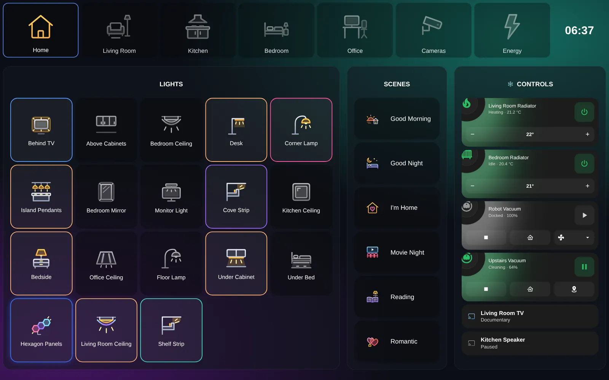

Room buttons and the clock at the top, columns below. Each column holds one or more sections: lights, scenes, climate, vacuum, media, cameras, values and cards.

The dashboard builds itself from the areas in your home: a **Home** tab (lights, scenes and controls of the whole home) and one tab per room. You can use it without touching anything.

Tap a room button to open that room's tab, with its lights, covers, climate devices and room scenes.

### 2. Lights

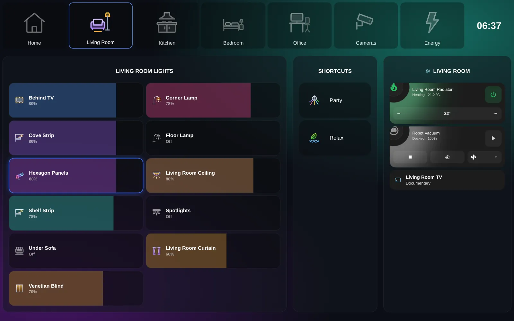

Tap a tile: the light turns on or off at once. A light that is on gets a frame in its own colour; an unavailable device is dimmed.

In the **Sliders** look every light is a horizontal bar: tap to toggle, slide left or right for brightness. Plugs, covers and fans can sit in the same section; sliding a cover sets its position, a fan its speed.

Choose tiles or sliders in Choose a style or in the section's settings.

**Options**

- **Tiles**: Square tiles; tap to toggle, long press for the window.
- **Sliders**: Horizontal bars; slide for brightness (position for covers, speed for fans).
- **Auto on phone**: Tiles on the tablet, sliders on phones.
- **Tiles per row** (2 · 3 · 4 · 5 · 6): How many tiles fit in a row in the tile look.
- **Sliders per row** (1 · 2 · 3): How many sliders sit side by side.

### 3. Light window

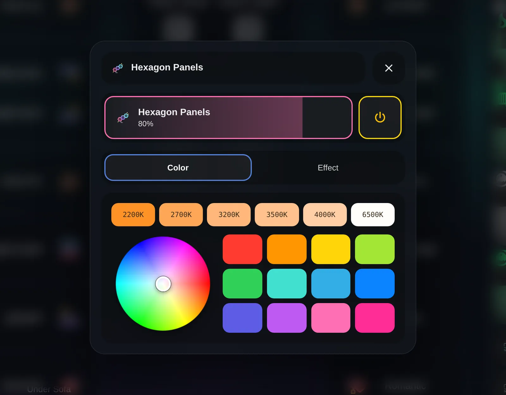

Long press a light tile. A big brightness bar and a power button at the top, tabs below:

**Colour:** white tones from 2200 K to 6500 K, a colour wheel and ready colours. **Effect:** the light's own effects. **Segment:** colour single segments of strips and lamps that have them.

Close it by tapping outside, with the back button, Esc or ✕. On phones it slides up from the bottom and closes when pulled down.

**Options**

- **Holding a light** (Light window · HA dialog · Effect screen): What opens on a long press of a light tile (Settings).
- **Light window from the bottom**: On phones the window slides up from the bottom and closes when pulled down (Choose a style → Phone).

### 4. Cover window

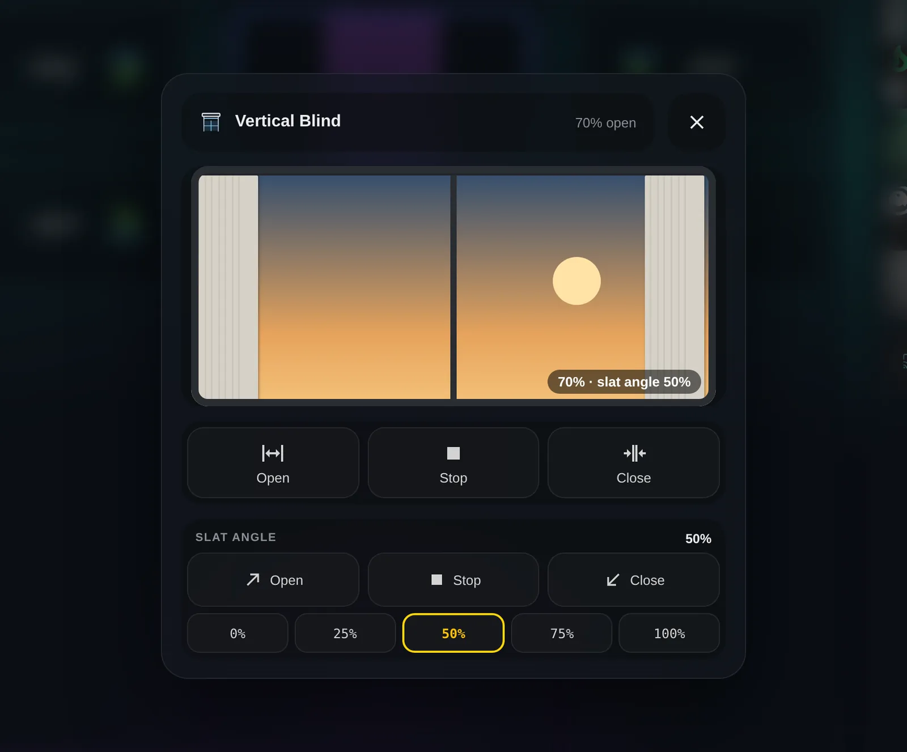

Long press a cover tile. The drawing shows the cover at its real position, with **Open**, **Stop**, **Close** below. While it moves, pressing the same button again stops it; drag the drawing to fine-tune the position.

There are six designs: center opening curtain, one-side curtain, shutter, roller shade, venetian blind and vertical blind. Pick one from the drawings in the cover's ⚙ settings.

Venetian and vertical blinds get a second row for the slat angle. If a separate motor turns the slats, pick it as the **Slat angle motor** in ⚙.

**Options**

- **Cover window** (Auto · Center opening · One side · Shutter · Roller shade · Venetian blind · Vertical blind): The drawing and buttons of the window. Auto picks from the device type.
- **Gathers to** (Left · Right · Both sides): For one-side curtains and vertical blinds, the side the cover gathers to.
- **Slat angle motor (optional)**: For venetian and vertical blinds, the cover entity of a separate slat motor. If it reports a position, 0-100% presets appear.

### 5. Scenes, climate, vacuum and media

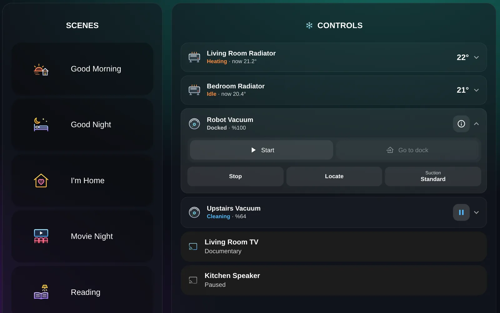

Scene buttons run a script, scene or automation with one tap; each has its own colour and icon.

Climate cards hold air conditioners and radiators: on/off, target temperature, mode and fan. Depending on the **Season** setting, air conditioners show in summer and radiators in winter.

The media section holds TVs and speakers; a tap opens the device window.

The vacuum card starts, stops and sends it to the dock. In Choose a style pick **Halo** (big ring cards) or **Simple** (one row per device that expands when tapped).

**Options**

- **Season** (Automatic · Summer · Winter): Air conditioners in summer, radiators in winter. Automatic: May to September is summer (Settings).
- **Climate and vacuum cards** (Halo · Simple): Halo shows big ring cards; Simple shows one row per device that expands when tapped (Choose a style).
- **Type** (Automatic · Air conditioner · Radiator): Whether a climate item is an air conditioner or a radiator (item ⚙).
- **Temperature sensor**: The room temperature shown on the card; empty uses the device's own value.
- **Humidity sensor**: The humidity shown on the card.
- **Outdoor temperature sensor**: The radiator card shows the heating need when it is cold outside.
- **Device controlled together**: A second device that gets the same commands (e.g. a second radiator in the room).

### 6. Cameras

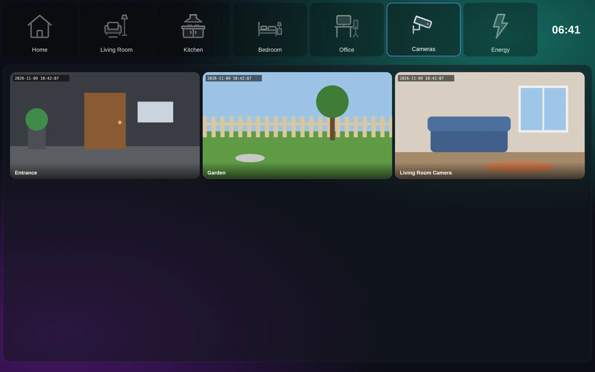

A camera tile shows a snapshot and refreshes it every few seconds (5 s to 1 min in the item settings). It does not refresh while the tab is not on screen.

Tap the tile and the live view opens in the largest window that fits the screen.

**+ Tab → Cameras tab** gathers every camera in one tab; choose how many cameras sit in a row.

**Options**

- **Picture refresh** (5 s · 10 s · 30 s · 1 min): How often one camera refreshes (item ⚙).
- **Picture refresh**: The same setting for every camera in the section (section settings).
- **Cameras per row** (Auto · 1 · 2 · 3 · 4): Cameras per row; Auto fits as many as the box allows (at most 2 on phones).
- **Cameras tab**: In the + Tab menu: every camera in one tab.

### 7. Feeding card

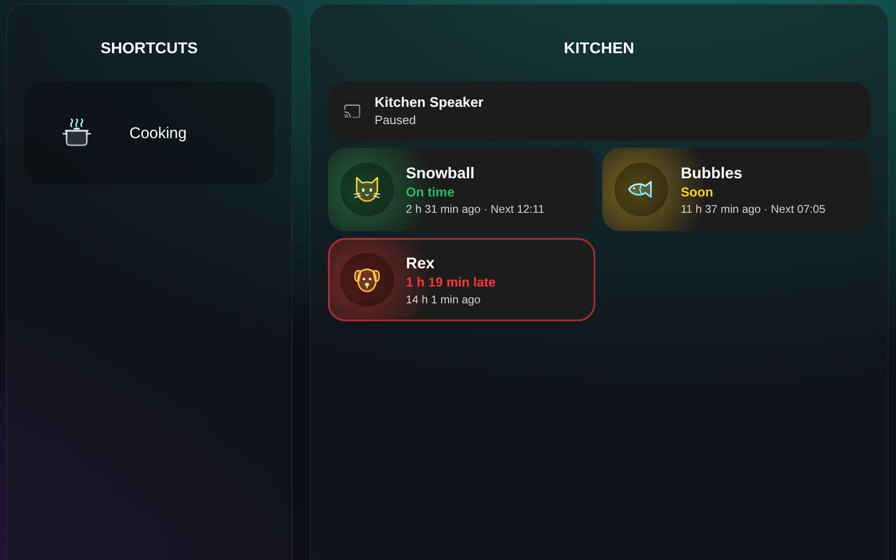

Feeding tracking for your pets: every N hours or at set times of day.

The card is green on time, yellow when it is close, orange when it is due and red when late. Tap to log "Fed" (tap again within 10 s to undo), long press for the last feedings.

It can send a notification when late and run an automatic feeder. Add it to a section as a **Pet**.

For every pet Home Assistant gets a "<name> feeding" state and a "<name> fed" button to use in automations.

**Options**

- **Kind** (Cat · Dog · Fish · Bird · Rabbit · Turtle · Other): Sets the card's icon.
- **When to feed** (Every N hours · At set times of day): The feeding schedule.
- **Every how many hours**: The interval for Every N hours.
- **Times (comma separated)**: The times for At set times of day (e.g. 08:00, 20:00).
- **Soon warning (min before)**: How many minutes before the card turns yellow.
- **Grace time (min)**: How long after the time before it turns red.
- **Notify when late**: Sends a Home Assistant notification when late.
- **Automatic feeder (optional)**: Runs a service when you log a feeding (e.g. a feeder button).

### 8. Energy

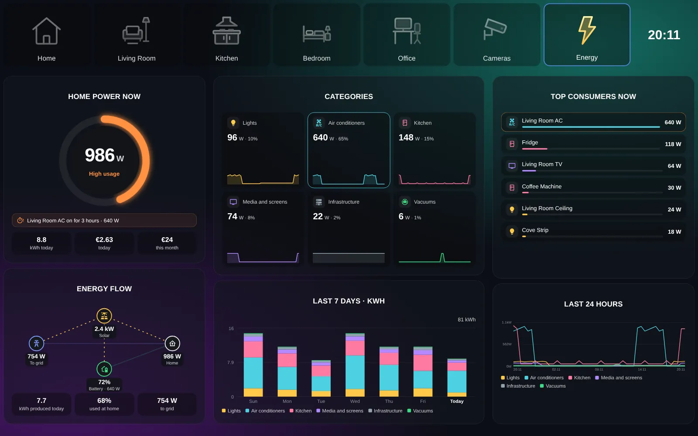

Home power now, categories, the devices drawing the most right now, daily usage and the last 24 hours in one tab. The data comes from "Individual devices" in Home Assistant's Energy settings and from its own history; the dashboard keeps no records of its own.

The Halo ring turns from green to red with usage. Tap a category tile for that category's devices, tap a device row for its more-info window. The standby card shows what the home draws when nothing is in use, and what that adds up to in a year.

**+ Tab → Energy tab** sets up a ready tab; cards can also be added one by one to a section as an **Energy card**. Price, bills and estimated devices are on the **Energy** page in the top bar (next step).

Light and plug tiles can also show live watts in their corner (Energy → Look → Watts on light tiles).

**Options**

- **Card** (Home power now · Category tiles · Top consumers now · Daily usage · Last 24 hours · Standby usage): Added to a section as an Energy card; change its kind with the item ⚙.
- **Details below**: Under the Halo: today's kWh, cost and this month's cost (without a price, monthly usage at this rate).
- **Tier and yearly limit bars**: Under the Halo: this month's tier bar and the last 12 months against the yearly limit.
- **Columns** (2 · 3 · 4): Category tiles per row (2 on phones).
- **Small chart** (24 hours · 7 days · None): The small chart on a category tile.
- **How many devices** (3 · 5 · 6 · 8 · 10): How many devices the top consumers list shows.
- **Category**: Limits the list to one category.
- **Hide idle devices**: Devices under 2 W are not listed.
- **Days** (7 · 30): How many days the daily usage chart shows.
- **Unit** (kWh · Money): Daily usage in kWh or money.
- **Lines** (Categories · Total): Last 24 hours as category lines or one total.
- **Energy tab**: In the + Tab menu: a ready Energy tab.

### 9. Light effects (optional)

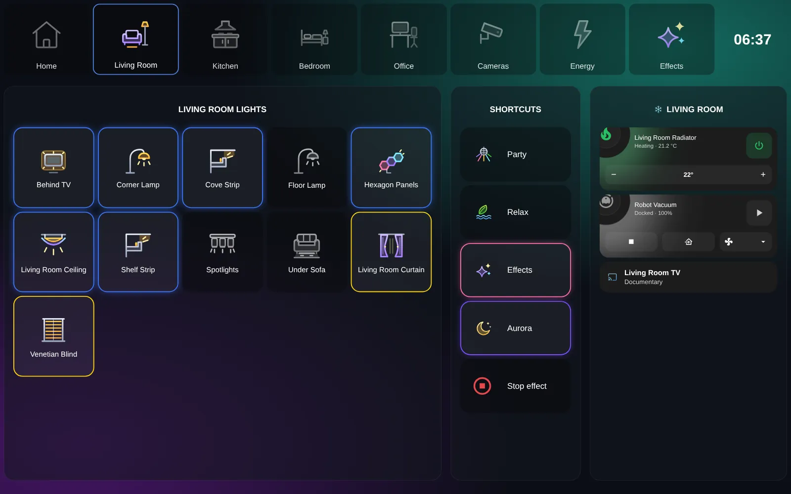

If Lemur Light Effect Card is installed too, the dashboard finds it by itself: an **Effects** button appears in the top bar and opens the effect screen for that tab's room.

Effect buttons can be added to scenes; while an effect plays, the room's light tiles glow in its colours.

If it is not installed these buttons do not show and nothing else changes.

**Options**

- **Effects in the top bar**: The button in the top bar that opens the effect screen (Choose a style → Light effects).
- **Effects inside the aligned area**: Keep Effects inside the aligned area when room buttons are aligned to a column (Settings).
- **Effect screen**: A scene button that opens the effect screen.
- **Stop effect**: A button that stops the room's effect.
- **Effect screen**: A long press on a light opens the effect screen directly (Settings → Holding a light).

### 10. On phones

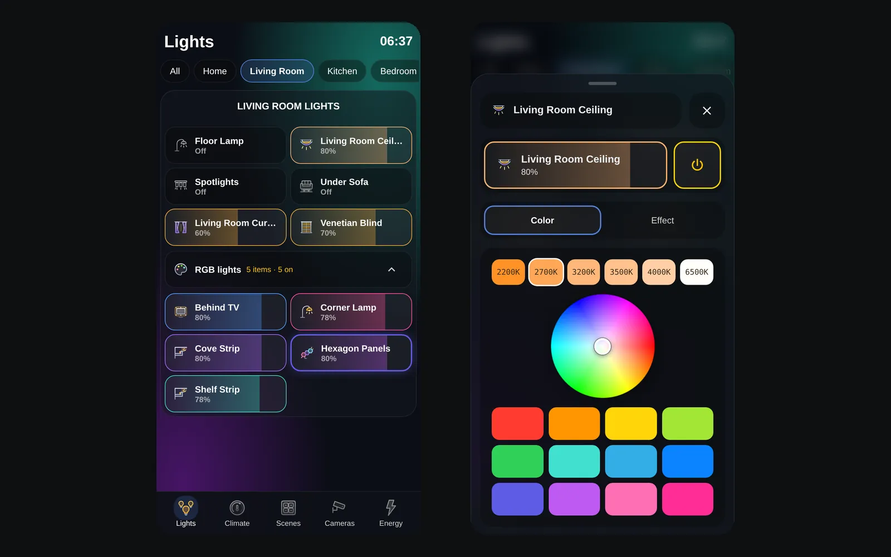

The same dashboard switches to a phone layout by itself; no second dashboard needed.

Navigation can be categories at the bottom (Lights, Climate, Scenes, Cameras), rooms at the bottom or rooms at the top. Lights as tiles or one per row; the light window slides up from the bottom.

In the Lights category swipe the room strip on top to move between rooms; **All** shows every light in the home.

All of it is in **Choose a style → Phone**; the tablet is not affected.

**Options**

- **Navigation** (Categories at the bottom · Rooms at the bottom · Rooms on top): Navigation on phones.
- **Lights** (As in the section · Tiles · One per row): Lights on phones.
- **Light window from the bottom**: The light and cover windows slide up from the bottom.

## Editing

### 11. Admin panel

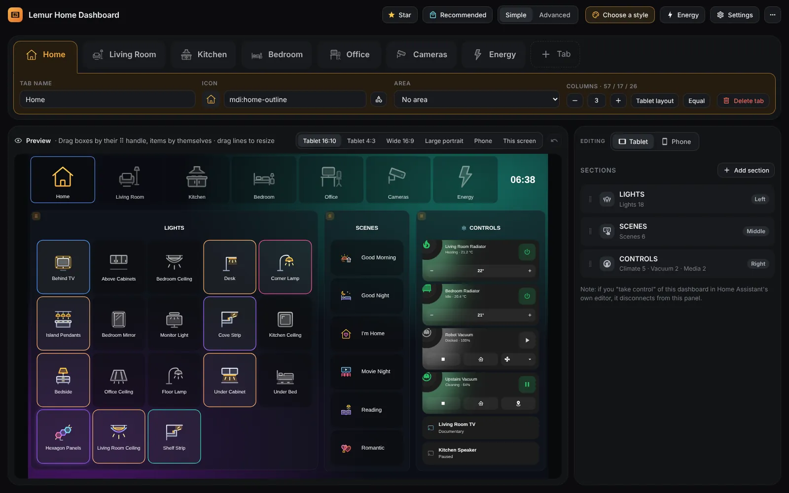

**Lemur Home Dashboard** in the sidebar (admins only). Tabs at the top, a live preview on the left, the selected tab's sections on the right.

Your first change saves the automatic layout; from then on everything is edited here. Every change can be undone (button or Ctrl+Z).

**Simple** mode shows only the basics; **Advanced** also opens size, colour, condition and card settings. The **?** next to harder settings explains them with an example.

**Options**

- **Simple**: The basics: tabs, sections, devices, name, icon, look, on tap.
- **Advanced**: Also opens size, colour, condition, custom action, card and layout settings; nothing is deleted.
- **Preview** (Tablet 16:10 · Tablet 4:3 · Wide 16:9 · Phone · This screen): The preview screen.
- **Editing** (Tablet · Phone): Whether changes go to the tablet or only to phones.
- **Undo**: Every change can be undone (Ctrl+Z).

### 12. Tabs

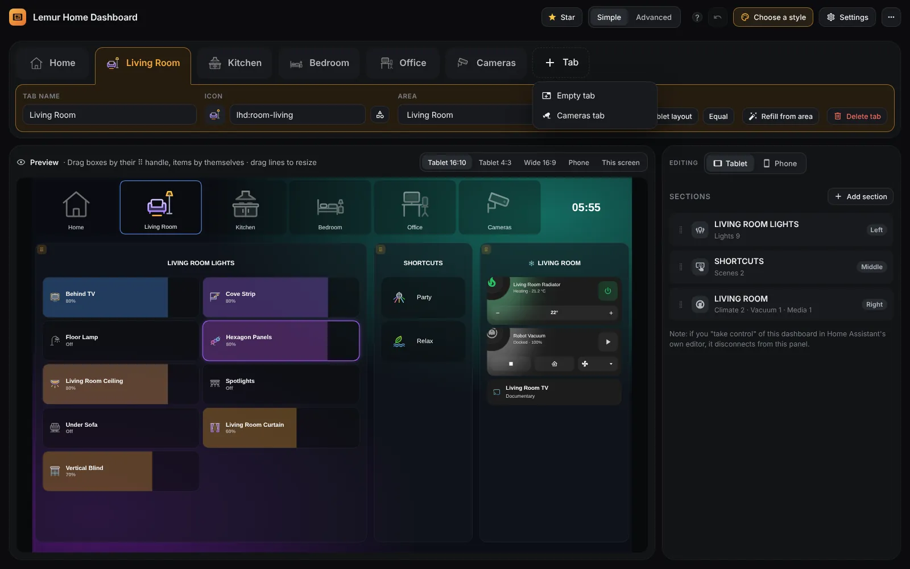

Tabs on top, the selected tab's settings below. Every tab is a room button in the dashboard's top bar.

Drag tabs to reorder them. A tab tied to an area uses that room for the effect screen and brightness on the clock.

**Options**

- **Tab name**: The name on the room button.
- **Icon**: The room button's icon.
- **Area**: The tab's room: the effect screen and brightness on the clock use it.
- **Refill from area**: Rebuilds the tab from the devices of the chosen area.
- **Columns**: 1 to 6 columns; drag the lines in the preview for widths.
- **Tablet layout** (Tablet layout · Equal): Ready column ratios.
- **Columns inside**: Splits a column into 2-3 columns of its own (advanced).
- **Tab** (Empty tab · Tab from area · Cameras tab): A new tab.
- **Delete tab**: Deletes the tab (asks first, can be undone).

### 13. Auto setup

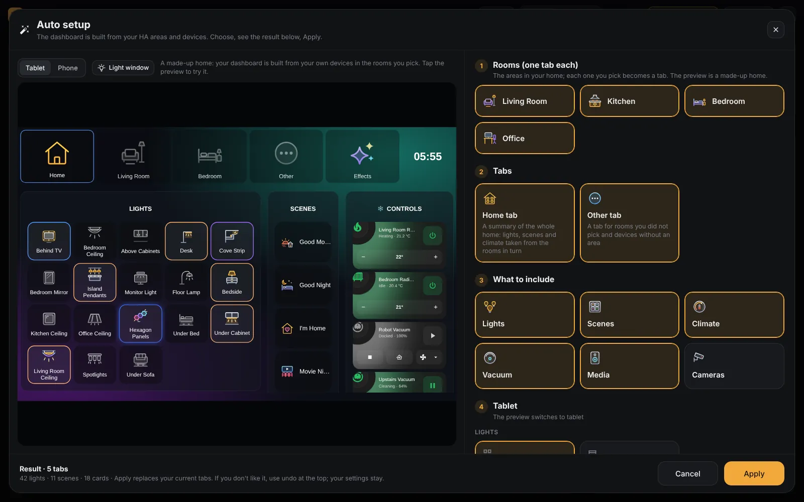

**⋯ → Auto setup** builds the dashboard from the areas and devices in your home. You see the result in the preview while choosing.

The preview uses an imaginary home; applying builds the dashboard with your own rooms and devices.

**Options**

- **Rooms (one tab each)**: Every selected room becomes a tab.
- **Home tab**: A summary of the whole home: lights, scenes and climate from each room.
- **Other tab**: A tab for unselected rooms and devices without an area.
- **What to include** (Lights · Scenes · Climate · Vacuum · Media · Cameras): Which sections go into the tabs.
- **Look** (Tiles · Slider bars · Bars on phones): How lights look.
- **Climate and vacuum cards** (Halo · Simple): Climate and vacuum cards.
- **Phone** (Categories at the bottom · Rooms at the bottom · Rooms on top): Navigation on phones (shown when the preview is switched to Phone).
- **Light window** (From the bottom · In the middle): The light window on phones.
- **Background**: Background; if you pick none the current one stays.
- **Light effects** (Effects on · Effects hidden): The Effects button (when Light Effect Card is installed).
- **Apply**: Replaces the current tabs; settings stay and undo brings them back.

### 14. Adding devices

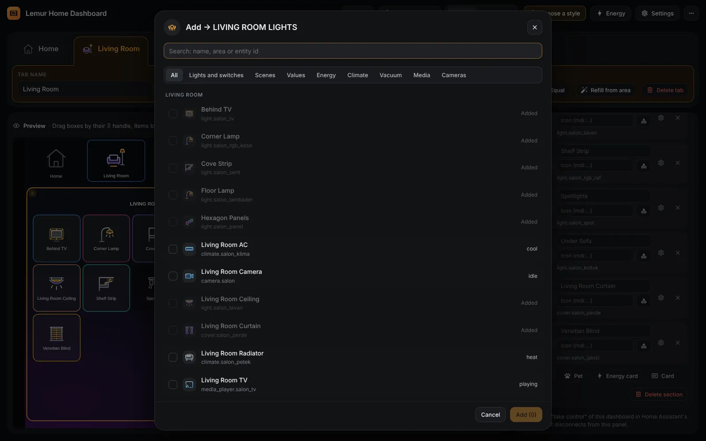

Press **Add** in a section. The picker lists every device in the home; the filter on top (Lights and switches, Scenes, Values, Climate, Vacuum, Media, Cameras) narrows it.

Add several at once. Scripts, scenes and automations become coloured buttons; sensors become value tiles.

The **Card** button lists Halo cards, Home Assistant cards and installed custom cards.

**Options**

- **All** (All · Lights and switches · Scenes · Values · Climate · Vacuum · Media · Cameras): The picker's filter.
- **Add**: Pick from the home's devices; several at once.
- **Card**: A Halo card, a Home Assistant card or an installed custom card.
- **Pet**: A feeding card.
- **Subtitle**: A small heading inside the section.
- **Empty tile** (Empty tile · Empty button): A placeholder tile or button (give it an action in ⚙).

### 15. Item settings

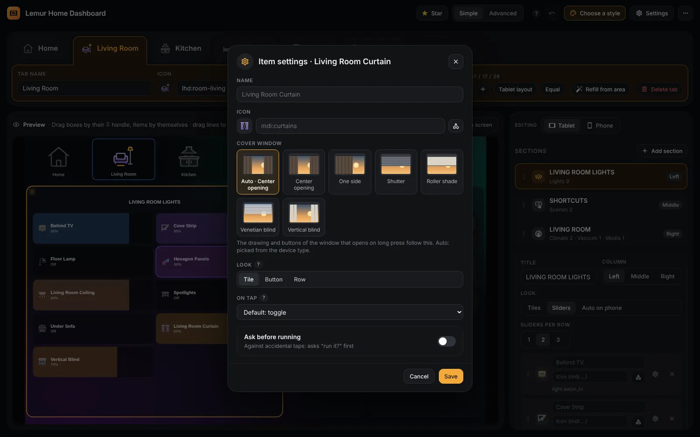

The ⚙ next to every item: name, icon, **Look** (tile, button, row), what a **Tap** and a **Long press** do.

Tap or long press: device window, toggle, run a service, open a card in a window or nothing.

Type-specific settings live here too, such as the cover design or how often a camera refreshes.

**Options**

- **Name**: The name shown on the dashboard; templates allowed.
- **Icon**: From the dashboard's icon set or an mdi:... name.
- **Icon when on** (Icon when on · Icon when off): Separate icons for on and off on value items (advanced).
- **Look** (Tile · Button · Row · Halo): How the item is drawn; the choices depend on its type.
- **On tap** (More info · Toggle · Call a service · Open a card in a window · Nothing · Advanced (YAML)): What a tap does.
- **On hold**: What a long press does; same choices.
- **Ask before running**: Asks "run it?" first; the question can be written.

### 16. Energy page

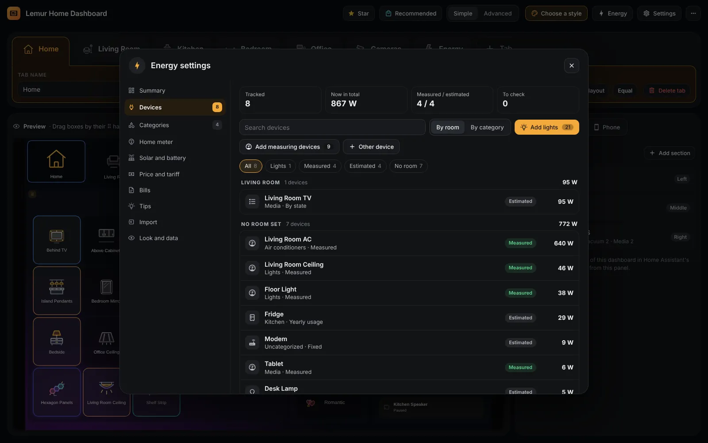

The **Energy** button in the top bar opens price, bills, estimated devices and the look of the cards on their own page. **Summary** shows this month's usage and cost, the yearly limit, the last bill and the estimated devices.

**Price and tariff:** price from the last bill, one price or tiered (lower and upper price and a daily limit; the month's limit is the daily limit × days). The yearly limit follows the year (4,000 kWh in 2026, 3,000 kWh from 2027) or is entered by hand.

**Bills:** enter the period, kWh and amount. The dashboard adds up what it measured in that period; the difference becomes a grey **Not measured** category tile. The usage of the last 12 months starts the yearly limit tracking.

**Estimated devices:** for devices that do not measure power: light (standby and max W, by brightness), on/off, fixed, yearly usage (the label's kWh/year) or cycles (kWh/100 cycles). Each gets a power and an energy sensor in Home Assistant and is added to the Energy settings inside the chosen category. Cards show them with "~".

**Options**

- **Price** (From the bill · One price · Tiered): Where the cost on the cards comes from. From the bill: the last bill's amount ÷ kWh.
- **Daily limit**: The daily average limit for tiers (default 8 kWh); this month's limit is worked out from it.
- **Yearly limit** (By year · Manual): Past 85% of the limit the bar under the Halo turns yellow.
- **Add bill**: Period start and end, kWh and the total amount.
- **Usage of the last 12 months (kWh)**: From the chart on the back of the bill.
- **Kind** (Light · On / off · Fixed · Yearly usage · Cycles): How the estimate is worked out. Example: a 2-60 W light at 30% is 19.4 W; a 250 kWh/year fridge averages 28.5 W.
- **Category**: Which category it goes into in the Energy settings.
- **Total home power** (Sum of categories): Data source: the total power Halo shows.
- **Standby power** (Lowest of the last 24 hours): Data source: the standby card's power.
- **Halo colour limits (W)**: Look: Halo's green, yellow and orange limits (default 300 / 800 / 1800 W).
- **Watts on light tiles** (Off · When on · Always): Look: live watts on tiles of lights and plugs that measure power or have an estimate.
- **Mark estimated values**: Look: estimated watts with "~" in purple.
- **Not measured tile**: Look: the share not measured as a category tile.

### 17. Cards and values

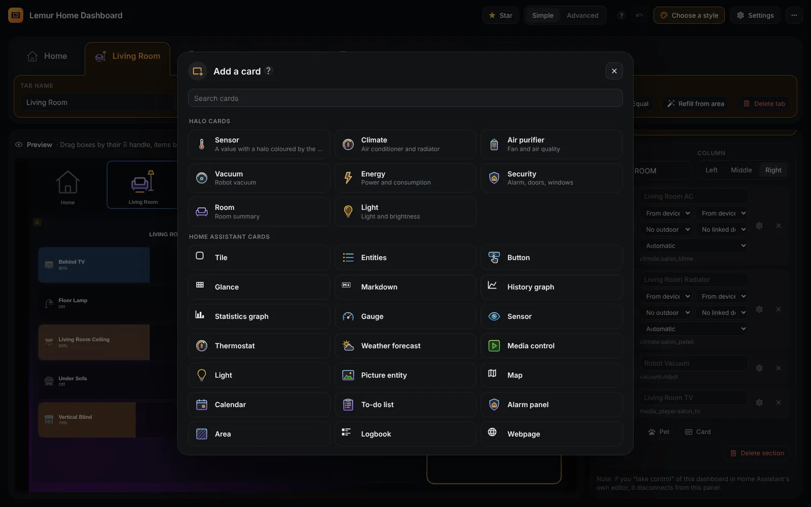

Values such as sensors, timers and counters, and any card, can go into a section.

Value tiles show an icon, value and name; a running timer counts down. Cards come from Halo cards, Home Assistant cards or installed custom cards.

**Options**

- **Card** (Halo cards · Home Assistant cards · Installed custom cards · Write YAML): The card picker.
- **Visual** (Visual · YAML): The chosen card opens with its visual editor and live preview; or YAML.
- **Height** (Auto · 1 · 1.5 · 2): Height of card and Halo items (rows).
- **Open a card in a window**: Given to a button, the card opens in the dashboard's window like the light window.
- **Second line** (State · Last changed · Attribute · Text or template): The second line of a value item.
- **Name on top, value below**: On value items, name on top and value below.
- **Halo**: Shows a numeric value as a Halo sensor card.
- **Colour by value**: 4 limits, 5 colours: frame, value and icon colour by value.
- **Colour by state**: Maps an entity's state to a colour; works with text values too.

### 18. Sections and columns

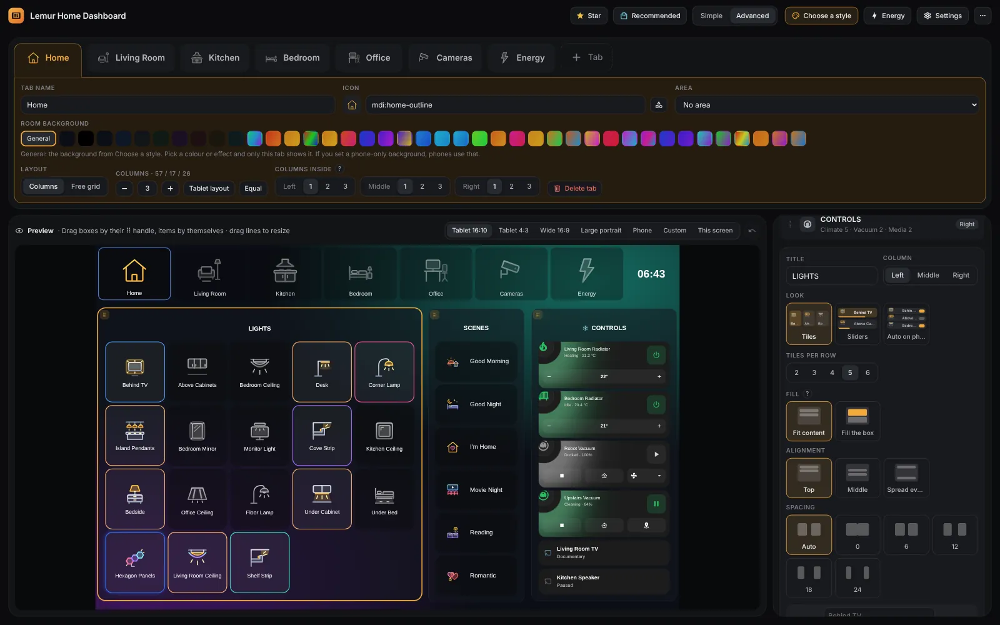

Sections are free: anything can go into any box, and each item shows in its own way.

Drag a section by its handle in the preview to another column; drag an item itself to reorder it or move it to another section. Drag the lines to change column widths.

The section settings hold its title, column, look (tiles, sliders), tiles per row, fill and alignment.

**Options**

- **Title**: The section's title; can be empty.
- **Column**: The column the section sits in.
- **Fill** (Fit content · Fill the box): Whether buttons and tiles spread over the box's height.
- **Alignment** (Top · Middle · Spread evenly): Where content sits when it is shorter than the box.
- **Spacing** (Auto · 0 · 6 · 12 · 18 · 24): Space between items (pixels).
- **Delete section**: Deletes the section (asks first, can be undone).

### 19. Icon picker

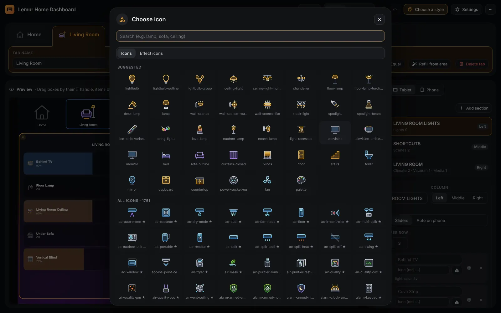

The button next to icon fields. Pick from the dashboard's colour icon set; icons that fit the thing come first, and search understands Turkish words too.

★ marks drawings made for this dashboard. With Light Effect Card installed its effect icons can be picked too.

You can also type an `mdi:...` name directly.

**Options**

- **Suggested**: Icons that fit the thing come first.
- **All icons**: The whole set; search understands Turkish words too.
- **Effect icons**: Light Effect Card's effect icons when it is installed.

### 20. Choose a style

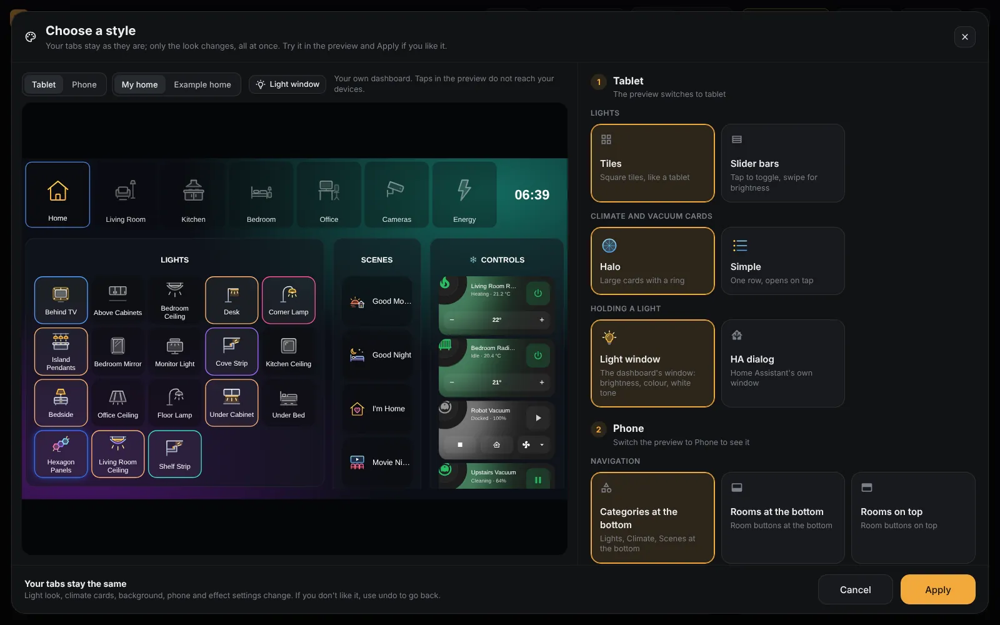

**Choose a style** in the top bar. Preview on the left, big options on the right; each choice shows in the preview at once and **Apply** saves them together.

**Tablet:** lights as tiles or sliders; climate cards Halo or Simple. **Phone:** navigation, lights, light window.

**Background:** 30 effect colours, dark, black, any colour or your own picture.

**Options**

- **My home** (My home · Example home): Preview your own dashboard or the example home.
- **Tiles** (Tiles · Sliders): Lights on the tablet.
- **Climate and vacuum cards** (Halo · Simple): Climate and vacuum cards on the tablet.
- **Navigation** (Categories at the bottom · Rooms at the bottom · Rooms on top): Navigation, lights and light window on phones.
- **Background** (Effect · Dark · Black · Colour · Image): The dashboard background.
- **Effect**: 30 effect colours: Meditation (default), Aurora, Fire, Sunset, Ocean and more.
- **Image**: A picture in HA's www folder (/local/background.jpg) or a web address.
- **Light effects**: Shows or hides the Effects button; explains the card if it is not installed.

### 21. Phone-only layout

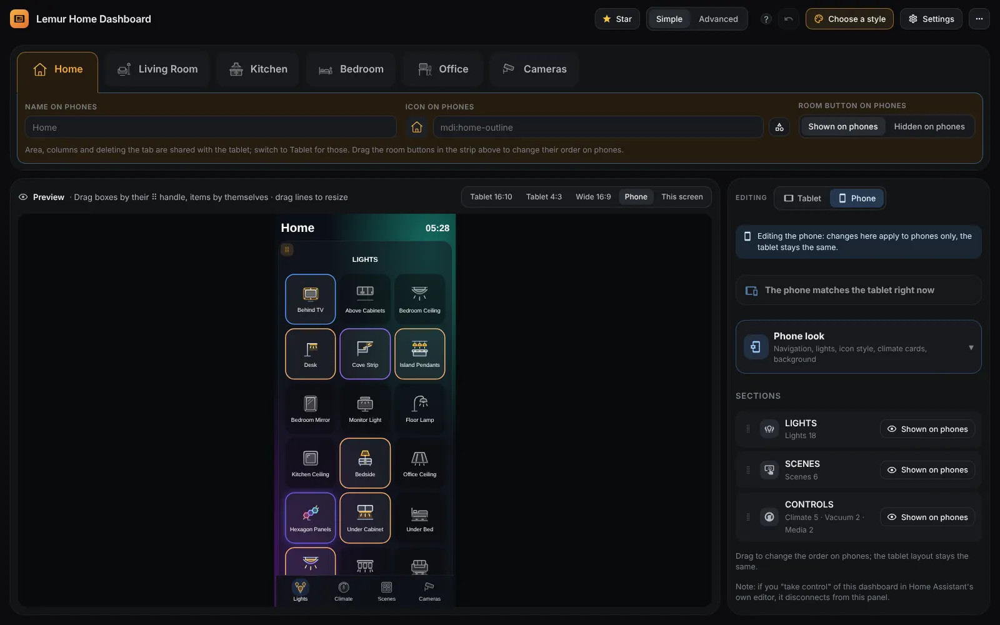

Switch to **Editing: Phone** in the admin panel: the preview becomes a phone and changes apply to phones only; the tablet stays the same.

On phones set the order and visibility of room buttons, sections and items, the look of sections, the icon style, climate cards and background.

Everything you change says "phone only". **Make the phone match the tablet** removes all phone-only settings (it asks first).

**Options**

- **Shown on phones** (Shown on phones · Hidden on phones): Show or hide a section on phones.
- **Look on phones** (Same as tablet · Tiles · One per row): A section's look on phones.
- **Tiles per row on phones** (Auto · 2 · 3 · 4 · 5): Tiles per row on phones.
- **Items shown on phones**: Hide single items on phones; drag them in the preview to reorder.
- **Name on phones** (Name on phones · Icon on phones · Room button on phones): A room button's name, icon and visibility on phones.
- **Icon style** (Icon style · Climate and vacuum cards · Background): A separate style for phones in the Phone look card.
- **Back to tablet**: Returns one setting to the tablet's.
- **Make the phone match the tablet**: Removes everything phone-only; asks first.

## More

### 22. Settings

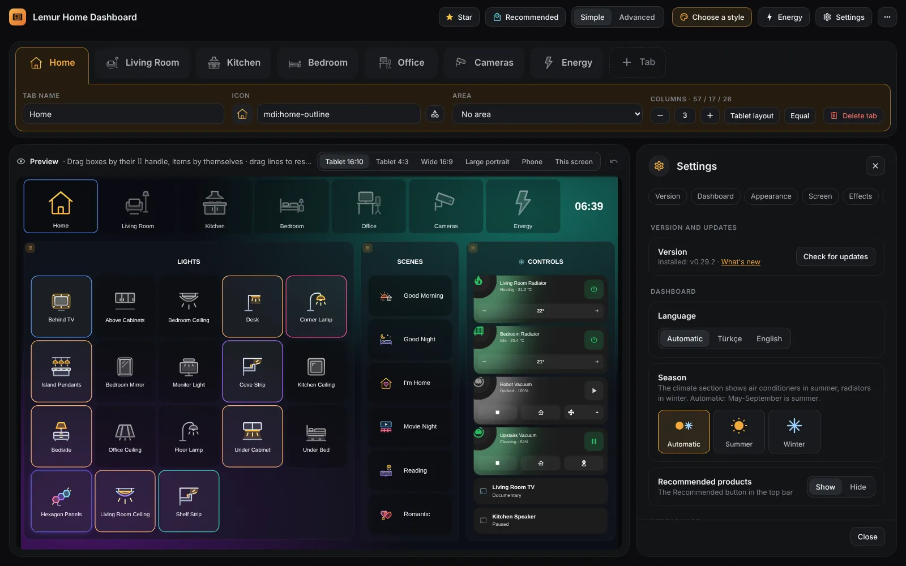

**Settings** at the top right apply to every tablet in the home: language, season, icon style, top bar, brightness on the clock, HA theme.

**Hide the top bar / Hide the sidebar** turn off Home Assistant's top bar and menu on this dashboard only, for kiosk use on a tablet.

Version and updates at the top: install a new version from here. **Backup** downloads everything in one file; **Report a problem** opens a GitHub issue.

**Options**

- **Version and updates**: Installed version, What's new and updates; download a new version and restart HA from here.
- **Language** (Automatic · Türkçe · English): The dashboard's language.
- **Icon style** (Automatic · Colourful · Flat · Single colour): How icons are coloured.
- **Light colour on lights**: In Single colour, a light that is on keeps its own colour.
- **Room button size**: Width and height of room buttons (default 235 × 155).
- **Align room buttons to a column**: Room buttons end at the chosen column's right edge and share the space evenly.
- **Brightness on the clock** (Hidden · Box): Swiping the clock area changes the brightness of every light that is on in the room.
- **Brightness indicator** (While swiping · Always): When the brightness indicator shows.
- **HA theme**: The HA theme used by pop-up windows.
- **Hide the top bar** (Hide the top bar · Hide the sidebar): Hides HA's top bar and sidebar on this dashboard (kiosk).
- **Canvas**: Design width and reference height; the dashboard scales to the screen with it (advanced).
- **Holding a light** (Light window · HA dialog · Effect screen): The window a long press on a light opens.
- **Report a problem**: Opens a GitHub issue with version and device details; no room, device or person names are added.
- **Download backup** (Download backup · Restore a backup): Tabs, sections, settings and pets in one file; restoring asks first.

### 23. Advanced settings

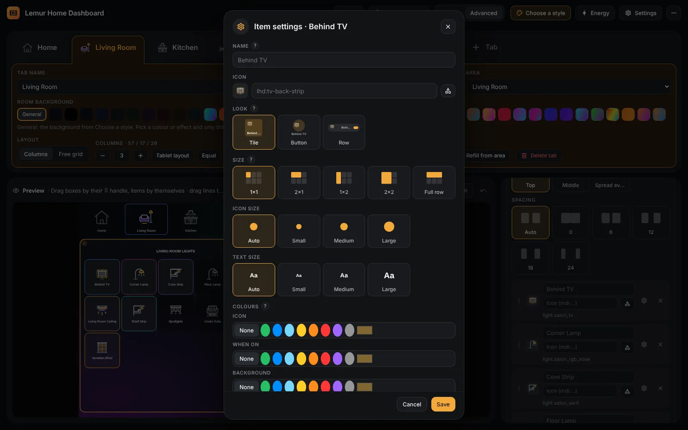

**Only show when:** the item shows while a chosen entity is in a given state. **Colour by value** and **Colour by state:** colour from a number or a state.

**Second line** and **templates:** the name and second line accept Home Assistant templates. **Ask before running:** the button asks first.

**Backup control:** the second copy of a lamp that shows up twice; if the lamp does not answer, the command goes through the backup. **Wall switches:** bind a signal-only relay to a lamp.

**Options**

- **Size** (1×1 · 2×1 · 1×2 · 2×2 · Full row): How much of the grid a tile takes.
- **Icon size** (Auto · Small · Medium · Large): Icon and text size.
- **Colours** (Icon · When on · Background): Icon colour, colour when on and background tint.
- **Only show when** (equals · is one of · is none of): The item shows only while the entity is in that state; otherwise no gap is left.
- **Second line**: The name and second line accept Home Assistant templates ({{ }}).
- **Backup control**: The second copy of a lamp that shows up twice; if it does not answer the command goes there and an orange dot appears.
- **Wall switches** (Brightness % · Kelvin): A signal-only relay is bound to a lamp; brightness and kelvin can be set for turning on (Settings, advanced).

### 24. Tips

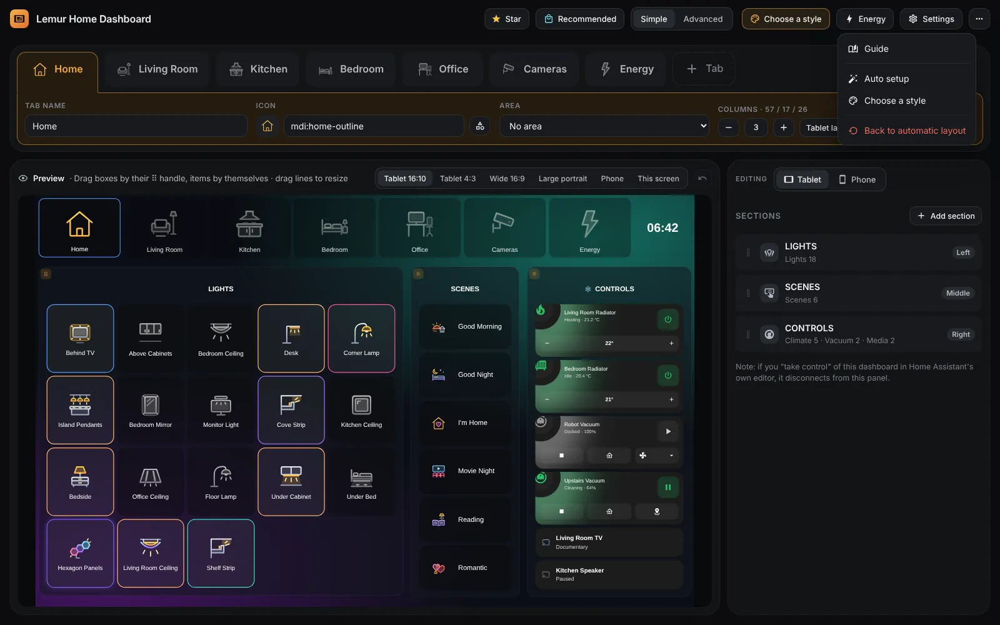

If something goes wrong, **Undo** (Ctrl+Z). **⋯ → Back to automatic layout** rebuilds everything.

If you choose "take control" for this dashboard in HA's own editor, it leaves this panel; always edit here.

This guide is always in **⋯ → Guide** and **Settings → Help**.

**Options**

- **Undo**: Takes back the last changes.
- **Back to automatic layout**: Deletes every tab and section and rebuilds from the home's areas; settings stay.
- **What's new**: Shows once after an update; open it again from Settings → Version.
- **Guide**: This guide.
