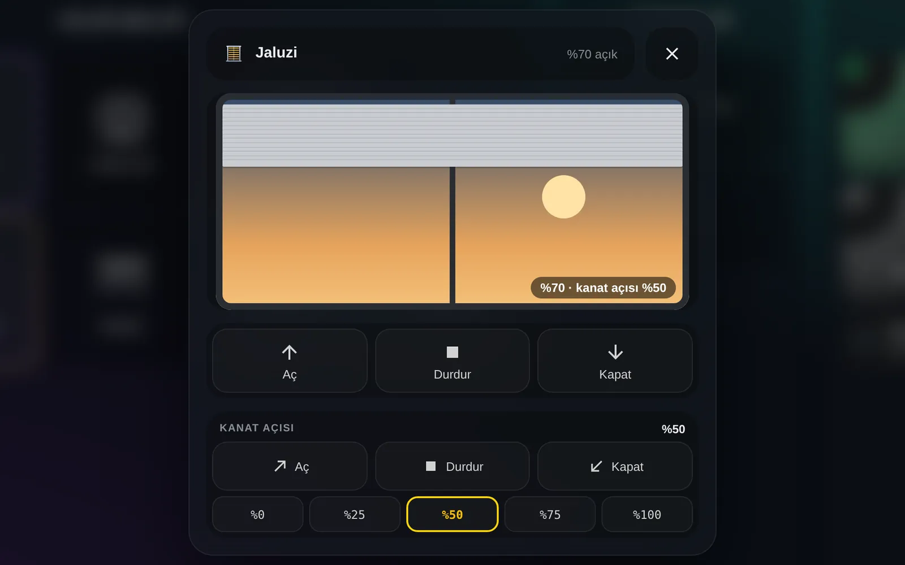
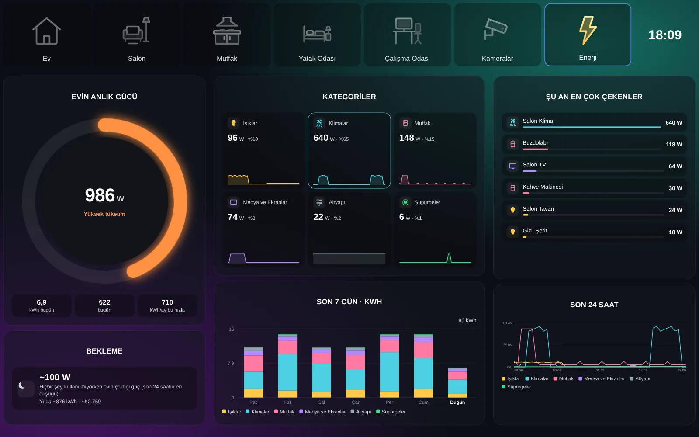
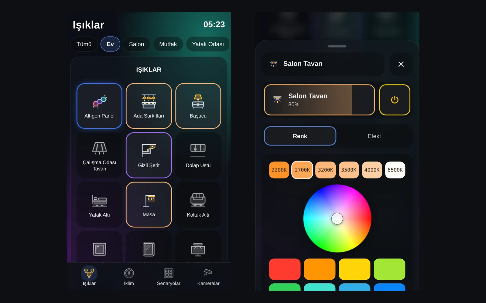
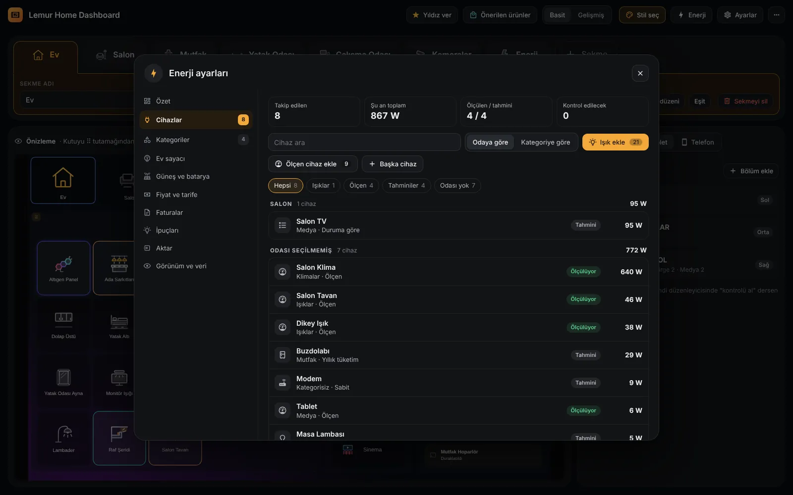
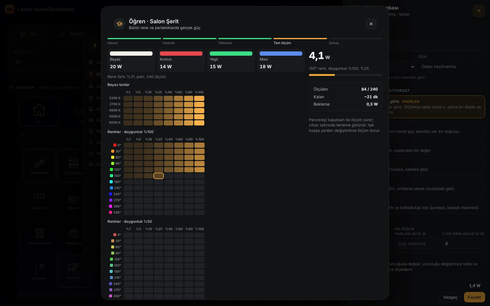
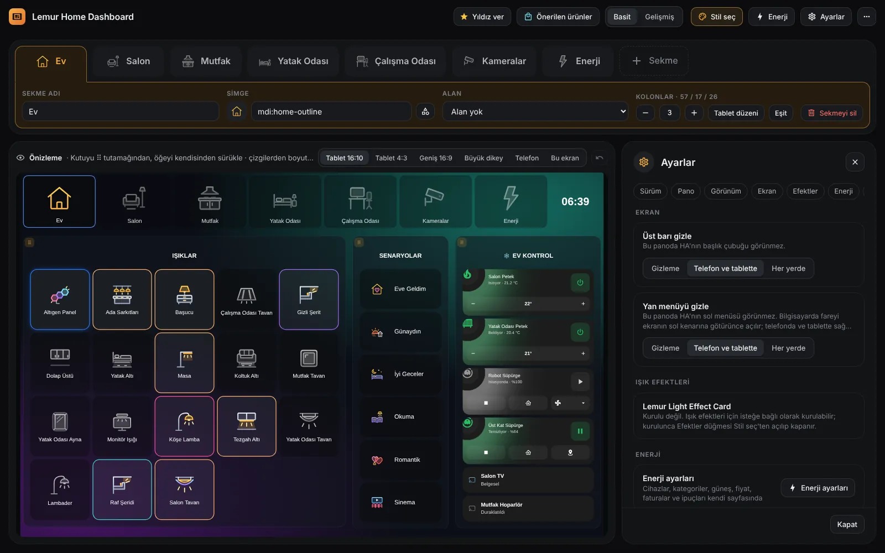
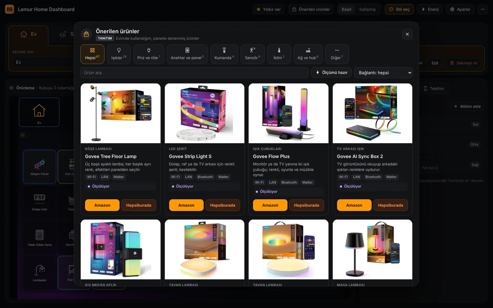

# Lemur Home Dashboard rehberi

Panonun yapabildiği her şey, sırayla. Aynı rehber yönetim panelinde **⋯ → Rehber**'de de var. [English](GUIDE.md)

## Kullanmak

### 1. Pano bir bakışta

Üstte oda düğmeleri ve saat, altında kolonlar. Her kolonda bir ya da birkaç bölüm var: ışıklar, senaryolar, iklim, süpürge, medya, kameralar, değerler ve kartlar.

Pano evindeki alanlardan kendiliğinden kurulur: bir **Ev** sekmesi (bütün evin ışıkları, senaryolar ve kontroller) ve her oda için bir sekme. Hiçbir şeye dokunmadan kullanabilirsin.

Oda düğmesine dokununca o odanın sekmesi açılır. Sekmede o odanın ışıkları, perdeleri, iklim cihazları ve odaya özel senaryolar durur.

### 2. Işıklar

Karoya dokun: ışık anında açılır ya da kapanır. Açık ışık kendi renginde çerçeveyle görünür, ulaşılamayan cihaz soluk durur.

**Kaydırmalı** görünümde her ışık yatay bir çubuktur: dokun aç/kapat, sağa sola kaydır parlaklık. Aynı bölümde priz, perde ve fan da olabilir; perdede kaydırınca konum, fanda hız değişir.

Karo mu çubuk mu olacağını Stil seç'ten ya da bölümün ayarından seçersin.

**Seçenekler**

- **Karo**: Kare karolar; dokun aç/kapat, basılı tut pencere.
- **Kaydırmalı**: Yatay çubuklar; sağa sola kaydırınca parlaklık (perdede konum, fanda hız).
- **Telefonda otomatik**: Tablette karo, telefonda kaydırmalı çubuk.
- **Satırdaki karo** (2 · 3 · 4 · 5 · 6): Karo görünümünde bir satıra kaç karo sığacağı.
- **Satırdaki çubuk** (1 · 2 · 3): Kaydırmalı görünümde yan yana kaç çubuk.

### 3. Işık penceresi

Işık karosuna basılı tut. Üstte büyük parlaklık çubuğu ve güç düğmesi, altında sekmeler:

**Renk:** 2200 K ile 6500 K arası beyaz tonlar, renk çemberi ve hazır renkler. **Efekt:** ışığın kendi efektleri. **Segment:** segmentli şerit ve lambalarda tek tek segmente renk.

Pencere dışarı dokununca, geri tuşuyla, Esc ya da ✕ ile kapanır. Telefonda alttan açılır, aşağı çekince kapanır.

**Seçenekler**

- **Işığa basılı tutunca** (Işık penceresi · HA penceresi · Efekt ekranı): Işık karosuna basılı tutunca ne açılsın (Stil seç → Tablet).
- **Işık penceresi alttan**: Telefonda pencere ekranın altından gelir, aşağı çekince kapanır (Stil seç → Telefon).

### 4. Perde penceresi

Perde karosuna basılı tut. Ortadaki çizim perdenin gerçek konumunu gösterir, altında **Aç**, **Durdur**, **Kapat**. Perde hareket ederken aynı düğmeye yeniden basınca durur; çizimi sürükleyerek konumu ince ayarlarsın.

Altı tasarım var: ortadan açılan perde, tek yönden açılan perde, panjur, stor, jaluzi ve dikey stor. Perdenin ⚙ ayarında çizimli kartlardan seçilir.

Jaluzi ve dikey storda kanat açısı için ikinci bir sıra çıkar. Kanatları ayrı bir motor döndürüyorsa ⚙'de **Kanat açısı motoru** olarak seçilir.

**Seçenekler**

- **Perde penceresi** (Oto · Ortadan açılan · Tek yönden · Panjur · Stor · Jaluzi · Dikey stor): Pencerenin çizimi ve düğmeleri. Oto, cihazın türünden seçer.
- **Toplanma yönü** (Sola · Sağa · İki yana): Tek yönden açılan perde ve dikey storda perdenin toplandığı taraf.
- **Kanat açısı motoru (isteğe bağlı)**: Jaluzi ve dikey storda kanatları döndüren ayrı motorun perde varlığı. Konum bildiriyorsa %0-100 hazır açılar çıkar.

### 5. Senaryolar, iklim, süpürge ve medya

Senaryo düğmeleri bir betiği, sahneyi ya da otomasyonu tek dokunuşla çalıştırır; her birinin kendi rengi ve simgesi var.

İklim kartlarında klima ve petekler: aç/kapat, hedef sıcaklık, mod ve fan. **Mevsim** ayarına göre yazın klimalar, kışın petekler görünür.

Medya bölümünde TV ve hoparlörler; dokununca cihaz penceresi açılır.

Süpürge kartı başlatır, duraklatır, istasyona gönderir. Stil seç'te **Halo** (büyük halkalı kartlar) ya da **Sade** (her cihaz tek satır, dokununca genişler) seçilir. Açık Sade satırda düğmeler büyük: süpürgede Başlat/Duraklat ve İstasyona dön, altında Durdur, Bul, Emiş; iklimde Güç, Mod, Fan, Salınım.

**Seçenekler**

- **Mevsim** (Otomatik · Yaz · Kış): İklim bölümünde yazın klimalar, kışın petekler. Otomatik: Mayıs-Eylül yaz (Ayarlar).
- **İklim, süpürge ve değer kartları** (Halo · Sade): Halo büyük halkalı kartlar; Sade her cihazı tek satırda gösterir, dokununca genişler (Stil seç).
- **Tür** (Otomatik · Klima · Petek): İklim öğesinin türü (öğe ⚙).
- **Sıcaklık sensörü**: Kartta gösterilecek oda sıcaklığı; boşsa cihazın kendi değeri.
- **Nem sensörü**: Kartta gösterilecek nem.
- **Dış sıcaklık sensörü**: Petek kartı dışarısı soğukken ısıtma ihtiyacını gösterir.
- **Birlikte kontrol edilen cihaz**: Aynı komutu alan ikinci cihaz (ör. aynı odadaki ikinci petek).

### 6. Kameralar

Kamera karosu anlık görüntüyü gösterir ve birkaç saniyede bir yeniler (öğe ayarından 5 sn ile 1 dk arası). Sekme ekranda değilken görüntü yenilenmez.

Karoya dokununca canlı görüntü ekrana sığan en büyük pencerede açılır.

**+ Sekme → Kameralar sekmesi** evdeki bütün kameraları tek sekmede toplar; satırda kaç kamera olacağı seçilir.

**Seçenekler**

- **Görüntü yenileme** (5 sn · 10 sn · 30 sn · 1 dk): Tek kameranın görüntü yenileme aralığı (öğe ⚙).
- **Görüntü yenileme**: Bölümdeki bütün kameralar için aynı ayar (bölüm ayarı).
- **Satırda kaç kamera** (Oto · 1 · 2 · 3 · 4): Satırda kaç kamera; Oto kutuya sığdığı kadar (telefonda en fazla 2).
- **Kameralar sekmesi**: + Sekme menüsünde: bütün kameralar tek sekmede.

### 7. Besleme kartı

Evcil hayvanların için besleme takibi: her N saatte bir ya da günün belli saatlerinde.

Kart zamanında yeşil, yaklaşınca sarı, zamanı gelince turuncu, gecikince kırmızı. Dokununca "Besledim" kaydedilir (10 sn içinde yeniden dokununca geri alınır), basılı tutunca son beslemeler açılır.

Gecikince bildirim gönderebilir ve isteğe bağlı otomatik yemliği çalıştırabilir. Bölüme **Evcil hayvan** olarak eklenir.

Home Assistant'ta her hayvan için "<ad> besleme" durumu ve "<ad> besledim" düğmesi oluşur; otomasyonlarda kullanılabilir.

**Seçenekler**

- **Tür** (Kedi · Köpek · Balık · Kuş · Tavşan · Kaplumbağa · Diğer): Kartın simgesi buna göre.
- **Ne zaman beslenir** (Her N saatte bir · Günün belli saatlerinde): Besleme düzeni.
- **Kaç saatte bir**: Her N saatte bir düzeninde aralık.
- **Saatler (virgülle)**: Günün belli saatlerinde düzeninde saatler (ör. 08:00, 20:00).
- **Yaklaşıyor uyarısı (dk önce)**: Kart kaç dakika önceden sarıya döner.
- **Gecikme payı (dk)**: Zamanı geçtikten sonra kırmızıya dönmeden önceki süre.
- **Gecikince bildirim**: Gecikince Home Assistant bildirimi gönderir.
- **Otomatik yemlik (isteğe bağlı)**: (Gelişmiş) "Besledim"e basınca bir servis de çalışır (ör. yemlik düğmesi).

### 8. Enerji

Evin anlık gücü, kategoriler, şu an en çok çeken cihazlar, günlük tüketim ve son 24 saat tek sekmede; güneş enerjisi ya da batarya olan evde enerji akışı ve batarya. Cihazlar ve kategoriler panelin Enerji sayfasından gelir (yoksa Home Assistant'ın Enerji ayarlarındaki "Cihaz tüketimi" listesinden); grafikler Home Assistant'ın kendi kayıtlarından.

Halo halkası tüketime göre yeşilden kırmızıya döner. Kategori karosuna dokununca o kategorinin cihazları, cihaz satırına dokununca cihaz penceresi açılır. Bekleme kartı hiçbir şey kullanılmıyorken evin çektiği gücü ve yıllık karşılığını gösterir.

**+ Sekme → Enerji sekmesi** hazır bir sekme kurar. Kartlar bir bölüme **Enerji kartı** ile tek tek de eklenir. Her kartın beş görünümü var; seçerken her biri senin verinle küçük önizleme olarak çizilir. Kutu küçülünce kart sadeleşir.

Enerji değerleri her bölüme eklenebilir: evin şu anki gücü, bugünkü tüketim, bugünün ve bu ayın tutarı, dönem sonu tahmini, yılın toplamı, ölçülmeyen pay, her odanın gücü ve bugünkü tüketimi. Enerji kartı menüsünün üstünde ya da Cihaz ekle → Enerji'de. Bölüme uyan görünümle gelir: ışıkların yanında karo, senaryoların yanında düğme, iklim kartlarının yanında Halo.

Evin ve odaların toplamı Home Assistant'ta gerçek sensördür (sensor.lhd_ev_power, sensor.lhd_oda_<oda>_power ve _energy); otomasyonlarda kullanılır. Işık ve priz karolarının köşesinde anlık watt da gösterilebilir (Enerji → Görünüm ve veri → Işık karosunda watt); ışık grubunda bu, gruptaki ışıkların toplamıdır.

**İpuçları** bildirim göndermez: Halo'nun altında tek satırda sırayla döner (ör. "Klima 3 saattir açık"), ilgili cihazın satırının kenarı turuncu olur. Dokununca cihaz açılır, basılı tutunca o ipucu o ekranda bir daha görünmez.

**Seçenekler**

- **Kart** (Evin anlık gücü · Kategori karoları · Şu an en çok çekenler · Günlük tüketim · Son 24 saat · Bekleme tüketimi · Güneş ve şebeke akışı · Batarya · Bu ay ve tarife · Ev sayacı · İpuçları): Bölüme Enerji kartı olarak eklenir; öğe ⚙ ile türü değişir. Akış ve batarya kartları Enerji sayfasında güneş ya da batarya açılınca dolar.
- **Görünüm**: Her kartta beş görünüm (ör. Evin anlık gücü: halka, gösterge, dağılım halkası, sayı ve eğri, seviye çubuğu). İlki kartın varsayılan çizimi.
- **Altındaki bilgiler**: Halo'nun altında bugünkü kWh, para ve bu ayın tutarı (fiyat yoksa bu hızla aylık tüketim).
- **Kademe ve yıllık sınır çubukları**: Halo'nun altında bu ayın kademe çubuğu ve bu yılın yıllık sınıra göre durumu.
- **Sütun** (Oto · 2 · 3 · 4): Kategori karolarında satırdaki karo. Oto, kategori sayısına uyar (2 yan yana, 4 ikiye iki, 6 üçe iki).
- **Sıra** (Kategoriler'deki sıra · Çok çekene göre): Kategori karolarının sırası: Enerji → Kategoriler'deki sıra ya da en çok çekene göre.
- **Kategorisiz karosu**: Kategoriye konmamış cihazların toplamı; hep sonda durur, kapatılabilir.
- **Küçük grafik** (24 saat · 7 gün · Yok): Kategori karosundaki küçük grafik; bütün kategoriler aynı ölçekte.
- **Kaç cihaz** (3 · 5 · 6 · 8 · 10): En çok çekenler listesinde kaç cihaz.
- **Kategori**: Listeyi tek bir kategoriyle sınırlar.
- **Beklemedekileri gizle**: 2 W altındaki cihazlar listede görünmez.
- **Gün** (7 · 30): Günlük tüketim grafiğinde kaç gün.
- **Birim** (kWh · Para): Günlük tüketim kWh ya da para olarak.
- **Çizgiler** (Kategoriler · Toplam): Son 24 saatte kategori çizgileri ya da tek toplam.
- **Bölüme uyan değerler**: Enerji kartı menüsünün üstünde: seçilen değer bölüme uyan görünümle, öteki öğelerle aynı boyda eklenir.
- **Enerji sekmesi**: + Sekme menüsünde: hazır Enerji sekmesi.

### 9. Işık efektleri (isteğe bağlı)

Lemur Light Effect Card ayrıca kuruluysa pano onu kendiliğinden tanır: üst şeritte **Efektler** düğmesi çıkar, dokununca efekt ekranı o sekmenin odasıyla açılır.

Senaryolara efekt düğmeleri eklenebilir; odada efekt oynarken ışık karoları efektin renkleriyle parlar.

Kurulu değilse bu düğmeler görünmez, başka hiçbir şey değişmez.

**Seçenekler**

- **Üst şeritte Efektler**: Üst şeritte efekt ekranını açan düğme (Stil seç → Işık efektleri).
- **Efektler de hizalı alanda**: (Gelişmiş) Oda düğmeleri kolona hizalıyken Efektler de hizalı alanda dursun (Ayarlar).
- **Efekt ekranı**: Senaryo bölümüne eklenen, efekt ekranını açan düğme.
- **Efekti durdur**: Odadaki efekti durduran düğme.
- **Efekt ekranı**: Işığa basılı tutunca doğrudan efekt ekranı (Stil seç → Tablet → Işığa basılı tutunca).

### 10. Telefonda

Aynı pano telefonda kendiliğinden telefon düzenine geçer; ayrı bir pano gerekmez. Dikey tablette de aynı düzen kullanılır.

Gezinme altta kategorilerle (Işıklar, İklim, Senaryolar, Kameralar, Enerji), altta odalarla ya da üstte odalarla olabilir. Işıklar karo ya da tek sıra; bölüm bölüm ikili sıra da seçilir. Işık penceresi alttan açılır.

Telefonda bölüm kutularının çerçevesi ince, ışıklara ve düğmelere daha çok yer kalır. İstersen bölümler çerçevesiz olur: kutular çizilmez, başlıklar küçük etiket olur.

Işıklar kategorisinde üstteki oda şeridinde sağa sola kaydırarak odalar arasında geçilir; **Tümü** bütün evin ışıklarıdır. Saatte parlaklık açıksa üstteki sayfa adı ile saatin olduğu satır sağa sola kaydırılır; bu satırda kaydırınca oda değişmez.

Gezinme, ışıklar ve ışık penceresi **Stil seç → Telefon**'da; çerçevesiz bölümler yönetim panelinde **Düzenlenen: Telefon → Telefon görünümü**'nde. Tablet hiçbirinden etkilenmez.

**Seçenekler**

- **Gezinme** (Altta kategoriler · Altta odalar · Üstte odalar): Telefonda gezinme.
- **Işıklar** (Bölümdeki gibi · Karo · Tek sıra): Telefonda ışıklar.
- **Işık penceresi alttan**: Işık ve perde penceresi alttan açılır, aşağı çekince kapanır.
- **Bölümler** (Çerçeveli · Çerçevesiz): Çerçevesiz: telefonda bölüm kutuları çizilmez, başlıklar küçük etiket olur; ışıklara daha çok yer kalır (Telefon görünümü).
- **Telefonda ve dikey tablette de**: Saatte parlaklık telefonda ve dikey tablette de çalışsın (Ayarlar).

## Düzenlemek

### 11. Yönetim paneli

Sol menüdeki **Lemur Home Dashboard** (yalnız yöneticiler görür). Üstte sekmeler, solda canlı önizleme, sağda seçili sekmenin bölümleri.

Üst şeritte: Yıldız ver, Önerilen ürünler, Basit/Gelişmiş, Stil seç, Enerji, Ayarlar ve ⋯ (Rehber, Otomatik kur, Stil seç, Otomatik düzene dön). **Geri al** önizlemenin başlığında, ekran seçiminin yanında; Ctrl+Z de çalışır.

İlk değişiklikte otomatik düzen kaydedilir, sonra her şey buradan düzenlenir.

**Basit** modda günlük düzen için gerekenler görünür; **Gelişmiş** ince ayarları da açar. Gelişmiş bir ayar kullanıldıysa basit modda da görünür; gizlendiği için hiçbir ayar kaybolmaz ya da değişmez. Karmaşık ayarların yanındaki **?** örnekle anlatır.

**Seçenekler**

- **Basit**: Sekme adı, simgesi, alanı, kolon sayısı (boş kolonu kaldırma dahil); bölüm, cihaz, ad, simge, görünüm, dokununca; telefonda gezinme, ışıklar, çerçeveli/çerçevesiz, ışık penceresi, bölüm ve öğe gizleme, bölümün telefon görünümü (ikili sıra dahil), katlanır gruplar, oda düğmesini gizleme; Stil seç, simge stili, saatte parlaklığı açma ve telefonda kullanma, tema, üst bar ve yan menü.
- **Gelişmiş**: Ayrıca: serbest ızgara, kolon içi sütunlar, odanın arka planı, öğe boyutu, renk, koşul, özel eylem ve kart ayarları, boş karo ve alt başlık; telefona özel oda adı ve simgesi, telefonda satırdaki karo, telefona özel simge stili, iklim kartı ve zemin; oda düğmelerini kolona hizalama ve boyutu; saatte parlaklığın kutu, simge ve hep göster seçenekleri; kanvas genişliği; duvar anahtarları; özel önizleme ekranı. Hiçbir ayar silinmez.
- **Önizleme** (Tablet 16:10 · Tablet 4:3 · Geniş 16:9 · Büyük dikey · Telefon · Özel · Bu ekran): Önizleme ekranı. Büyük dikey, gerçek dikey tablet gibi telefon düzeninde çizilir. **Özel** (gelişmiş): cihazının çözünürlüğünü yaz, önizleme o oranla çizilir; tablette çözünürlük olduğu gibi (ör. 2560 × 1600), telefonda tarayıcının gördüğü genişlik (ör. 412 × 915). Değer bu tarayıcıda hatırlanır.
- **Düzenlenen** (Tablet · Telefon): Değişikliklerin tablete mi yalnız telefona mı yazılacağı.
- **Geri al**: Her değişiklik geri alınır: önizlemenin başlığındaki düğme, değişiklikten sonra çıkan bildirim ya da Ctrl+Z.
- **Yıldız ver**: Panoyu beğendiysen projenin GitHub sayfasını açar; hatırlatma ya da sayım yok.
- **Önerilen ürünler**: Önerilen ürünler penceresini açar (Daha fazlası → Önerilen ürünler).

### 12. Sekmeler

Üstte sekmeler, altında seçili sekmenin ayarları. Her sekme panonun üst şeridinde bir oda düğmesidir.

Sekmeler sürüklenerek sıralanır. Bir alana bağlı sekme, efekt ekranında ve saatte parlaklıkta o odayı kullanır.

**Seçenekler**

- **Sekme adı**: Oda düğmesindeki ad.
- **Simge**: Oda düğmesinin simgesi.
- **Alan**: Sekmenin odası: efekt ekranı ve saatte parlaklık bu odayı kullanır.
- **Odanın arka planı** (Genel): (Gelişmiş) Bu sekmeye özel arka plan: renk ya da efekt. **Genel** Stil seç'teki zemini kullanır. Telefona özel zemin seçildiyse telefonda o geçerli.
- **Alandan yeniden doldur**: Seçili alanın cihazlarıyla sekmeyi baştan kurar.
- **Düzen** (Sütunlar · Serbest ızgara): (Gelişmiş) Serbest ızgarada kutu ⠿ ile taşınır, sağ alt köşesinden büyütülür; ötekiler yer açar. Sütunlar'a dönünce eski düzen yerinde. Bölüm listesinde kolon yerine kutunun boyu yazar.
- **Ekrana sığdır** (Ekrana sığdır · Kaydırılabilir): (Serbest ızgara) Ekrana sığdır: düzen ekranı tam kaplar, kaydırma yok; satır sayısı 8-20 arası seçilir. Kaydırılabilir: satır yüksekliği sabit, sayfa aşağı uzar.
- **Boşlukları doldur**: (Serbest ızgara) Kutular sağa ve aşağı uzayıp boş hücreleri kapatır.
- **Dikey düzeni otomatiğe döndür**: (Serbest ızgara) Büyük dikey ekranda düzen kendiliğinden 6 sütuna iner; orada değiştirirsen o ekranın kendi düzeni olur. Bu düğme onu siler, geniş düzenden yeniden türetir.
- **Kolonlar**: 1 ile 6 arası kolon; − ve + son kolonu kaldırır ya da ekler, genişlikler önizlemedeki çizgilerden sürüklenir. Boş kolon panoda çizilmez; düzenlemede içindeki **Bu kolonu kaldır** ortadaki boş kolonu da kaldırır, öbür kolonlar yerinde kalır.
- **Tablet düzeni** (Tablet düzeni · Eşit): Hazır kolon oranları; Tablet düzeni yalnız 3 kolonda.
- **Kolon içi sütun**: Bir kolonu kendi içinde 2-3 sütuna böler (gelişmiş).
- **Sekme** (Boş sekme · Alandan sekme · Kameralar sekmesi · Enerji sekmesi): Yeni sekme.
- **Sekmeyi sil**: Sekmeyi siler (önce sorar, geri alınabilir).

### 13. Otomatik kur

**⋯ → Otomatik kur** panoyu evdeki alanlardan ve cihazlardan baştan kurar. Seçimleri yaparken sonucu önizlemede görürsün.

Önizleme hayali bir evden; uygulayınca pano senin odalarınla ve cihazlarınla kurulur.

**Seçenekler**

- **Odalar (her biri bir sekme)**: Her seçilen oda bir sekme olur.
- **Ev sekmesi**: Bütün evin özeti: odalardan sırayla ışıklar, senaryolar, iklim.
- **Diğer sekmesi**: Seçilmeyen odaların ve alanı olmayan cihazların sekmesi.
- **Neler dahil olsun** (Işıklar · Senaryolar · İklim · Süpürge · Medya · Kameralar · Enerji): Sekmelere hangi bölümler girsin; Enerji seçilirse sonda bir Enerji sekmesi açılır.
- **Görünüm** (Karo · Kaydırmalı çubuk · Telefonda çubuk): Işıkların görünümü.
- **İklim, süpürge ve değer kartları** (Halo · Sade): İklim ve süpürge kartları.
- **Işığa basılı tutunca** (Işık penceresi · HA penceresi · Efekt ekranı): Işık karosuna basılı tutunca açılan pencere.
- **Telefon** (Altta kategoriler · Altta odalar · Üstte odalar): Telefonda gezinme (önizlemede Telefon'a geçince görünür).
- **Işık penceresi** (Alttan açılsın · Ortada açılsın): Telefonda ışık penceresi.
- **Arka plan**: Arka plan; seçmezsen şimdiki kalır.
- **Işık efektleri** (Efektler açık · Efektler gizli): Efektler düğmesi (Light Effect Card kuruluysa).
- **Uygula**: Mevcut sekmelerin yerine geçer; ayarlar kalır, geri al ile dönülür.

### 14. Cihaz eklemek

Bölümde **Ekle**'ye bas. Seçicide evdeki bütün cihazlar listelenir; üstteki süzgeçle (Işık ve anahtar, Senaryolar, Değerler, Enerji, İklim, Süpürge, Medya, Kameralar) daraltılır.

Birden fazla cihaz tek seferde eklenir. Betik, sahne ve otomasyonlar renkli düğme olur; sensörler değer karosu.

**Kart** düğmesi Halo kartlarını, Home Assistant kartlarını ve kurulu özel kartları listeler. **Enerji kartı** enerji kartlarını ve bölüme uyan enerji değerlerini açar.

**Seçenekler**

- **Tümü** (Tümü · Işık ve anahtar · Senaryolar · Değerler · Enerji · İklim · Süpürge · Medya · Kameralar): Seçicideki süzgeç. Enerji: evin ve odaların gücü, bugünkü tüketim, tutarlar, yılın toplamı, ölçülmeyen pay.
- **Ekle**: Evdeki cihazlardan seç; birden fazla tek seferde.
- **Kart**: Halo kartı, Home Assistant kartı ya da kurulu özel kart.
- **Evcil hayvan**: Besleme kartı.
- **Enerji kartı**: Enerji kartı ya da bölüme uyan bir enerji değeri; menü önizlemeli.
- **Alt başlık**: (Gelişmiş) Bölümün içinde küçük bir ara başlık.
- **Boş karo** (Boş karo · Boş düğme): (Gelişmiş) Yer tutan boş karo ya da düğme (sonra ⚙ ile eylem verilir).

### 15. Öğe ayarları

Her öğenin yanındaki ⚙: ad, simge, **Görünüm** (karo, düğme, satır), **Dokununca** ve **Basılı tutunca** ne olacağı.

Dokununca ya da basılı tutunca: cihaz penceresi, aç/kapat, servis çalıştır, pencerede kart aç ya da hiçbir şey.

Perdelerde tasarım, kameralarda yenileme sıklığı gibi türe özel ayarlar da burada.

**Seçenekler**

- **Ad**: Panoda görünen ad; şablon yazılabilir.
- **Simge**: Panonun simge setinden ya da mdi:... adıyla.
- **Açıkken simge** (Açıkken simge · Kapalıyken simge): Değer öğesinde açıkken ve kapalıyken ayrı simge (gelişmiş).
- **Görünüm** (Karo · Düğme · Satır · Halo): Öğenin çizimi; türüne göre seçenekler değişir.
- **Dokununca** (Cihaz penceresi · Aç / kapat · Servis çalıştır · Pencerede kart aç · Hiçbir şey · Gelişmiş (YAML)): Dokununca ne olsun.
- **Basılı tutunca**: Basılı tutunca ne olsun; seçenekler aynı.
- **Dokununca onay iste**: Önce "çalıştırılsın mı?" diye sorar; soru yazılabilir.

### 16. Enerji sayfası

Üst çubuktaki **Enerji** kendi sayfasında açılır: Özet, Cihazlar, Kategoriler, Ev sayacı, Güneş ve batarya, Fiyat ve tarife, Faturalar, İpuçları, Aktar, Görünüm ve veri. **Özet** her bölümün bugünkü durumunu gösterir; satıra dokununca o bölüm açılır.

**Cihazlar:** odaya ya da kategoriye göre gruplu, her grubun toplamı yanında; üstte arama ve süzgeçler. Her satırda bir durum etiketi var: Ölçülüyor, Öğreniliyor, Öğrenildi, Hazır tablo, Tahmini ya da Kontrol et. Oda, Home Assistant'ta cihaza seçilen alandan gelir.

**Işık ekle** takip edilmeyen ışıkları odalarına göre listeler, toplu eklenir; **Ölçen cihaz ekle** güç ölçen cihazları getirir; **Başka cihaz** elle eklenir. Cihaza dokununca düzenleme sağdan açılır: **Bu ne?**, **Gücünü nereden biliyoruz?** ve **Değerler**. Ölçmeyen her cihaz için Home Assistant'ta bir güç ve bir enerji sensörü oluşur; kartlarda "~" ile görünür. Gerçek değeri **Öğren** ile prizle ölçülür (sonraki adım).

**Paylaşımlı priz:** bir prizde birden çok cihaz varsa prizin ayarında **Bu prize bağlı cihazlar**'ı işaretle. Onların gücü prizden çıkar, kalan pay ayrı satır olur; hiçbiri iki kez sayılmaz.

**Kategoriler:** ad, renk, sıra ve içindeki cihazlar; her biri için toplam güç ve kWh sensörü oluşur, Home Assistant'ın Enerji ayarlarına kendiliğinden eklenir. **Ev sayacı:** evin tamamını ölçen cihaz (Shelly Pro EM gibi) kendiliğinden bulunur; ev ölçülen değerle gösterilir, ölçülmeyen pay fatura girmeden bulunur. **Güneş ve batarya:** yalnız açtığının ayarları görünür; şebeke kesilip ev bataryadan beslenince akış kartı kesintiyi gösterir.

**Fiyat ve tarife** üç adım: faturandaki tarife, 1 kWh'in fiyatı ve yılın gidişi (bu yılın toplamı, bu hızla yıl sonu, yıllık sınırı geçeceğin gün, son kaynak fiyatının başlayacağı gün). Fatura girmeden çalışır: yılın toplamı Home Assistant'ın kayıtlarından gelir; 2 haftadan az kayıt varsa yıl sonu tahmini yapılmaz. **Faturalar** hesabı kesinleştirir. **Aktar** başka bir eklentiyle kurulmuş sanal cihazları ve grupları önce gösterir, onaylayınca panele getirir.

**Seçenekler**

- **Faturanda hangi tarife var?** (Kademeli · Üç zamanlı · Son kaynak · Bilmiyorum · Sabit fiyat): Kademeli: günde ortalama 8 kWh'e kadar ucuz, üstü pahalı. Üç zamanlı: gündüz 06-17, puant 17-22, gece 22-06. Son kaynak: yıllık sınırı geçtiysen. Bilmiyorum: birim fiyat son faturadan. Sabit fiyat: her kWh aynı.
- **Resmi fiyatları yaz**: Kademede ve üç zamanlıda EPDK 4 Nisan 2026 tarifesini vergiler dahil yazar. Tarife değişince güncellemen gerekir.
- **Daha kesin olsun (isteğe bağlı)**: 1 Ocak'tan son faturaya kadarki kWh ve geçen yılın toplamı; boşsa Home Assistant'ın kayıtları kullanılır.
- **Sınır (kWh/yıl)** (Yıla göre · Elle): Daha kesin olsun'da. Yıla göre 3.000 kWh (EPDK 30 Ekim 2026 kararı). Geçilirse geçildiği ayı izleyen 3. ayın 1'inden yıl sonuna kadar son kaynak fiyatı. Elle: ticarethane ya da farklı bir sınır.
- **Fatura ekle**: Dönem başı ve sonu, kWh ve toplam tutar.
- **Süzgeçler** (Hepsi · Işıklar · Ölçen · Tahminiler · Kontrol et · Odası yok): Cihazlar listesini daraltır. Odası yok: oda toplamlarına girmeyen cihazlar.
- **Işık ekle**: Takip edilmeyen ışıklar odalarına göre; hazır tablosu olanlar ölçülmüş değerle gelir.
- **Ölçen cihaz ekle**: Güç ölçen ama eklenmemiş cihazlar; enerji sensörü bulunursa o da gelir.
- **Gücünü nereden biliyoruz?** (Kendi ölçüyor · Işık: parlaklığa göre · Duruma göre · Açık / kapalı · Hep aynı · Yıllık etiket · Çevrimle): Cihazın gücünün hesap yolu; cihaza uyanlar listelenir, önerilen işaretli. Örnek: 2-60 W ışık %30 parlaklıkta 19,4 W; 250 kWh/yıl buzdolabı ortalama 28,5 W.
- **Kategori**: Cihazın kategorisi; buradan yeni kategori de açılır.
- **Bu prize bağlı cihazlar**: Paylaşımlı prizdeki öteki takip edilen cihazlar. Kalan payın adı isteğe bağlı; boşsa prizin adıyla görünür.
- **LED şerit**: Işığın düzenlemesinde: uzunluk ve adaptör gücü. Uzunluk değişince tablo orantılı ölçeklenir, adaptör gücünü geçmez.
- **Evin sayacı yap**: Güç, alınan ve verilen kWh ve gerilim aynı cihazdan. Sayaç Enerji ayarlarına şebeke kaynağı olarak eklenir; orada zaten bir şebeke sayacı varsa dokunulmaz.
- **Güneş enerjisi var**: Üretim ve şebeke sensörleri; üretim Enerji ayarlarına güneş kaynağı olarak eklenir.
- **Batarya var**: Batarya sensörleri; güneş olmadan da çalışır.
- **Tek sensör** (Tek sensör · Alınan ve verilen ayrı · Yok): Şebeke ölçümü: artı/eksi tek sensör ya da alınan ve verilen ayrı.
- **İşaret ters**: Batarya sensörü şarjı eksi gösteriyorsa.
- **Uzun süre açık kalan**: İpucu: bu güçten fazlasını bu süreden uzun çeken cihaz (varsayılan 300 W, 3 saat).
- **Sekmede nokta**: İpucu varken Enerji sekmesinin düğmesinde küçük nokta (varsayılan kapalı).
- **Gizlenenleri geri getir**: Basılı tutarak gizlediğin ipuçlarını geri getirir.
- **Enerji ayarlarıyla eşle**: Görünüm ve veri: cihazlar, kategoriler ve güneş Home Assistant'ın Enerji panosunda da görünsün.
- **Evin toplam gücü** (Kategorilerin toplamı): Görünüm ve veri: Halo'nun gösterdiği toplam güç.
- **Bekleme gücü** (Son 24 saatin en düşüğü): Görünüm ve veri: bekleme kartının gücü.
- **Halo renk sınırları (W)**: Görünüm ve veri: Halo'nun yeşil, sarı ve turuncu sınırları (varsayılan 300 / 800 / 1800 W).
- **Işık karosunda watt** (Kapalı · Açıkken · Hep): Görünüm ve veri: güç ölçen ya da tahmini değeri olan ışık ve prizlerin karosunda anlık watt.
- **Tahmini değerleri ayır**: Görünüm ve veri: tahmini watt "~" ile ve morla.
- **Ölçülmeyen karo**: Görünüm ve veri: ölçülmeyen pay kategori karolarında.

### 17. Öğren

Güç ölçmeyen akıllı bir cihazın gerçek değeri bir kez güç ölçen bir prizle (ya da 1PM tipi bir röleyle) öğretilir; sonra priz başka cihaza taşınır. Enerji → Cihazlar → cihaz → **Öğren**.

Başlamadan üç kontrol: prizi seç, **Prizde yalnız bu cihaz var**'ı işaretle ve **Dene**'ye bas. Cihaz bir kez açılıp kapanır, prizin değeri değişmeli. Eksik adım düğmenin yanında yazar.

Işıkta önce ortak havuza bakılır. Yoksa bekleme, kısa bir renk yoklaması, ardından bütün beyaz tonlar ve renkler her birinde 8 parlaklıkla ölçülür; sonra ışığın efektleri (atlanabilir). Ölçüm Home Assistant'ın içinde, arka planda sürer. Duraklatılabilir; ışık başka yerden değiştirilirse durur; sonunda ışık eski durumuna döner.

Tutarlılık için yalnız komuttan sonra gelen okumalar sayılır; lamba rengi ve parlaklığı almadıysa komut yeniden gönderilir. Priz koparsa ondan hemen önceki adımlar, tuhaf görünen hücreler (art arda aynı değer, parlaklık artarken düşen güç) yeniden ölçülür. Prizin okuyamadığı düşük güçler 0 W yazılmaz, satırdan hesaplanır; okunamayan bekleme, ağdaki ışıkta 0,4 W sayılır.

Bitince sonucu görüp **Kaydet**; aynı modeldeki öteki ışıklara tek dokunuşla uygulanır. Home Assistant yeniden başlarsa yarım kalan öğrenim kaldığı adımdan sürer; biten ama kaydedilmemiş sonuç da kaybolmaz.

TV, klima gibi durumu olan cihazlarda her durumun ortalaması sen cihazı kullanırken toplanır. Buzdolabı gibi hep açık cihazlarda prizin günlerce ortalaması alınır; **Bitir ve kaydet** ile cihaz o watt ile Sabit olur. Aynı anda en çok 3 ışık öğrenilir, bir priz tek cihazı ölçer. Ölçümünü ortak havuza gönderebilirsin: otomatik kontrol edilir (0 W hücre, takılan ya da yavaş priz, okunamayan düşük güçler); model havuzdaysa ve ölçümün tutarlıysa kendiliğinden eklenir, bir modelin ilk ölçümü onay bekler.

**Seçenekler**

- **Ölçen priz**: Güç ölçen priz ya da röle; yeni değer gönderme sıklığı yanında yazar (süreyi o belirler).
- **Prizde yalnız bu cihaz var**: Prizde başka bir şey varsa ölçüm yanlış çıkar.
- **Dene**: Cihazı bir kez açıp kapatır; prizin değiştiği görülmeli.
- **Ölçmeye başla**: Tam ölçümü başlatır; adım sayısı ve yaklaşık süre önce yazar.
- **Efektleri atla**: Ölçülen efektler kalır, kalanlar ortalamayla hesaplanır.
- **Kaldığı yerden devam et** (Kaldığı yerden devam et · Baştan başlat): Durmuş ya da hata vermiş ölçümde: ölçülen adımlar korunarak sürer ya da baştan başlar.
- **Yeniden ölçülen**: Sonuçta yeniden ölçülen hücre sayısı.
- **Prizin okuyamadığı**: Sonuçta prizin okuyamadığı hücre sayısı; bunlar satırdaki değerlerden hesaplanır.
- **Şerit LED**: Şeritte uzunluk ve adaptör gücü; tablo uzunluğa göre uyarlanır, adaptör gücünü geçmez.
- **Kaydet ve öğren**: Yeni cihaz eklerken öğrenmeyi hemen başlatır.

### 18. Kartlar ve değerler

Bölüme sensör, zamanlayıcı, sayaç gibi değerler ve herhangi bir kart eklenebilir.

Değer karoları simge, değer ve ad gösterir; çalışan zamanlayıcı geri sayar. Kartlar Halo kartlarından, Home Assistant kartlarından ya da kurulu özel kartlardan seçilir.

**Seçenekler**

- **Kart** (Halo kartları · Home Assistant kartları · Kurulu özel kartlar · YAML ile yaz): Kart seçici.
- **Görsel** (Görsel · YAML): Seçilen kart görsel düzenleyicisi ve canlı önizlemesiyle açılır; istersen YAML.
- **Yükseklik** (Otomatik · 1 · 1,5 · 2): Kart ve Halo öğesinin yüksekliği (satır).
- **Pencerede kart aç**: Bir düğmeye verilince kart, ışık penceresi gibi panonun penceresinde açılır.
- **İkinci satır** (Durum · Son değişim · Öznitelik · Yazı ya da şablon): Değer öğesinin ikinci satırı.
- **Ad üstte, değer altta**: Değer öğesinde ad üstte, değer altta.
- **Halo**: Sayısal değeri Halo sensör kartı olarak gösterir.
- **Değere göre renk**: 4 sınır, 5 renk: değere göre çerçeve, değer ve simge rengi.
- **Duruma göre renk**: Bir varlığın durumunu renge eşler; metin değerlerde de çalışır.

### 19. Bölümler ve kolonlar

Bölümler serbesttir: her kutuya her şey eklenebilir, her öğe kendi türüne göre görünür.

Önizlemede bölümü tutamağından sürükleyip başka kolona taşı; öğeyi kendisinden sürükleyip sırala ya da başka bölüme taşı. Kolon genişlikleri çizgilerden sürüklenir.

Bölüm ayarında başlık, kolon, görünüm (karo, kaydırmalı), satırdaki karo sayısı, doldurma ve hizalama seçilir.

**Seçenekler**

- **Başlık**: Bölümün başlığı; boş bırakılabilir.
- **Kolon**: Bölümün durduğu kolon.
- **Doldurma** (İçeriğe göre · Kutuyu doldur): Düğmeler ve karolar kutunun yüksekliğine eşit dağılsın mı.
- **Hizalama** (Üst · Orta · Eşit dağıt): İçerik kutudan kısaysa nereye dursun.
- **Aralık** (Otomatik · 0 · 6 · 12 · 18 · 24): Öğeler arası boşluk (piksel).
- **Bölümü sil**: Bölümü siler (önce sorar, geri alınabilir).

### 20. Simge seçici

Simge alanlarının yanındaki düğme. Panonun renkli simge setinden seçilir; önce o şeye uygun olanlar önerilir, arama Türkçe kelimeleri de tanır.

★ işaretliler panoya özel çizimler. Light Effect Card kuruluysa efekt simgeleri de seçilebilir.

İstersen `mdi:...` adını doğrudan yazarsın.

**Seçenekler**

- **Önerilen**: O şeye uygun simgeler önce.
- **Tüm simgeler**: Bütün set; arama Türkçe kelimeleri de tanır.
- **Efekt simgeleri**: Light Effect Card kuruluysa onun efekt simgeleri.

### 21. Stil seç

Üst çubuktaki **Stil seç**. Solda önizleme, sağda büyük seçenekler; her seçim önizlemede anında görünür, **Uygula** hepsini birden kaydeder.

**Tablet:** ışıklar karo ya da çubuk; iklim ve süpürge kartları Halo ya da Sade; ışığa basılı tutunca açılan pencere (seçince önizlemede denenir). **Telefon:** gezinme, ışıklar, ışık penceresi.

**Arka plan:** 30 efekt renk, koyu, siyah, istediğin renk ya da kendi resmin.

**Seçenekler**

- **Benim evim** (Benim evim · Örnek ev): Önizlemede kendi panon ya da örnek ev.
- **Karo** (Karo · Kaydırmalı): Tablette ışıklar.
- **İklim, süpürge ve değer kartları** (Halo · Sade): Tablette iklim ve süpürge kartları.
- **Işığa basılı tutunca** (Işık penceresi · HA penceresi · Efekt ekranı): Işığa basılı tutunca açılan pencere; seçince önizlemede denenir.
- **Gezinme** (Altta kategoriler · Altta odalar · Üstte odalar): Telefonda gezinme, ışıklar ve ışık penceresi.
- **Arka plan** (Efekt · Koyu · Siyah · Renk · Resim): Pano zemini.
- **Efekt**: 30 efekt renk: Meditasyon (varsayılan), Kutup ışığı, Ateş, Gün batımı, Okyanus ve daha fazlası.
- **Resim**: HA'nın www klasöründeki bir resim (/local/zemin.jpg) ya da bir internet adresi.
- **Işık efektleri**: Efektler düğmesini açar ya da gizler; kurulu değilse kartı anlatır.

### 22. Telefona özel düzen

Yönetim panelinde **Düzenlenen: Telefon**'a geç: önizleme telefona döner ve değişiklikler yalnız telefona yazılır, tablet aynı kalır.

Telefonda oda düğmelerinin, bölümlerin ve öğelerin sırası ve görünürlüğü; bölümlerin görünümü (ikili sıra dahil) ve katlanır gruplar ayrı ayarlanır. **Telefon görünümü** kartında gezinme, ışıklar, çerçeveli/çerçevesiz bölümler ve ışık penceresi; gelişmiş modda simge stili, iklim kartları ve zemin.

Değişen her yerde "telefona özel" yazar. Bölümün adı, kolonu ve içindeki cihazlar tabletle ortak; bunlar için Tablet'e geçilir. **Telefonu tabletle aynı yap** telefona özel her şeyi siler (önce sorar).

**Seçenekler**

- **Telefonda görünür** (Telefonda görünür · Telefonda gizli): Bölümü telefonda göster ya da gizle.
- **Telefonda görünüm** (Tabletteki gibi · Karo · Tek sıra · İkili sıra): Karolu bölümün telefondaki görünümü. **Tek sıra:** her ışık bir satır. **İkili sıra:** iki kaydırma çubuğu yan yana (dokun aç/kapat, kaydır parlaklık).
- **Telefonda satırdaki karo** (Oto · 2 · 3 · 4 · 5): (Gelişmiş) Telefonda satırdaki karo.
- **Bölümler** (Çerçeveli · Çerçevesiz): Telefon görünümü: Çerçevesiz seçilince telefonda bölüm kutuları çizilmez, başlıklar küçük etiket olur. Çerçeveli bölümler de telefonda ince çerçevelidir.
- **Telefonda görünen öğeler**: Öğeleri tek tek telefonda gizle; önizlemede sürükleyerek sırala.
- **Katlanır gruplar** (Katlanır grup ekle): Bölümü seç → **Katlanır grup ekle**, adını ve simgesini ver, içine alınacak öğeleri işaretle. Gruptakiler bölümün sonunda ışık çubuğu boyunda tek satırda toplanır; satırda kaç öğe ve kaçının açık olduğu yazar (ör. 12 öğe · 3 açık), dokununca açılır. Açık ya da kapalı kalması tarayıcıda hatırlanır. Bir öğe tek grupta olur; bir bölümde birden çok grup olabilir.
- **Telefonda adı** (Telefonda adı · Telefonda simgesi · Oda düğmesi telefonda): Oda düğmesini telefonda gizle (sekme yine açılabilir); telefona özel adı ve simgesi gelişmiş modda. Telefondaki sıra üstteki şeritte sürüklenerek değişir.
- **Simge stili** (Simge stili · İklim ve süpürge kartları · Zemin): (Gelişmiş) Telefon görünümü kartında telefona ayrı stil.
- **Tablettekine dön**: Bir ayarı tablettekine döndürür.
- **Telefonu tabletle aynı yap**: Telefona özel her şeyi siler; önce sorar.

## Daha fazlası

### 23. Ayarlar

Sağ üstteki **Ayarlar** evdeki bütün tabletlere uygulanır. En üstteki düğmelerle bölümlere atlanır: Sürüm, Pano, Görünüm, Ekran, Efektler, Anahtarlar (gelişmiş), Enerji, Yardım, Yedek.

**Pano:** dil, mevsim, Önerilen ürünler. **Görünüm:** Stil seç'e giden kart, simge stili, oda düğmeleri (gelişmiş), saatte parlaklık, HA teması. **Ekran:** üst bar ve yan menü (bkz. Tablette tam ekran), kanvas (gelişmiş).

**Saatte parlaklık:** saatin olduğu alanı sağa sola kaydırınca o sekmenin odasında açık bütün ışıkların parlaklığı birlikte değişir; en sola çekince kapanırlar, hepsi kapalıyken kaydırınca en son kapatılanlar açılır. Telefonda ve dikey tablette sayfa adı ile saatin olduğu satır kaydırılır.

En üstte sürüm ve güncelleme: yeni sürüm buradan kurulur. **Yedek** her şeyi tek dosyada indirir; **Sorun bildir** GitHub'da kayıt açar.

**Seçenekler**

- **Sürüm ve güncelleme**: Yüklü sürüm, Yenilikler ve güncelleme; yeni sürüm buradan indirilir ve HA yeniden başlatılır.
- **Dil** (Otomatik · Türkçe · English): Panonun dili.
- **Mevsim** (Otomatik · Yaz · Kış): İklim bölümünde yazın klimalar, kışın petekler. Otomatik: Mayıs-Eylül yaz.
- **Önerilen ürünler** (Göster · Gizle): Üst şeritteki Önerilen ürünler düğmesini gösterir ya da gizler.
- **Simge stili** (Otomatik · Renkli · Düz · Tek renk): Simgelerin renklendirilmesi.
- **Işıkta ışığın rengi**: Tek renkte açık ışığın simgesi lambanın kendi renginde.
- **Oda düğmelerini kolona hizala**: (Gelişmiş) Oda düğmeleri seçilen kolonun sağ kenarında biter, aradaki alanı eşit paylaşır.
- **Oda düğmelerinin boyutu**: (Gelişmiş) Oda düğmelerinin genişliği ve yüksekliği (varsayılan 235 × 155).
- **Saatte parlaklık**: Saatin olduğu alanı kaydırınca odadaki açık ışıkların parlaklığı birlikte değişir.
- **Görünüm** (Gizli · Kutu): (Gelişmiş) Gizli: yalnız saat görünür, kaydırınca belirir. Kutu: oda düğmeleri gibi bir kutu.
- **Telefonda ve dikey tablette de**: Telefonda ve dikey tablette saatin olduğu satır kaydırılır; kapatınca bu satır kaydırılamaz.
- **Simge**: (Gelişmiş) Solda ampul simgesi.
- **Parlaklık göstergesi** (Kaydırırken · Hep): (Gelişmiş) Parlaklık göstergesi yalnız kaydırırken ya da açık ışık varken hep görünür.
- **HA teması**: Açılır pencerelerin kullanacağı HA teması.
- **Üst barı gizle** (Gizleme · Telefon ve tablette · Her yerde): HA'nın başlık çubuğu bu panoda gizlenir (Tablette tam ekran).
- **Yan menüyü gizle** (Gizleme · Telefon ve tablette · Her yerde): HA'nın sol menüsü bu panoda gizlenir; kenardan kaydırınca açılır.
- **Kanvas**: Tasarım genişliği ve referans yüksekliği; pano ekrana bu oranla ölçeklenir (gelişmiş).
- **Sorun bildir**: Sürüm ve cihaz bilgisiyle GitHub'da kayıt açar; oda, cihaz ya da kişi adı eklenmez.
- **Yedeği indir** (Yedeği indir · Yedekten geri yükle): Sekmeler, bölümler, ayarlar ve hayvanlar tek dosyada; geri yüklemeden önce sorar.

### 24. Tablette tam ekran

Ayarlar → Ekran'daki **Üst barı gizle** ve **Yan menüyü gizle** Home Assistant'ın başlığını ve sol menüsünü yalnız bu panoda kapatır. Duvardaki tablet tam ekran pano olur.

İkisi de üç seçenekli: **Gizleme**, **Telefon ve tablette** (bilgisayarda görünür kalır) ya da **Her yerde**.

Gizli yan menü bilgisayarda fare ekranın sol kenarına gidince açılır. Telefonda ve tablette sol kenardan sağa kaydır: iPhone ve iPad'de bunu Home Assistant uygulaması, Android'de (HA uygulaması, Fully Kiosk, tarayıcı) pano yapar. Android'in geri hareketi en kenarı kullandığı için kaydırmaya biraz içeriden başla. Menünün dışına dokununca yine gizlenir.

Üst bar gizliyken iPhone'da pano saat ve pil şeridinin altından başlar; iPad'de üstteki şerit panonun zemin rengini alır.

**Seçenekler**

- **Üst barı gizle** (Gizleme · Telefon ve tablette · Her yerde): HA'nın başlık çubuğu.
- **Yan menüyü gizle** (Gizleme · Telefon ve tablette · Her yerde): HA'nın sol menüsü; gizliyken kenardan kaydırınca açılır.

### 25. Gelişmiş ayarlar

**Sadece şu durumda göster:** öğe, seçilen varlık belli bir durumdayken görünür. **Değere göre renk** ve **Duruma göre renk:** sayı ya da duruma göre renk.

**İkinci satır** ve **şablon:** ad ve alt satıra Home Assistant şablonu yazılabilir. **Dokununca onay iste:** düğme önce sorar.

**Yedek kontrol:** iki kez görünen lambanın ikinci kopyası; lamba cevap vermezse komut yedekten gider. **Duvar anahtarları:** yalnız sinyal veren röleyi bir lambaya bağlar.

**Seçenekler**

- **Boyut** (1×1 · 2×1 · 1×2 · 2×2 · Satır boyu): Karonun ızgarada kapladığı yer.
- **Simge boyutu** (Otomatik · Küçük · Orta · Büyük): Simge ve yazı boyutu.
- **Renkler** (Simge · Açıkken · Arka plan): Simge rengi, açıkken renk ve arka plan tonu.
- **Sadece şu durumda göster** (şuna eşitse · şunlardan biriyse · şunlar değilse): Öğe yalnız seçilen varlık şu durumdayken görünür; yoksa yerinde boşluk kalmaz.
- **İkinci satır**: Ad ve ikinci satıra Home Assistant şablonu ({{ }}) yazılabilir.
- **Yedek kontrol**: İki kez görünen lambanın ikinci kopyası; cevap gelmezse komut oradan gider, karoda turuncu nokta çıkar.
- **Duvar anahtarları** (Parlaklık % · Kelvin): Yalnız sinyal veren röle bir lambaya bağlanır; açarken parlaklık ve kelvin verilebilir (Ayarlar, gelişmiş).

### 26. Önerilen ürünler

Yönetim panelinin üst şeridindeki **Önerilen ürünler**: geliştiricinin kendi evinde kullandığı ve panelle denediği ürünler. Başlığın altında **Tanıtım** etiketi var.

Kategoriler, arama, bağlantı türü (Wi-Fi, Zigbee, Matter…) ve **Ölçümü hazır** süzgeci. Her kartta ne işe yaradığı, bağlantı türleri ve panelde gücünün hazır olup olmadığı yazar.

Mağaza düğmeleri ortaklık bağlantısıdır; fiyat değişmez. Telefon ve tablette ürün mağaza uygulamasında açılır. Bilgisayarda Amazon doğrudan açılır; Hepsiburada linki Home Assistant uygulaması üzerinden telefonuna bildirim olarak gider. Uygulama yoksa telefonla okutulacak kod ve **Bu bilgisayarda aç** çıkar.

Liste GitHub'dan güncellenir; yeni ürün için panel güncellemesi gerekmez. İstemezsen Ayarlar → Pano → Önerilen ürünler: Gizle.

**Seçenekler**

- **Kategori** (Hepsi · Işıklar · Priz ve röle · Anahtar ve panel · Kumanda · Sensör · İklim · Ağ ve hub · Diğer): Ürün kategorileri.
- **Ölçümü hazır**: Yalnız panelde gücü hazır olanlar: ölçüm tablosu olan ya da gücünü kendisi ölçen ürünler.
- **Panelde güç** (Ölçüm tablosu hazır · Kendisi ölçüyor · Ölçülüyor · Ölçüm gerekmez): Kartta ürünün gücünün panelde nasıl bilindiği.
- **Telefonuma gönder**: Bilgisayarda Hepsiburada linkini telefona bildirim olarak gönderir; birden çok telefonun varsa ilk seferde sorar.
- **Önerilen ürünler** (Göster · Gizle): Ayarlar → Pano: üst şeritteki düğmeyi gösterir ya da gizler.

### 27. İpuçları

Bir şey ters giderse **Geri al** (Ctrl+Z). **⋯ → Otomatik düzene dön** her şeyi baştan kurar.

HA'nın kendi düzenleyicisinde bu pano için "kontrolü al" dersen pano bu panelden kopar; düzenlemeyi hep buradan yap.

Bu rehber her zaman **⋯ → Rehber**'de ve **Ayarlar → Yardım**'da.

**Seçenekler**

- **Geri al**: Son değişiklikleri geri alır.
- **Otomatik düzene dön**: Bütün sekme ve bölümleri siler, panoyu evin alanlarından yeniden kurar; ayarlar kalır.
- **Yenilikler**: Güncellemeden sonra bir kez çıkar; Ayarlar → Sürüm'den yeniden açılır.
- **Rehber**: Bu rehber.
