# Lemur Home Dashboard rehberi

Panonun yapabildiği her şey, sırayla. Aynı rehber yönetim panelinde **⋯ → Rehber**'de de var. [English](GUIDE.md)

## Kullanmak

### 1. Pano bir bakışta

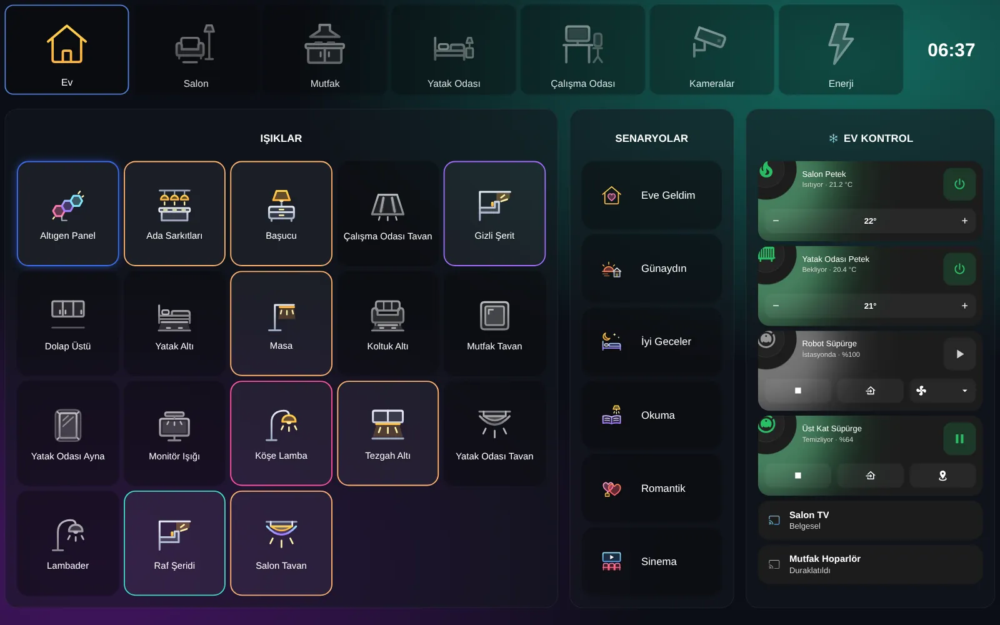

Üstte oda düğmeleri ve saat, altında kolonlar. Her kolonda bir ya da birkaç bölüm var: ışıklar, senaryolar, iklim, süpürge, medya, kameralar, değerler ve kartlar.

Pano evindeki alanlardan kendiliğinden kurulur: bir **Ev** sekmesi (bütün evin ışıkları, senaryolar ve kontroller) ve her oda için bir sekme. Hiçbir şeye dokunmadan kullanabilirsin.

Oda düğmesine dokununca o odanın sekmesi açılır. Sekmede o odanın ışıkları, perdeleri, iklim cihazları ve odaya özel senaryolar durur.

### 2. Işıklar

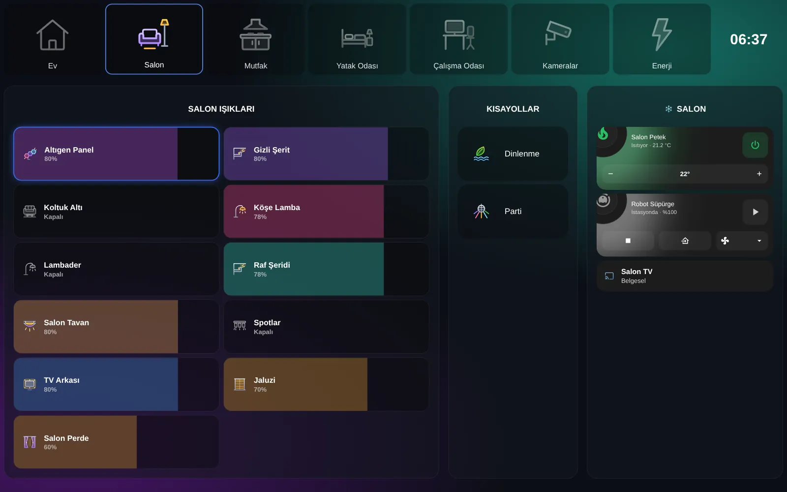

Karoya dokun: ışık anında açılır ya da kapanır. Açık ışık kendi renginde çerçeveyle görünür, ulaşılamayan cihaz soluk durur.

**Kaydırmalı** görünümde her ışık yatay bir çubuktur: dokun aç/kapat, sağa sola kaydır parlaklık. Aynı bölümde priz, perde ve fan da olabilir; perdede kaydırınca konum, fanda hız değişir.

Karo mu çubuk mu olacağını Stil seç'ten ya da bölümün ayarından seçersin.

**Seçenekler**

- **Karo**: Kare karolar; dokun aç/kapat, basılı tut pencere.
- **Kaydırmalı**: Yatay çubuklar; sağa sola kaydırınca parlaklık (perdede konum, fanda hız).
- **Telefonda otomatik**: Tablette karo, telefonda kaydırmalı çubuk.
- **Satırdaki karo** (2 · 3 · 4 · 5 · 6): Karo görünümünde bir satıra kaç karo sığacağı.
- **Satırdaki çubuk** (1 · 2 · 3): Kaydırmalı görünümde yan yana kaç çubuk.

### 3. Işık penceresi

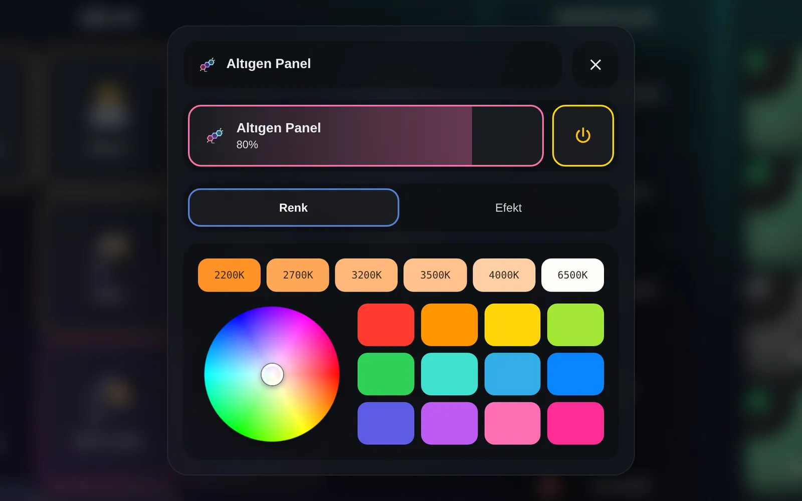

Işık karosuna basılı tut. Üstte büyük parlaklık çubuğu ve güç düğmesi, altında sekmeler:

**Renk:** 2200 K ile 6500 K arası beyaz tonlar, renk çemberi ve hazır renkler. **Efekt:** ışığın kendi efektleri. **Segment:** segmentli şerit ve lambalarda tek tek segmente renk.

Pencere dışarı dokununca, geri tuşuyla, Esc ya da ✕ ile kapanır. Telefonda alttan açılır, aşağı çekince kapanır.

**Seçenekler**

- **Işığa basılı tutunca** (Işık penceresi · HA penceresi · Efekt ekranı): Işık karosuna basılı tutunca ne açılsın (Ayarlar).
- **Işık penceresi alttan**: Telefonda pencere ekranın altından gelir, aşağı çekince kapanır (Stil seç → Telefon).

### 4. Perde penceresi

Perde karosuna basılı tut. Ortadaki çizim perdenin gerçek konumunu gösterir, altında **Aç**, **Durdur**, **Kapat**. Perde hareket ederken aynı düğmeye yeniden basınca durur; çizimi sürükleyerek konumu ince ayarlarsın.

Altı tasarım var: ortadan açılan perde, tek yönden açılan perde, panjur, stor, jaluzi ve dikey stor. Perdenin ⚙ ayarında çizimli kartlardan seçilir.

Jaluzi ve dikey storda kanat açısı için ikinci bir sıra çıkar. Kanatları ayrı bir motor döndürüyorsa ⚙'de **Kanat açısı motoru** olarak seçilir.

**Seçenekler**

- **Perde penceresi** (Oto · Ortadan açılan · Tek yönden · Panjur · Stor · Jaluzi · Dikey stor): Pencerenin çizimi ve düğmeleri. Oto, cihazın türünden seçer.
- **Toplanma yönü** (Sola · Sağa · İki yana): Tek yönden açılan perde ve dikey storda perdenin toplandığı taraf.
- **Kanat açısı motoru (isteğe bağlı)**: Jaluzi ve dikey storda kanatları döndüren ayrı motorun perde varlığı. Konum bildiriyorsa %0-100 hazır açılar çıkar.

### 5. Senaryolar, iklim, süpürge ve medya

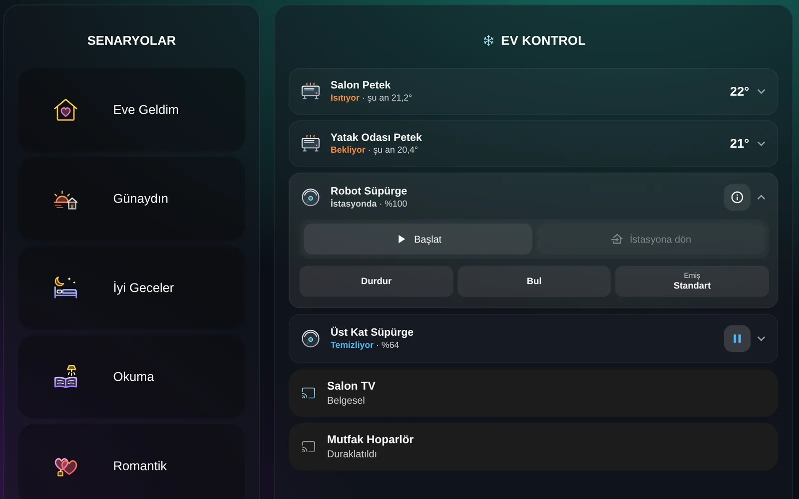

Senaryo düğmeleri bir betiği, sahneyi ya da otomasyonu tek dokunuşla çalıştırır; her birinin kendi rengi ve simgesi var.

İklim kartlarında klima ve petekler: aç/kapat, hedef sıcaklık, mod ve fan. **Mevsim** ayarına göre yazın klimalar, kışın petekler görünür.

Medya bölümünde TV ve hoparlörler; dokununca cihaz penceresi açılır.

Süpürge kartı başlatır, durdurur, istasyona gönderir. Stil seç'te **Halo** (büyük halkalı kartlar) ya da **Sade** (her cihaz tek satır, dokununca genişler) seçilir.

**Seçenekler**

- **Mevsim** (Otomatik · Yaz · Kış): İklim bölümünde yazın klimalar, kışın petekler. Otomatik: Mayıs-Eylül yaz (Ayarlar).
- **İklim ve süpürge kartları** (Halo · Sade): Halo büyük halkalı kartlar; Sade her cihazı tek satırda gösterir, dokununca genişler (Stil seç).
- **Tür** (Otomatik · Klima · Petek): İklim öğesinin türü (öğe ⚙).
- **Sıcaklık sensörü**: Kartta gösterilecek oda sıcaklığı; boşsa cihazın kendi değeri.
- **Nem sensörü**: Kartta gösterilecek nem.
- **Dış sıcaklık sensörü**: Petek kartı dışarısı soğukken ısıtma ihtiyacını gösterir.
- **Birlikte kontrol edilen cihaz**: Aynı komutu alan ikinci cihaz (ör. aynı odadaki ikinci petek).

### 6. Kameralar

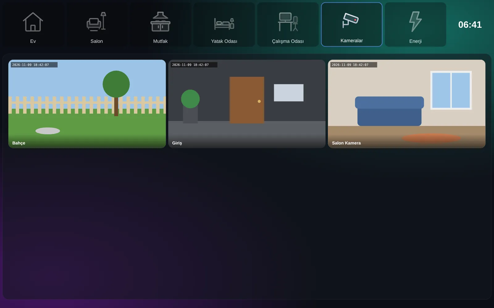

Kamera karosu anlık görüntüyü gösterir ve birkaç saniyede bir yeniler (öğe ayarından 5 sn ile 1 dk arası). Sekme ekranda değilken görüntü yenilenmez.

Karoya dokununca canlı görüntü ekrana sığan en büyük pencerede açılır.

**+ Sekme → Kameralar sekmesi** evdeki bütün kameraları tek sekmede toplar; satırda kaç kamera olacağı seçilir.

**Seçenekler**

- **Görüntü yenileme** (5 sn · 10 sn · 30 sn · 1 dk): Tek kameranın görüntü yenileme aralığı (öğe ⚙).
- **Görüntü yenileme**: Bölümdeki bütün kameralar için aynı ayar (bölüm ayarı).
- **Satırda kaç kamera** (Oto · 1 · 2 · 3 · 4): Satırda kaç kamera; Oto kutuya sığdığı kadar (telefonda en fazla 2).
- **Kameralar sekmesi**: + Sekme menüsünde: bütün kameralar tek sekmede.

### 7. Besleme kartı

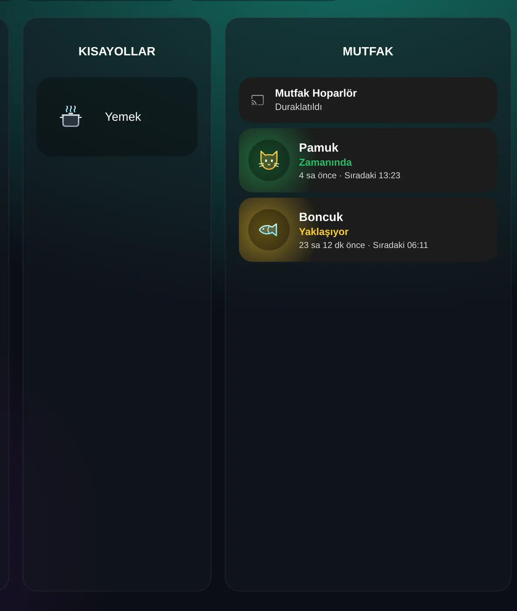

Evcil hayvanların için besleme takibi: her N saatte bir ya da günün belli saatlerinde.

Kart zamanında yeşil, yaklaşınca sarı, zamanı gelince turuncu, gecikince kırmızı. Dokununca "Besledim" kaydedilir (10 sn içinde yeniden dokununca geri alınır), basılı tutunca son beslemeler açılır.

Gecikince bildirim gönderebilir ve isteğe bağlı otomatik yemliği çalıştırabilir. Bölüme **Evcil hayvan** olarak eklenir.

Home Assistant'ta her hayvan için "<ad> besleme" durumu ve "<ad> besledim" düğmesi oluşur; otomasyonlarda kullanılabilir.

**Seçenekler**

- **Tür** (Kedi · Köpek · Balık · Kuş · Tavşan · Kaplumbağa · Diğer): Kartın simgesi buna göre.
- **Ne zaman beslenir** (Her N saatte bir · Günün belli saatlerinde): Besleme düzeni.
- **Kaç saatte bir**: Her N saatte bir düzeninde aralık.
- **Saatler (virgülle)**: Günün belli saatlerinde düzeninde saatler (ör. 08:00, 20:00).
- **Yaklaşıyor uyarısı (dk önce)**: Kart kaç dakika önceden sarıya döner.
- **Gecikme payı (dk)**: Zamanı geçtikten sonra kırmızıya dönmeden önceki süre.
- **Gecikince bildirim**: Gecikince Home Assistant bildirimi gönderir.
- **Otomatik yemlik (isteğe bağlı)**: "Besledim"e basınca bir servis de çalışır (ör. yemlik düğmesi).

### 8. Enerji

Evin anlık gücü, kategoriler, şu an en çok çeken cihazlar, günlük tüketim ve son 24 saat tek sekmede; güneş enerjisi olan evde enerji akışı ve batarya. Cihazlar ve kategoriler panelin Enerji sayfasından gelir (yoksa Home Assistant'ın Enerji ayarlarındaki "Cihaz tüketimi" listesinden); grafikler Home Assistant'ın kendi kayıtlarından.

Halo halkası tüketime göre yeşilden kırmızıya döner. Kategori karosuna dokununca o kategorinin cihazları, cihaz satırına dokununca cihaz penceresi açılır. Bekleme kartı hiçbir şey kullanılmıyorken evin çektiği gücü ve yıllık karşılığını gösterir.

**+ Sekme → Enerji sekmesi** hazır bir sekme kurar; kartlar tek tek de bölüme **Enerji kartı** olarak eklenir. Fiyat, faturalar ve tahmini cihazlar üst çubuktaki **Enerji** sayfasında (sonraki adım).

Işık ve priz karolarının köşesinde anlık watt da gösterilebilir (Enerji → Görünüm → Işık karosunda watt).

**İpuçları** bildirim göndermez: Halo'nun altında tek satırda sırayla döner (ör. "Klima 3 saattir açık"), ilgili cihazın satırının kenarı turuncu olur. Dokununca cihaz açılır, basılı tutunca o ipucu o ekranda bir daha görünmez.

**Seçenekler**

- **Kart** (Evin anlık gücü · Kategori karoları · Şu an en çok çekenler · Günlük tüketim · Son 24 saat · Bekleme tüketimi · Güneş ve şebeke akışı · Batarya): Bölüme Enerji kartı olarak eklenir; öğe ⚙ ile türü değişir.
- **Altındaki bilgiler**: Halo'nun altında bugünkü kWh, para ve bu ayın tutarı (fiyat yoksa bu hızla aylık tüketim).
- **Kademe ve yıllık sınır çubukları**: Halo'nun altında bu ayın kademe çubuğu ve bu yılın yıllık sınıra göre durumu.
- **Sütun** (2 · 3 · 4): Kategori karolarında satırdaki karo (telefonda 2).
- **Küçük grafik** (24 saat · 7 gün · Henüz kategori yok. Kategorisiz cihazlar kartlarda "Kategorisiz" karosunda toplanır.): Kategori karosundaki küçük grafik.
- **Kaç cihaz** (3 · 5 · 6 · 8 · 10): En çok çekenler listesinde kaç cihaz.
- **Kategori**: Listeyi tek bir kategoriyle sınırlar.
- **Beklemedekileri gizle**: 2 W altındaki cihazlar listede görünmez.
- **Gün** (7 · 30): Günlük tüketim grafiğinde kaç gün.
- **Birim** (kWh · Para): Günlük tüketim kWh ya da para olarak.
- **Çizgiler** (Kategoriler · Toplam): Son 24 saatte kategori çizgileri ya da tek toplam.
- **Enerji sekmesi**: + Sekme menüsünde: hazır Enerji sekmesi.

### 9. Işık efektleri (isteğe bağlı)

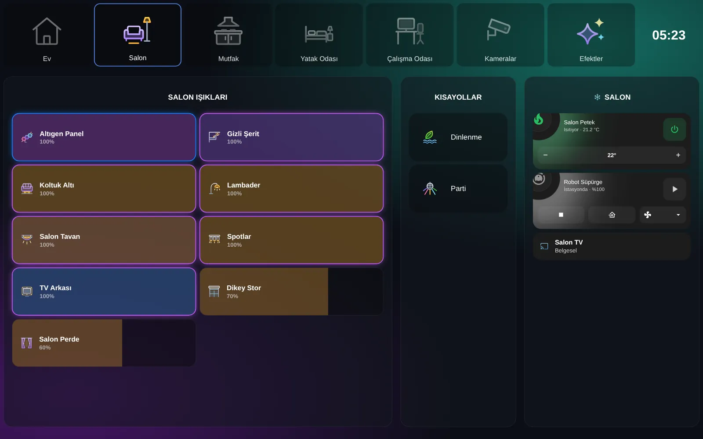

Lemur Light Effect Card ayrıca kuruluysa pano onu kendiliğinden tanır: üst şeritte **Efektler** düğmesi çıkar, dokununca efekt ekranı o sekmenin odasıyla açılır.

Senaryolara efekt düğmeleri eklenebilir; odada efekt oynarken ışık karoları efektin renkleriyle parlar.

Kurulu değilse bu düğmeler görünmez, başka hiçbir şey değişmez.

**Seçenekler**

- **Üst şeritte Efektler**: Üst şeritte efekt ekranını açan düğme (Stil seç → Işık efektleri).
- **Efektler de hizalı alanda**: Oda düğmeleri kolona hizalıyken Efektler de hizalı alanda dursun (Ayarlar).
- **Efekt ekranı**: Senaryo bölümüne eklenen, efekt ekranını açan düğme.
- **Efekti durdur**: Odadaki efekti durduran düğme.
- **Efekt ekranı**: Işığa basılı tutunca doğrudan efekt ekranı (Ayarlar → Işığa basılı tutunca).

### 10. Telefonda

Aynı pano telefonda kendiliğinden telefon düzenine geçer; ayrı bir pano gerekmez.

Gezinme altta kategorilerle (Işıklar, İklim, Senaryolar, Kameralar), altta odalarla ya da üstte odalarla olabilir. Işıklar karo ya da tek sıra; ışık penceresi alttan açılır.

Işıklar kategorisinde üstteki oda şeridinde sağa sola kaydırarak odalar arasında geçilir; **Tümü** bütün evin ışıklarıdır.

Hepsi **Stil seç → Telefon**'dan seçilir; tablet hiçbirinden etkilenmez.

**Seçenekler**

- **Gezinme** (Altta kategoriler · Altta odalar · Üstte odalar): Telefonda gezinme.
- **Işıklar** (Bölümdeki gibi · Karo · Tek sıra): Telefonda ışıklar.
- **Işık penceresi alttan**: Işık ve perde penceresi alttan açılır.

## Düzenlemek

### 11. Yönetim paneli

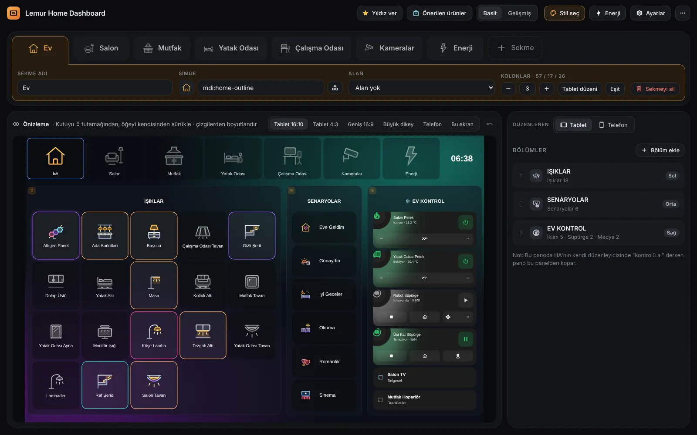

Sol menüdeki **Lemur Home Dashboard** (yalnız yöneticiler görür). Üstte sekmeler, solda canlı önizleme, sağda seçili sekmenin bölümleri.

İlk değişiklikte otomatik düzen kaydedilir, sonra her şey buradan düzenlenir. Her değişiklik geri alınabilir (düğme ya da Ctrl+Z).

**Basit** modda yalnız temel ayarlar görünür; **Gelişmiş** boyut, renk, koşul ve kart ayarlarını da açar. Karmaşık ayarların yanındaki **?** örnekle anlatır.

**Seçenekler**

- **Basit**: Temel ayarlar: sekme, bölüm, cihaz, ad, simge, görünüm, dokununca.
- **Gelişmiş**: Boyut, renk, koşul, özel eylem, kart ve yerleşim ayarlarını da açar; hiçbir ayar silinmez.
- **Önizleme** (Tablet 16:10 · Tablet 4:3 · Geniş 16:9 · Telefon · Bu ekran): Önizleme ekranı.
- **Düzenlenen** (Tablet · Telefon): Değişikliklerin tablete mi yalnız telefona mı yazılacağı.
- **Geri al**: Her değişiklik geri alınır (Ctrl+Z).

### 12. Sekmeler

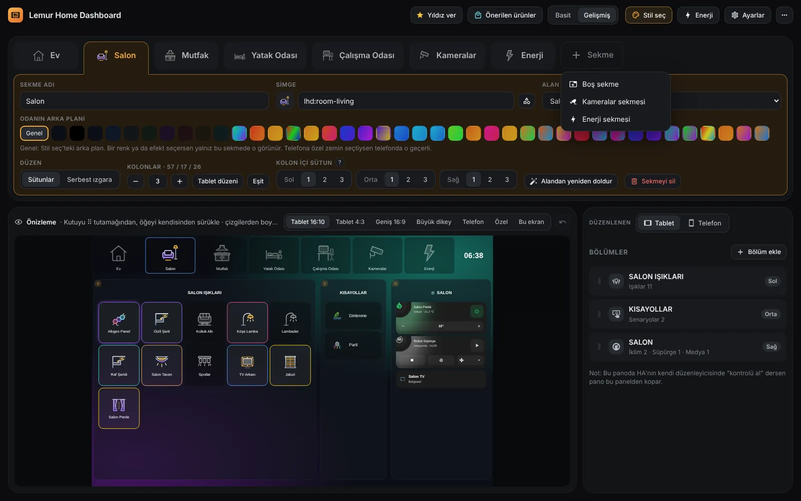

Üstte sekmeler, altında seçili sekmenin ayarları. Her sekme panonun üst şeridinde bir oda düğmesidir.

Sekmeler sürüklenerek sıralanır. Bir alana bağlı sekme, efekt ekranında ve saatte parlaklıkta o odayı kullanır.

**Seçenekler**

- **Sekme adı**: Oda düğmesindeki ad.
- **Simge**: Oda düğmesinin simgesi.
- **Alan**: Sekmenin odası: efekt ekranı ve saatte parlaklık bu odayı kullanır.
- **Alandan yeniden doldur**: Seçili alanın cihazlarıyla sekmeyi baştan kurar.
- **Kolonlar**: 1 ile 6 arası kolon; genişlikler önizlemedeki çizgilerden sürüklenir.
- **Tablet düzeni** (Tablet düzeni · Eşit): Hazır kolon oranları.
- **Kolon içi sütun**: Bir kolonu kendi içinde 2-3 sütuna böler (gelişmiş).
- **Sekme** (Boş sekme · Alandan sekme · Kameralar sekmesi): Yeni sekme.
- **Sekmeyi sil**: Sekmeyi siler (önce sorar, geri alınabilir).

### 13. Otomatik kur

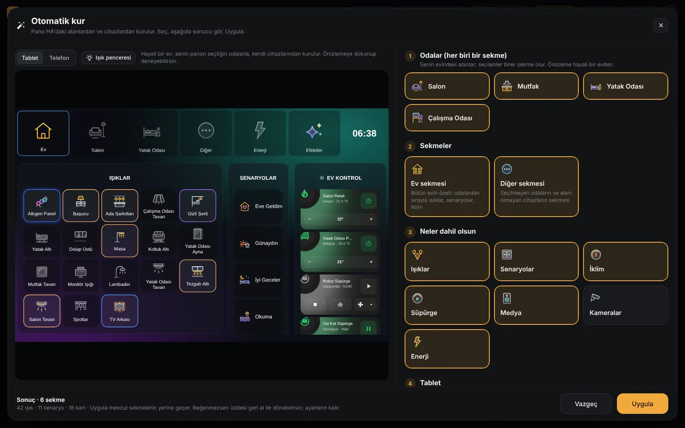

**⋯ → Otomatik kur** panoyu evdeki alanlardan ve cihazlardan baştan kurar. Seçimleri yaparken sonucu önizlemede görürsün.

Önizleme hayali bir evden; uygulayınca pano senin odalarınla ve cihazlarınla kurulur.

**Seçenekler**

- **Odalar (her biri bir sekme)**: Her seçilen oda bir sekme olur.
- **Ev sekmesi**: Bütün evin özeti: odalardan sırayla ışıklar, senaryolar, iklim.
- **Diğer sekmesi**: Seçilmeyen odaların ve alanı olmayan cihazların sekmesi.
- **Neler dahil olsun** (Işıklar · Senaryolar · İklim · Süpürge · Medya · Kameralar): Sekmelere hangi bölümler girsin.
- **Görünüm** (Karo · Kaydırmalı çubuk · Telefonda çubuk): Işıkların görünümü.
- **İklim ve süpürge kartları** (Halo · Sade): İklim ve süpürge kartları.
- **Telefon** (Altta kategoriler · Altta odalar · Üstte odalar): Telefonda gezinme (önizlemede Telefon'a geçince görünür).
- **Işık penceresi** (Alttan açılsın · Ortada açılsın): Telefonda ışık penceresi.
- **Arka plan**: Arka plan; seçmezsen şimdiki kalır.
- **Işık efektleri** (Efektler açık · Efektler gizli): Efektler düğmesi (Light Effect Card kuruluysa).
- **Uygula**: Mevcut sekmelerin yerine geçer; ayarlar kalır, geri al ile dönülür.

### 14. Cihaz eklemek

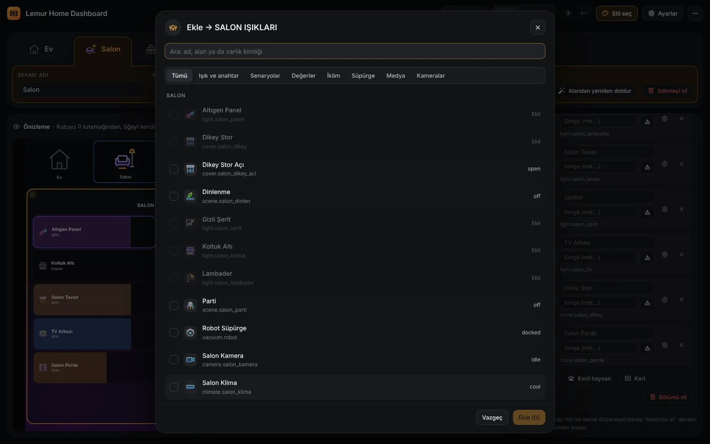

Bölümde **Ekle**'ye bas. Seçicide evdeki bütün cihazlar listelenir; üstteki süzgeçle (Işık ve anahtar, Senaryolar, Değerler, İklim, Süpürge, Medya, Kameralar) daraltılır.

Birden fazla cihaz tek seferde eklenir. Betik, sahne ve otomasyonlar renkli düğme olur; sensörler değer karosu.

**Kart** düğmesi Halo kartlarını, Home Assistant kartlarını ve kurulu özel kartları listeler.

**Seçenekler**

- **Tümü** (Tümü · Işık ve anahtar · Senaryolar · Değerler · İklim · Süpürge · Medya · Kameralar): Seçicideki süzgeç.
- **Ekle**: Evdeki cihazlardan seç; birden fazla tek seferde.
- **Kart**: Halo kartı, Home Assistant kartı ya da kurulu özel kart.
- **Evcil hayvan**: Besleme kartı.
- **Alt başlık**: Bölümün içinde küçük bir ara başlık.
- **Boş karo** (Boş karo · Boş düğme): Yer tutan boş karo ya da düğme (sonra ⚙ ile eylem verilir).

### 15. Öğe ayarları

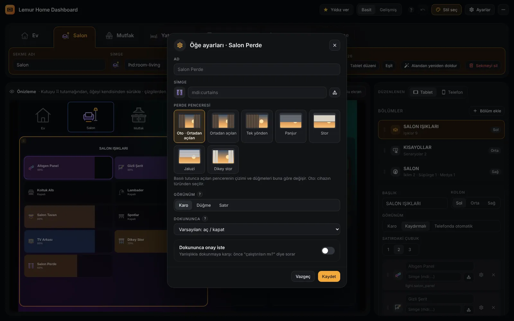

Her öğenin yanındaki ⚙: ad, simge, **Görünüm** (karo, düğme, satır), **Dokununca** ve **Basılı tutunca** ne olacağı.

Dokununca ya da basılı tutunca: cihaz penceresi, aç/kapat, servis çalıştır, pencerede kart aç ya da hiçbir şey.

Perdelerde tasarım, kameralarda yenileme sıklığı gibi türe özel ayarlar da burada.

**Seçenekler**

- **Ad**: Panoda görünen ad; şablon yazılabilir.
- **Simge**: Panonun simge setinden ya da mdi:... adıyla.
- **Açıkken simge** (Açıkken simge · Kapalıyken simge): Değer öğesinde açıkken ve kapalıyken ayrı simge (gelişmiş).
- **Görünüm** (Karo · Düğme · Satır · Halo): Öğenin çizimi; türüne göre seçenekler değişir.
- **Dokununca** (Cihaz penceresi · Aç / kapat · Servis çalıştır · Pencerede kart aç · Hiçbir şey · Gelişmiş (YAML)): Dokununca ne olsun.
- **Basılı tutunca**: Basılı tutunca ne olsun; seçenekler aynı.
- **Dokununca onay iste**: Önce "çalıştırılsın mı?" diye sorar; soru yazılabilir.

### 16. Enerji sayfası

Üst çubuktaki **Enerji** düğmesi cihazları, kategorileri, ev sayacını, güneşi, fiyatı, faturaları ve ipuçlarını kendi sayfasında açar. **Özet** her bölümün bugünkü durumunu gösterir; satıra dokununca o bölüm açılır.

**Cihazlar:** güç ölçen cihazlar bulunur ve **Ekle** ile doğrudan gelir. Ölçmeyenler **Panelden seç** ile eklenir: ad paneldekinden, tür ve kategori kendiliğinden, ölçülmüş ışıkların değerleri kütüphaneden gelir. Sanal ölçüm türleri: ışık (bekleme, en düşük ve en çok W, parlaklıkla), duruma göre (her durum için ayrı W; ör. TV oynatırken 95, duraklatınca 70 W), aç/kapa, sabit, yıllık tüketim (etiketteki kWh/yıl) ya da çevrim. Her biri için Home Assistant'ta güç ve enerji sensörü oluşur; kartlarda "~" ile görünür.

**Öğren:** ölçmeyen akıllı bir cihaz bir kez güç ölçen prize takılıp öğretilir. Işıkta önce ortak havuza bakılır; yoksa bütün beyaz tonlar, renkler ve parlaklıklar sırayla ölçülür (arka planda sürer). Efektler de ölçülür. TV gibi cihazlarda her durumun ortalaması kullanırken toplanır; buzdolabı gibi sürekli açık cihazlarda prizin günlerce ortalaması alınır. Farklı prizlerle birkaç öğrenme birlikte sürer. Ölçümü isteğe bağlı olarak ortak havuza gönderebilirsin; şerit LED'ler metre başına tutulur.

**Kategoriler:** ad, renk ve içindeki cihazlar. Her kategori için toplam güç ve kWh sensörü oluşur; cihazlar ve kategoriler Home Assistant Enerji ayarlarına kendiliğinden eklenir (Veri kaynağı → Enerji ayarlarıyla eşle).

**Ev sayacı:** evin tamamını ölçen cihaz kendiliğinden bulunur, **Evin sayacı yap** ile seçilir; ev ölçülen değerle, ölçülmeyen pay faturasız, yılın toplamı sayaçtan. **Güneş ve batarya:** **Güneş enerjisi var** ve **Batarya var** anahtarları; yalnızca açtığının ayarları görünür, akış ve batarya kartları bunlarla dolar. **Aktar:** başka bir eklentiyle kurulmuş sanal cihazları ve grupları önce gösterip panele aktarır.

**Fiyat ve tarife**, **Faturalar** (gerçek birim fiyat, ölçülmeyen pay, yıllık sınır) ve **İpuçları** (eşikler, sekmede nokta, gizlenenleri geri getir) aynı sayfada.

**Seçenekler**

- **Fiyat** (Faturadan · Tek fiyat · Kademeli): Kartlardaki para nereden hesaplansın. Faturadan: son faturanın tutarı ÷ kWh.
- **Günlük sınır**: Kademede günlük ortalama sınır (varsayılan 8 kWh); bu ayın sınırı bununla hesaplanır.
- **Yıllık sınır** (Yıla göre · Elle): Sınırın yüzde 85'ini geçince Halo'daki çubuk sarıya döner.
- **Fatura ekle**: Dönem başı ve sonu, kWh ve toplam tutar.
- **Son 12 ayın tüketimi (kWh)**: Faturanın arkasındaki grafikten.
- **Tür** (Ölçen · Işık · Duruma göre · Aç / kapa · Sabit · Yıllık tüketim · Çevrim): Cihazın hesap şekli. Örnek: 2-60 W ışık %30 parlaklıkta 19,4 W; 250 kWh/yıl buzdolabı ortalama 28,5 W.
- **Kategori**: Cihazın kategorisi; buradan yeni kategori de açılır.
- **Şerit LED**: Öğren sonucunda: şeritte uzunluk ve adaptör gücü; havuzdan alınan tablo buna göre uyarlanır.
- **Tek sensör** (Tek sensör · Alınan ve verilen ayrı · Yok): Şebeke ölçümü: artı/eksi tek sensör ya da alınan ve verilen ayrı.
- **İşaret ters**: Batarya sensörü şarjı eksi gösteriyorsa.
- **Uzun süre açık kalan**: İpucu: bu güçten fazlasını bu süreden uzun çeken cihaz (varsayılan 300 W, 3 saat).
- **Sekmede nokta**: İpucu varken Enerji sekmesinin düğmesinde küçük nokta (varsayılan kapalı).
- **Enerji ayarlarıyla eşle**: Veri kaynağı: cihazlar, kategoriler ve güneş Home Assistant'ın Enerji panosunda da görünsün.
- **Evin toplam gücü** (Kategorilerin toplamı): Veri kaynağı: Halo'nun gösterdiği toplam güç.
- **Bekleme gücü** (Son 24 saatin en düşüğü): Veri kaynağı: bekleme kartının gücü.
- **Halo renk sınırları (W)**: Görünüm: Halo'nun yeşil, sarı ve turuncu sınırları (varsayılan 300 / 800 / 1800 W).
- **Işık karosunda watt** (Kapalı · Açıkken · Hep): Görünüm: güç ölçen ya da tahmini değeri olan ışık ve prizlerin karosunda anlık watt.
- **Tahmini değerleri ayır**: Görünüm: tahmini watt "~" ile ve morla.
- **Ölçülmeyen karo**: Görünüm: ölçülmeyen pay kategori karolarında.

### 17. Kartlar ve değerler

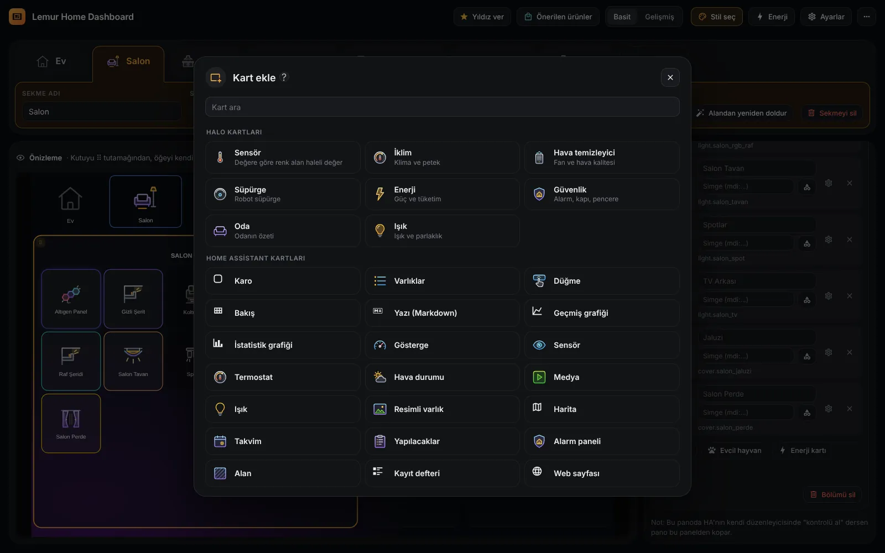

Bölüme sensör, zamanlayıcı, sayaç gibi değerler ve herhangi bir kart eklenebilir.

Değer karoları simge, değer ve ad gösterir; çalışan zamanlayıcı geri sayar. Kartlar Halo kartlarından, Home Assistant kartlarından ya da kurulu özel kartlardan seçilir.

**Seçenekler**

- **Kart** (Halo kartları · Home Assistant kartları · Kurulu özel kartlar · YAML ile yaz): Kart seçici.
- **Görsel** (Görsel · YAML): Seçilen kart görsel düzenleyicisi ve canlı önizlemesiyle açılır; istersen YAML.
- **Yükseklik** (Otomatik · 1 · 1,5 · 2): Kart ve Halo öğesinin yüksekliği (satır).
- **Pencerede kart aç**: Bir düğmeye verilince kart, ışık penceresi gibi panonun penceresinde açılır.
- **İkinci satır** (Durum · Son değişim · Öznitelik · Yazı ya da şablon): Değer öğesinin ikinci satırı.
- **Ad üstte, değer altta**: Değer öğesinde ad üstte, değer altta.
- **Halo**: Sayısal değeri Halo sensör kartı olarak gösterir.
- **Değere göre renk**: 4 sınır, 5 renk: değere göre çerçeve, değer ve simge rengi.
- **Duruma göre renk**: Bir varlığın durumunu renge eşler; metin değerlerde de çalışır.

### 18. Bölümler ve kolonlar

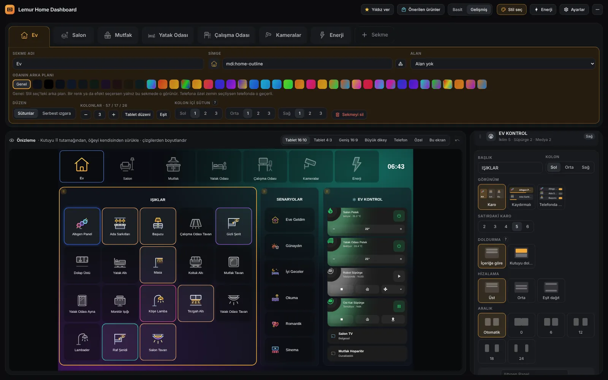

Bölümler serbesttir: her kutuya her şey eklenebilir, her öğe kendi türüne göre görünür.

Önizlemede bölümü tutamağından sürükleyip başka kolona taşı; öğeyi kendisinden sürükleyip sırala ya da başka bölüme taşı. Kolon genişlikleri çizgilerden sürüklenir.

Bölüm ayarında başlık, kolon, görünüm (karo, kaydırmalı), satırdaki karo sayısı, doldurma ve hizalama seçilir.

**Seçenekler**

- **Başlık**: Bölümün başlığı; boş bırakılabilir.
- **Kolon**: Bölümün durduğu kolon.
- **Doldurma** (İçeriğe göre · Kutuyu doldur): Düğmeler ve karolar kutunun yüksekliğine eşit dağılsın mı.
- **Hizalama** (Üst · Orta · Eşit dağıt): İçerik kutudan kısaysa nereye dursun.
- **Aralık** (Otomatik · 0 · 6 · 12 · 18 · 24): Öğeler arası boşluk (piksel).
- **Bölümü sil**: Bölümü siler (önce sorar, geri alınabilir).

### 19. Simge seçici

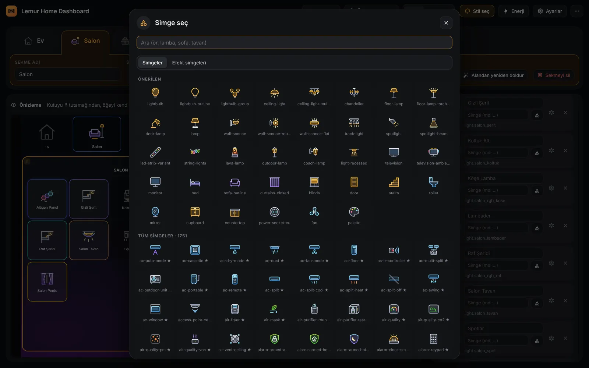

Simge alanlarının yanındaki düğme. Panonun renkli simge setinden seçilir; önce o şeye uygun olanlar önerilir, arama Türkçe kelimeleri de tanır.

★ işaretliler panoya özel çizimler. Light Effect Card kuruluysa efekt simgeleri de seçilebilir.

İstersen `mdi:...` adını doğrudan yazarsın.

**Seçenekler**

- **Önerilen**: O şeye uygun simgeler önce.
- **Tüm simgeler**: Bütün set; arama Türkçe kelimeleri de tanır.
- **Efekt simgeleri**: Light Effect Card kuruluysa onun efekt simgeleri.

### 20. Stil seç

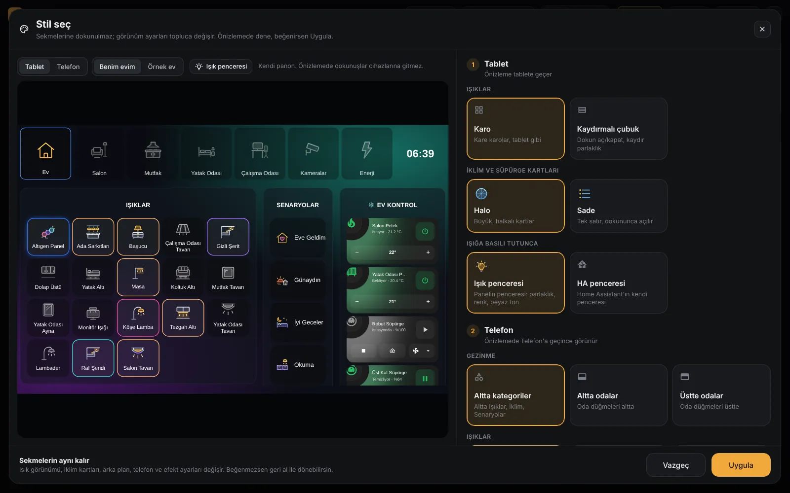

Üst çubuktaki **Stil seç**. Solda önizleme, sağda büyük seçenekler; her seçim önizlemede anında görünür, **Uygula** hepsini birden kaydeder.

**Tablet:** ışıklar karo ya da çubuk; iklim kartları Halo ya da Sade. **Telefon:** gezinme, ışıklar, ışık penceresi.

**Arka plan:** 30 efekt renk, koyu, siyah, istediğin renk ya da kendi resmin.

**Seçenekler**

- **Benim evim** (Benim evim · Örnek ev): Önizlemede kendi panon ya da örnek ev.
- **Karo** (Karo · Kaydırmalı): Tablette ışıklar.
- **İklim ve süpürge kartları** (Halo · Sade): Tablette iklim ve süpürge kartları.
- **Gezinme** (Altta kategoriler · Altta odalar · Üstte odalar): Telefonda gezinme, ışıklar ve ışık penceresi.
- **Arka plan** (Efekt · Koyu · Siyah · Renk · Resim): Pano zemini.
- **Efekt**: 30 efekt renk: Meditasyon (varsayılan), Kutup ışığı, Ateş, Gün batımı, Okyanus ve daha fazlası.
- **Resim**: HA'nın www klasöründeki bir resim (/local/zemin.jpg) ya da bir internet adresi.
- **Işık efektleri**: Efektler düğmesini açar ya da gizler; kurulu değilse kartı anlatır.

### 21. Telefona özel düzen

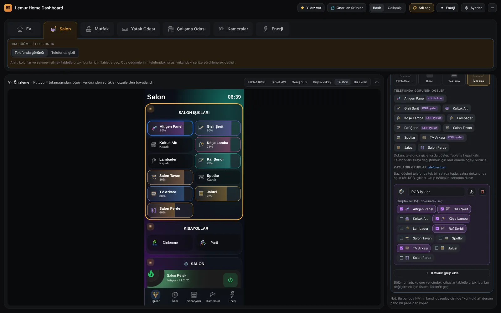

Yönetim panelinde **Düzenlenen: Telefon**'a geç: önizleme telefona döner ve değişiklikler yalnız telefona yazılır, tablet aynı kalır.

Telefonda oda düğmelerinin, bölümlerin ve öğelerin sırası ve görünürlüğü; bölümlerin görünümü; simge stili, iklim kartları ve zemin ayrı ayarlanır.

Değişen her yerde "telefona özel" yazar. **Telefonu tabletle aynı yap** telefona özel her şeyi siler (önce sorar).

**Seçenekler**

- **Telefonda görünür** (Telefonda görünür · Telefonda gizli): Bölümü telefonda göster ya da gizle.
- **Telefonda görünüm** (Tabletteki gibi · Karo · Tek sıra): Bölümün telefondaki görünümü.
- **Telefonda satırdaki karo** (Oto · 2 · 3 · 4 · 5): Telefonda satırdaki karo.
- **Telefonda görünen öğeler**: Öğeleri tek tek telefonda gizle; önizlemede sürükleyerek sırala.
- **Telefonda adı** (Telefonda adı · Telefonda simgesi · Oda düğmesi telefonda): Oda düğmesinin telefondaki adı, simgesi ve görünürlüğü.
- **Simge stili** (Simge stili · İklim ve süpürge kartları · Zemin): Telefon görünümü kartında telefona ayrı stil.
- **Tablettekine dön**: Bir ayarı tablettekine döndürür.
- **Telefonu tabletle aynı yap**: Telefona özel her şeyi siler; önce sorar.

## Daha fazlası

### 22. Ayarlar

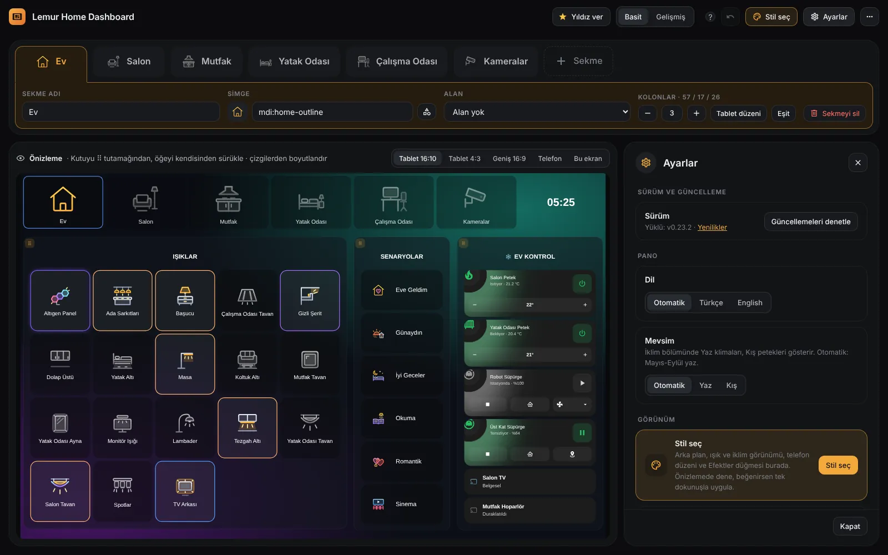

Sağ üstteki **Ayarlar** evdeki bütün tabletlere uygulanır: dil, mevsim, simge stili, üst şerit, saatte parlaklık, HA teması.

**Üst barı gizle / Yan menüyü gizle** yalnız bu panoda Home Assistant'ın başlığını ve menüsünü kapatır; tablette kiosk gibi kullanılır.

En üstte sürüm ve güncelleme: yeni sürüm buradan kurulur. **Yedek** her şeyi tek dosyada indirir; **Sorun bildir** GitHub'da kayıt açar.

**Seçenekler**

- **Sürüm ve güncelleme**: Yüklü sürüm, Yenilikler ve güncelleme; yeni sürüm buradan indirilir ve HA yeniden başlatılır.
- **Dil** (Otomatik · Türkçe · English): Panonun dili.
- **Simge stili** (Otomatik · Renkli · Düz · Tek renk): Simgelerin renklendirilmesi.
- **Işıkta ışığın rengi**: Tek renkte açık ışığın simgesi lambanın kendi renginde.
- **Oda düğmelerinin boyutu**: Oda düğmelerinin genişliği ve yüksekliği (varsayılan 235 × 155).
- **Oda düğmelerini kolona hizala**: Oda düğmeleri seçilen kolonun sağ kenarında biter, aradaki alanı eşit paylaşır.
- **Saatte parlaklık** (Gizli · Kutu): Saatin olduğu alanı kaydırınca odadaki açık ışıkların parlaklığı birlikte değişir.
- **Parlaklık göstergesi** (Kaydırırken · Hep): Parlaklık göstergesi ne zaman görünsün.
- **HA teması**: Açılır pencerelerin kullanacağı HA teması.
- **Üst barı gizle** (Üst barı gizle · Yan menüyü gizle): Bu panoda HA'nın üst barı ve sol menüsü gizlenir (kiosk).
- **Kanvas**: Tasarım genişliği ve referans yüksekliği; pano ekrana bu oranla ölçeklenir (gelişmiş).
- **Işığa basılı tutunca** (Işık penceresi · HA penceresi · Efekt ekranı): Işığa basılı tutunca açılan pencere.
- **Sorun bildir**: Sürüm ve cihaz bilgisiyle GitHub'da kayıt açar; oda, cihaz ya da kişi adı eklenmez.
- **Yedeği indir** (Yedeği indir · Yedekten geri yükle): Sekmeler, bölümler, ayarlar ve hayvanlar tek dosyada; geri yüklemeden önce sorar.

### 23. Gelişmiş ayarlar

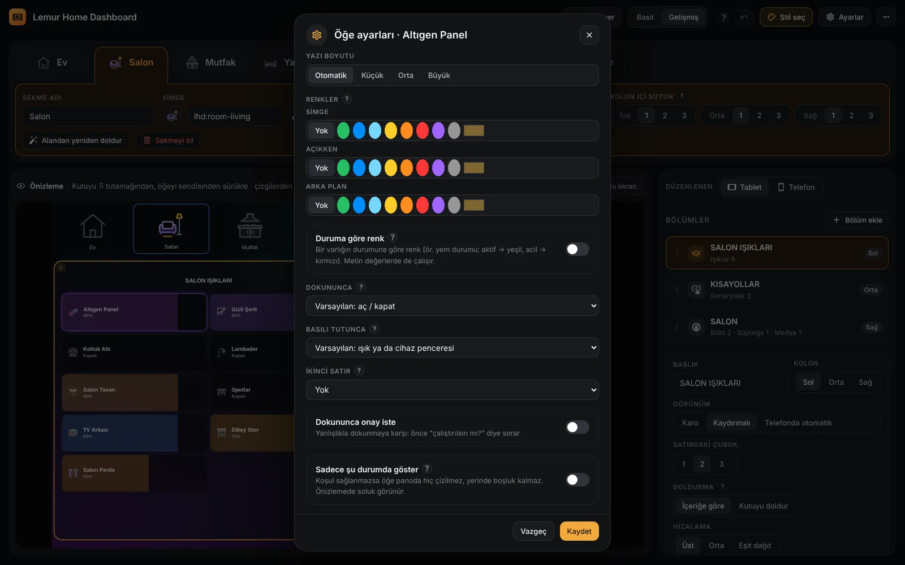

**Sadece şu durumda göster:** öğe, seçilen varlık belli bir durumdayken görünür. **Değere göre renk** ve **Duruma göre renk:** sayı ya da duruma göre renk.

**İkinci satır** ve **şablon:** ad ve alt satıra Home Assistant şablonu yazılabilir. **Dokununca onay iste:** düğme önce sorar.

**Yedek kontrol:** iki kez görünen lambanın ikinci kopyası; lamba cevap vermezse komut yedekten gider. **Duvar anahtarları:** yalnız sinyal veren röleyi bir lambaya bağlar.

**Seçenekler**

- **Boyut** (1×1 · 2×1 · 1×2 · 2×2 · Satır boyu): Karonun ızgarada kapladığı yer.
- **Simge boyutu** (Otomatik · Küçük · Orta · Büyük): Simge ve yazı boyutu.
- **Renkler** (Simge · Açıkken · Arka plan): Simge rengi, açıkken renk ve arka plan tonu.
- **Sadece şu durumda göster** (şuna eşitse · şunlardan biriyse · şunlar değilse): Öğe yalnız seçilen varlık şu durumdayken görünür; yoksa yerinde boşluk kalmaz.
- **İkinci satır**: Ad ve ikinci satıra Home Assistant şablonu ({{ }}) yazılabilir.
- **Yedek kontrol**: İki kez görünen lambanın ikinci kopyası; cevap gelmezse komut oradan gider, karoda turuncu nokta çıkar.
- **Duvar anahtarları** (Parlaklık % · Kelvin): Yalnız sinyal veren röle bir lambaya bağlanır; açarken parlaklık ve kelvin verilebilir (Ayarlar, gelişmiş).

### 24. İpuçları

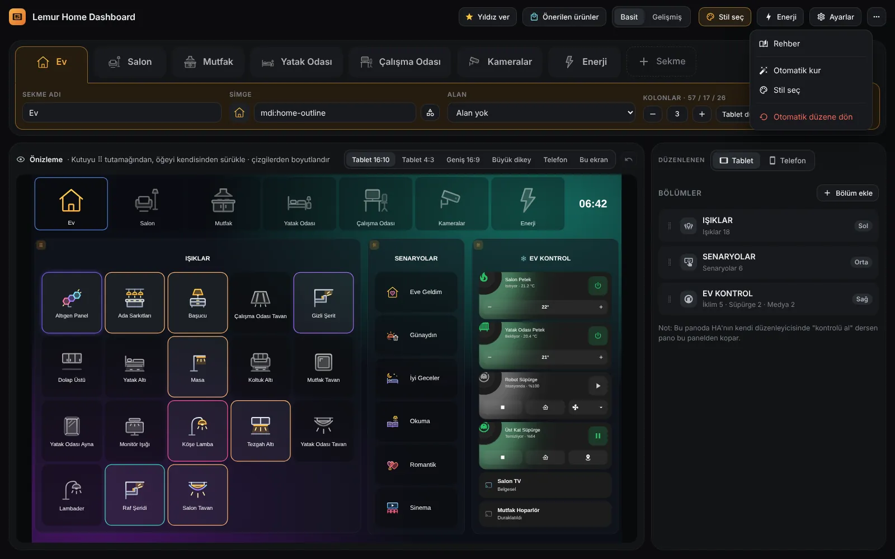

Bir şey ters giderse **Geri al** (Ctrl+Z). **⋯ → Otomatik düzene dön** her şeyi baştan kurar.

HA'nın kendi düzenleyicisinde bu pano için "kontrolü al" dersen pano bu panelden kopar; düzenlemeyi hep buradan yap.

Bu rehber her zaman **⋯ → Rehber**'de ve **Ayarlar → Yardım**'da.

**Seçenekler**

- **Geri al**: Son değişiklikleri geri alır.
- **Otomatik düzene dön**: Bütün sekme ve bölümleri siler, panoyu evin alanlarından yeniden kurar; ayarlar kalır.
- **Yenilikler**: Güncellemeden sonra bir kez çıkar; Ayarlar → Sürüm'den yeniden açılır.
- **Rehber**: Bu rehber.
